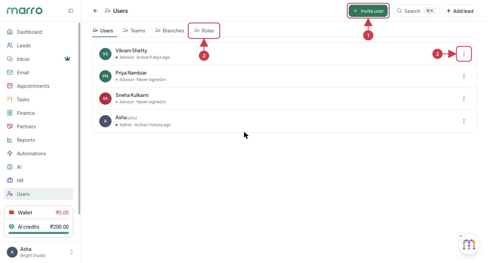
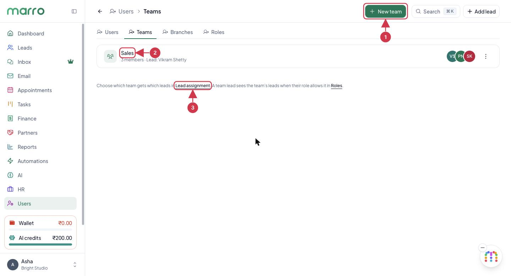
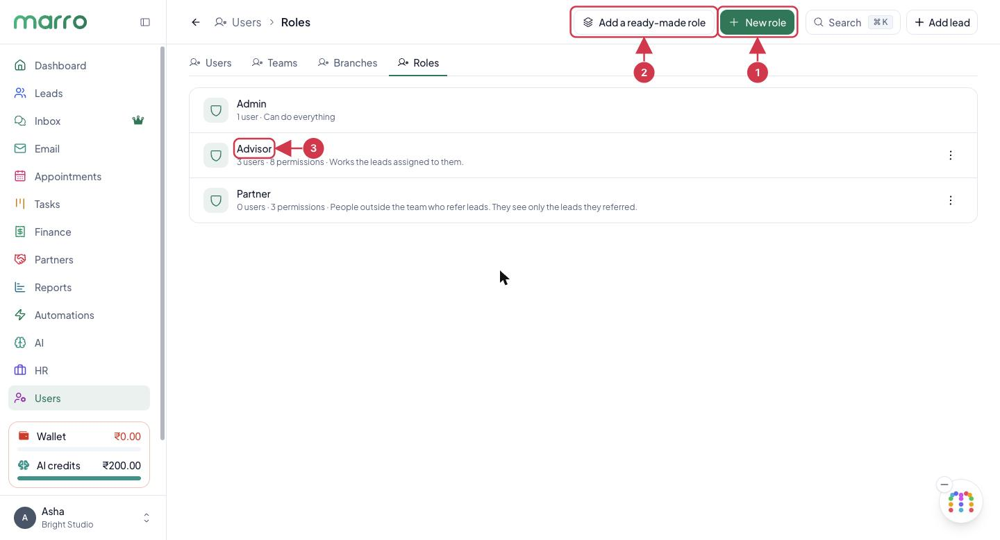
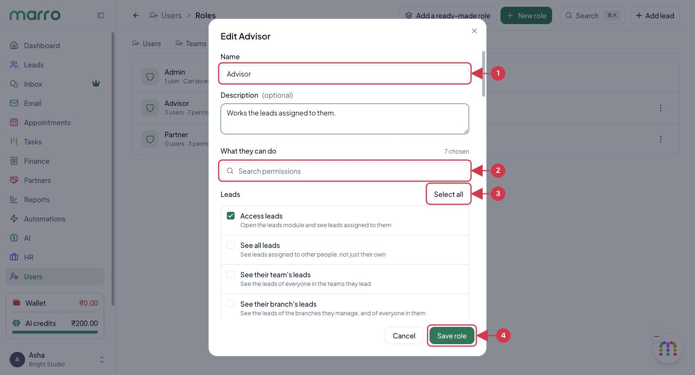
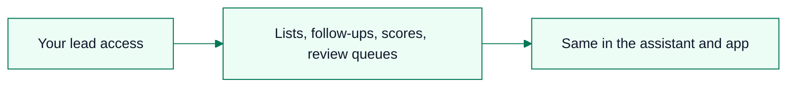

Open **Users** in the menu. The tabs are **Users**, **Teams**, **Branches** and **Roles**.

## Users

<Frame>
  
</Frame>

1. **Invite user** sends an email invitation, or you can set a password yourself.
2. A person's **⋯** menu changes their role or switches them off.
3. The **Roles** tab opens the roles.

## Teams

<Frame>
  
</Frame>

1. **New team** makes a team.
2. Open a team to see its members and choose its team lead.
3. **Lead assignment** is where you choose which team gets which leads. See [Lead assignment and rotation](/guides/lead-assignment).

## Roles

A new organization has **Admin**, **Advisor** (works leads) and **Partner** (refers leads). More ready-made roles (**Manager**, **Operations Head**, **Editor**, **Social Media Manager**) are under **Add a ready-made role**.

<Frame>
  
</Frame>

1. **New role** makes your own.
2. **Add a ready-made role** adds one.
3. Open a role to edit it.

<Frame>
  
</Frame>

1. Change the **name**.
2. **Search permissions**.
3. **Select all** ticks an area.
4. **Save role**.

Only permissions your subscription includes are counted.

| Permission | Lets people |
| --- | --- |
| **Create leads** | Also quote the leads assigned to them |
| **Manage reports** | Share reports and dashboards, set a role's home dashboard, email reports. Admin and Manager have it |
| **Send email campaigns** | Write, test, send and schedule [email campaigns](/guides/email-campaigns). Admin and Social Media Manager have it |

## Who sees which leads

- Lists, follow-ups, scores and AI review queues all follow your current lead access.
- Partners see their referral tree. Assigning an unrelated lead to a partner does not give access to it.
- Follow-ups linked to a lead disappear when you lose access to it.

## Good to know

| Topic | Rule |
| --- | --- |
| Password links | An invitation link sets a password only for an account your organization manages. Shared and platform accounts use **Forgot password**. A reset signs everyone out |
| Public forms | A match by phone keeps the lead's saved email. The submitted one stays for staff review |
| Requested documents | Once accepted, an old upload cannot replace them. A new document needs a new request |
| Proposal codes | Five verification attempts, then request a new code |

## Ask Marro

<Card title="Try asking" icon="message-circle">
  *"Add a Manager role"*

  *"Who is in the Pune team?"*

  Marro shows the change and asks before saving.
</Card>
