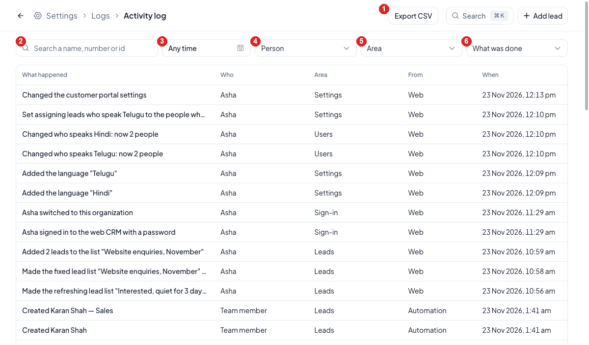

The **Activity log** records every change to your organization's setup, and every sign-in. Open **Settings → Logs → Activity log**.

<Frame>
  
</Frame>

1. **Export CSV** downloads what the filters show.
2. Search a name, number or id.
3. A period.
4. **Person**: one person's changes.
5. **Area**: Settings, Users, Leads, Automations, Sign-in and others.
6. **What was done**: one kind of change, such as a role changed.

Click a row to see what changed, before and after. **From** says where it was done: **Web**, the **App**, the **Assistant**, an **Automation** or the **API**.

<Note>
The Activity log is in the **Complete** plan. On other plans the page says so, with a link to your subscription.
</Note>

