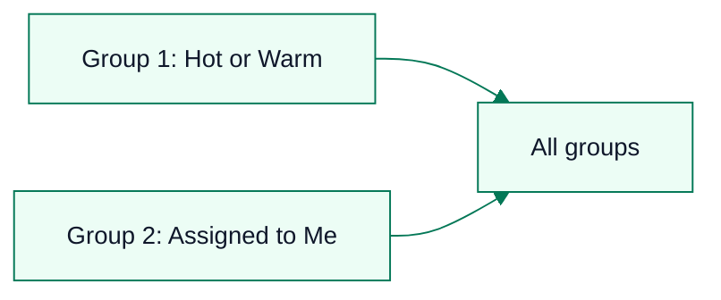

Choose **Filter** on Leads, Contacts, Companies, Opportunities or Follow-ups.

## Add a filter

<Steps>
  <Step title="Pick a field">Search for Stage, Tags, Assigned to, Last contact or any custom field.</Step>
  <Step title="Set it">Choose a condition and a value.</Step>
  <Step title="Add filter">It appears as a chip under the search box.</Step>
</Steps>

- Click a chip to change it, or its ✕ to remove it. **Clear** removes all.
- With two or more filters, the **All / Any** switch decides whether a record must match every filter or just one.
- Values match the field: choices for dropdowns, tags and people (with **Me** for whoever opens the view), a date picker, or a search for linked records.

## Groups

For a rule like (Hot or Warm) and assigned to me, choose **Edit all filters and groups** in the Filter menu.

Each group has its own All or Any. Groups combine as **All groups** or **Any group**. A list holds up to four groups with five filters each.

Filters never grant access to records you could not already see.

## Saved views and links

Save the list as a view to keep the filters. Old saved views and bookmarked links keep working.

| If this happened to a field | The filter |
| --- | --- |
| Hidden, deleted or changed | Matches no records |

Edit the filter or choose **Clear**.

## Good to know

| Where | Note |
| --- | --- |
| Follow-ups | Can filter their lead's custom fields. A follow-up without a lead cannot match a filter that needs one. |
| Mobile app | No filter menu yet. Build filters on the web. |

## Ask Marro

<Card title="Try asking" icon="message-circle">
  *"Show Hot or Warm leads assigned to me"*

  Marro can read the matching records and propose saving a view. Saving needs your approval.
</Card>
