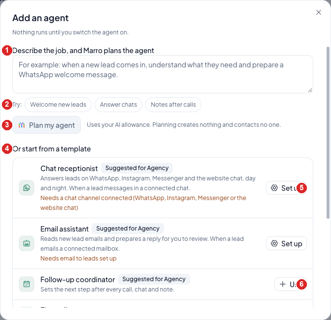
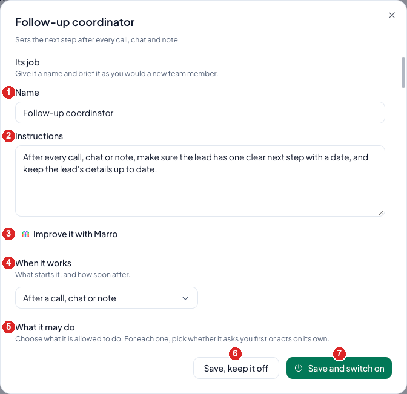
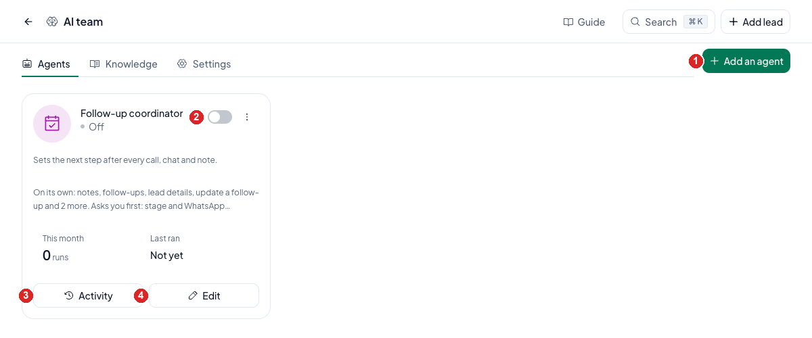
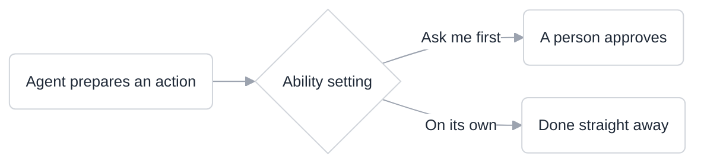

Agents work on your leads in the background: they reply, call, follow up and update leads without being asked. You set what each may do, every action is recorded on the lead, and your team can take over at any time. Open **AI → Agents**.

<Note>
  Agents are part of Marro AI, on Growth and Complete. Changing their settings needs permission to manage settings.
</Note>

## Your AI team

No agent is on by default. **AI → Agents** has the tabs **Agents**, **Knowledge** and **Settings**. Each agent is a card showing **Working** or **Off**, its **runs this month** and when it **last ran**, with **Activity** and **Edit**.

Press **Add an agent** and start from a template:

| Template | What it does |
| --- | --- |
| **First caller** | Calls every new lead within minutes with AI. If they don't answer, sends a WhatsApp and books a follow-up for the owner |
| **Chat receptionist** | Answers on WhatsApp, Instagram, Messenger and website chat, day and night, and hands over to a person when it should |
| **Email assistant** | Reads new lead emails and drafts threaded replies for review |
| **Follow-up coordinator** | Sets the next step after every call, chat and note |
| **Document collector** | At the stage you choose, asks for documents through the portal and chases them |
| **Call reviewer** | Reads every recorded call and saves what was said |

A template not in your plan, or needing something set up first (AI calls, a connected chat, the client portal), says so.

## Create an agent

Press **Add an agent**. Describe the job and let Marro plan it, or start from a template.

<Frame>
  
</Frame>

1. **Describe the job**: the result you want, as you would brief a new team member.
2. **Try**: fills in an example to start from.
3. **Plan my agent**: Marro suggests a name, instructions, when it starts and what it may do. It may ask up to three questions. Planning creates nothing, contacts no one and uses your AI allowance.
4. **Or start from a template**.
5. A template that needs something first says what, with **Set up** to go there.
6. **Use** a ready template. **Start from scratch** is at the bottom of the list.

<Frame>
  
</Frame>

1. **Name**.
2. **Instructions**.
3. **Improve it with Marro** rewrites the instructions.
4. **When it works**: what starts it.
5. **What it may do**: each ability, acting on its own or asking you first.
6. **Save, keep it off**.
7. **Save and switch on**: it starts working.

After a plan, the settings fold under **Change the settings**.

<Frame>
  
</Frame>

1. **Add an agent**.
2. On or off.
3. **Activity**: what it did, lead by lead.
4. **Edit** its settings.

## Its settings

| Section | What you set |
| --- | --- |
| **Its job** | Brief it in plain words, as you would a new team member |
| **When it works** | The trigger: a new lead, a chat message, after a call, chat or note, a recording, a stage, a document, a booking or a payment |
| **What it may do** | Abilities, in groups, each ticked and set to **Ask me first** or **On its own** |
| **Daily limit for catalog abilities** | Optional. Default 50 catalog actions a day, 20 of which may reach customers |

An agent never does more than its owner could. Past eight abilities, Marro suggests splitting the agent in two.

To check it first, use **Try its next actions** on a lead, **Try a chat reply** or **Try a call transcript**. Trials change nothing and send nothing. Use invented or anonymized samples.

## What they may do

| Reach | Choices |
| --- | --- |
| **Looks things up**, **Changes your records** | **On its own** is allowed |
| **Reaches your customers** | **On its own** once you choose it. Until then it waits for a person |
| **Involves money** | Always asks you first |

Agents never repeat each other: if another agent did the same kind of thing to a lead in the last 12 hours, the next attempt waits for a person. You can have one chat receptionist, one follow-up coordinator and one call reviewer.

## Give them instructions

Under **Manage**, each agent has instructions: tone, what to ask, what to listen for. Up to 4,000 characters.

Administrators can ask Marro on the web or staff WhatsApp to read one agent’s current instructions, including its default brief when applicable. Ask it to change a sentence or add a rule. Marro shows the requested edit for approval and keeps the rest of the instructions. If another administrator changes the brief before approval, Marro asks for a fresh review.

| Control | What it does |
| --- | --- |
| Empty field | The agent follows the **Best practices** shown below the field |
| **Add** | Copies one into your own |
| **Add all to edit** | Starts from all of them |
| **Clear** | Goes back |

Always, whatever you write:

<CardGroup cols={3}>
  <Card title="Facts" icon="book-open" href="/guides/business-knowledge">Come only from your business knowledge</Card>
  <Card title="Messages" icon="shield">Customers' messages are never taken as instructions</Card>
  <Card title="Handover" icon="hand">Agents hand over when they should</Card>
</CardGroup>

## See their work

Press **Activity** on an agent. Entries are newest first, each saying what it did, for which lead, and how it went.

| Status | Meaning |
| --- | --- |
| **Done** | Finished |
| **Waiting for you** | Needs your approval |
| **Skipped** | Not needed |
| **Did not finish** | Stopped before the end |

**Suggested actions** on **AI → Agents** shows changes waiting. Press **Review suggestions**, then approve (**Send**, **Add note**) or **Dismiss**. You can edit the wording first. An approval does exactly what you reviewed, once.

## Pause, or hand over a chat

<CardGroup cols={2}>
  <Card title="Pause agents" icon="pause">
    On **AI → Settings**. Turns off all agents and stops queued work. Actions already started may finish.
  </Card>
  <Card title="One chat" icon="comments">
    In the [Inbox](/guides/inbox), **Let the AI reply** gives a chat to the agent. **Take over** takes it back.
  </Card>
</CardGroup>

## Ask Marro

<Card title="Try asking" icon="message-circle">
  *"Create an agent that welcomes every new lead on WhatsApp"*

  *"Switch off the Follow-up coordinator"*

  Marro explains the proposal and asks before creating or changing an agent. New agents are saved off unless you say otherwise.
</Card>
