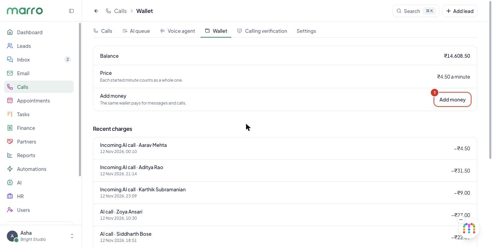
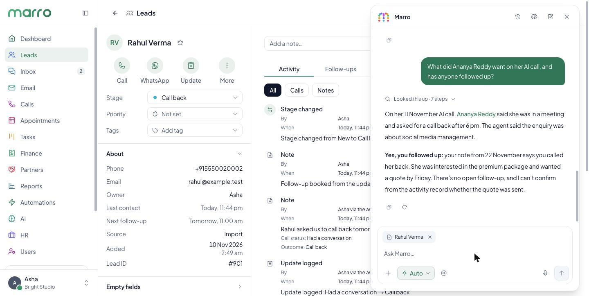

import { Flow } from "/snippets/flow.jsx";

An AI voice agent rings your leads from your business number. Each call’s recording and conversation are kept on the lead.

<Note>
  AI calling is part of Marro AI, on Growth and Complete. Its minutes are paid from the wallet.
</Note>

## Set up AI calling

Until calling is on, **Calls → AI calls** shows where your setup stands. If your wallet cannot cover the first month for your number, the page asks you to add money.

<CardGroup cols={2}>
  <Card title="Calling verification" icon="badge-check" href="/guides/calling-verification">Verify your business, forward your marketing number.</Card>
  <Card title="Voice agent" icon="bot" href="/guides/voice-agent">Its instructions, set-up and more lines.</Card>
  <Card title="AI queue" icon="list-ordered" href="/guides/ai-queue">Calls waiting for a free line.</Card>
  <Card title="Call log" icon="list" href="/guides/call-log">Every call, with recordings.</Card>
</CardGroup>

## Make AI calls

| From | How |
| --- | --- |
| One lead | **More → AI call** on the lead’s page. End it from the action row. |
| Several leads | Select up to ten leads on a computer and choose **Queue AI calls to selected**. |
| An automation | The **Call with AI** step. See [Call with AI](/guides/automations#call-with-ai). |

You need permission to make calls. AI calls go to Indian numbers in +91 format.

Extra calls wait for a free line. See the [AI queue](/guides/ai-queue).

## Incoming calls

Ask support to switch on answering. **Calls → Voice agent** then shows **Incoming calls: answered by your AI voice agent**.

<Flow steps={["Caller rings", "Matched to a lead, or a new lead", "Agent answers", "Callback request if they want a person"]} />

- A new number becomes a lead with the source **Phone call**.
- Each call uses one of your lines. If all are busy, the caller hears so and can call again.
- A call the AI can’t take is recorded as **Missed** and the owner is alerted by email, WhatsApp and the app.

## Calling hours

| Rule | What happens |
| --- | --- |
| Indian numbers | Called only between 9 am and 9 pm in your organization’s time zone. |
| Outside those hours | The call is not placed. |
| Calling paused by Marro | No new AI call starts. Calls in progress finish. |

## Paying for calls

Each AI call is charged by what it uses. There is no price per minute.

1. Before a call starts, the balance it may need is set aside. The call ends if that runs out.
2. A few minutes after the call ends, it is charged. Until then it shows as **Pending** under **Recent charges**.
3. What the call did not use goes back to the balance. A call that never connected costs nothing.

**Calls → Wallet** shows your balance, the longest call it can start now and your recent charges.

<Frame>
  
</Frame>

To add money, choose **Add money**. Full details are in [Wallet](/guides/wallet).

## After the call

The recording, transcript and summary appear in the lead’s **Activity** and in **Calls**. A call counts as answered when it lasted 10 seconds or more with words spoken.

<Frame>
  
</Frame>

Two automation triggers follow each call: **An AI call ends**, and **An AI call is analysed**, once the [Call analyst](/guides/agents) has given an outcome such as interested or wants a callback. See [Automations](/guides/automations).

## Calls answered by your team

[Cloud calls](/guides/cloud-calls) connect your staff’s phones to leads. If a business number is set to staff routing, staff answer incoming calls instead of the agent.

<CardGroup cols={2}>
  <Card title="Cloud calls" icon="phone" href="/guides/cloud-calls">Your team’s phones</Card>
  <Card title="Automations" icon="bolt" href="/guides/automations">Act after each call</Card>
</CardGroup>
