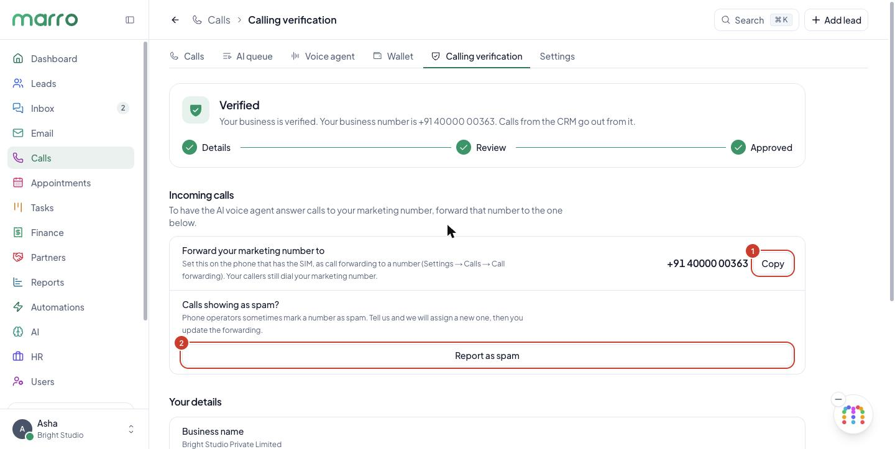
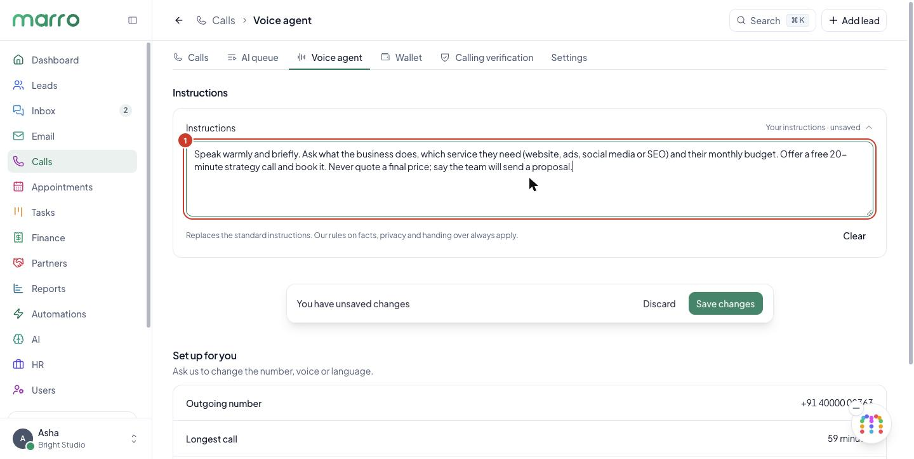
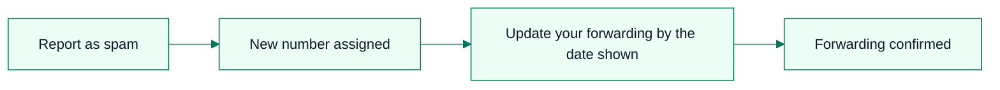
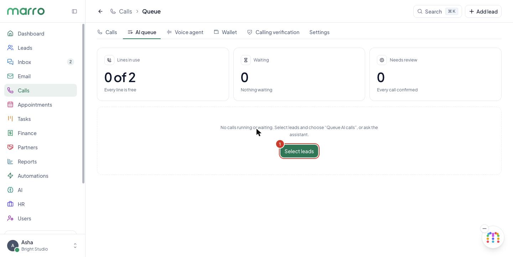
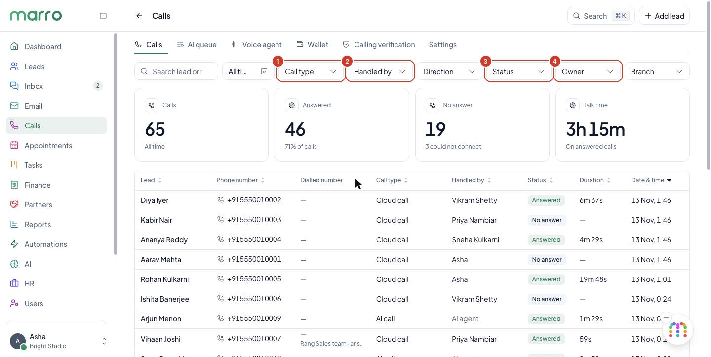
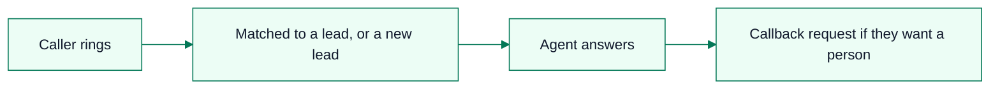

An AI voice agent rings your leads from your business number. Each call’s recording and conversation are kept on the lead.

<Note>
  AI calling is part of Marro AI, on Growth and Complete. Its minutes are paid from the wallet.
</Note>

## Get it switched on

Your business must be verified first. Open **Settings → Voice → Calling verification** (you need permission to manage settings).

<Frame>
  
</Frame>

<Steps>
  <Step title="Choose your registration">Enter a **GSTIN**, **CIN**, **LLPIN** or **Udyam number** in India, or your **ABN** in Australia. Working on your own? Register free on the Udyam portal.</Step>
  <Step title="Add business details">Registered name and address, an authorised person, and what you will use AI calls for.</Step>
  <Step title="Attach the certificate">PDF, JPEG or PNG, up to 5 MB, signed and sealed by an authorised signatory. Only Marro’s team can open it.</Step>
  <Step title="Business number">Leave **Get a business number** ticked to have one set up, at the monthly price shown, paid from your [wallet](/guides/billing).</Step>
  <Step title="Confirm the calling rules">You call people who enquired or agreed to hear from you, respect the Do Not Disturb register, and call between 9 am and 9 pm.</Step>
</Steps>

Most Indian businesses are checked automatically within minutes. The page shows **Verified**, or **Changes needed** with the reason. We email you the result.

Until calling is on, **Calls → AI calls** shows where your setup stands. If your wallet cannot cover the first month for your number, the page asks you to add money. AI calls stay off until your business knowledge is added. Marro’s team then sets up the voice and language with you.

## Teach the voice agent

Write its instructions under **Voice agent** in [your AI team](/guides/agents#give-them-instructions).

<Frame>
  
</Frame>

- It answers from your public business knowledge and your active product catalogue. If it cannot confirm a price or detail, it says so and offers a team follow-up.
- It starts in the lead’s saved language, or your business default. Callers can ask to switch language during a call.
- It confirms an appointment once booking succeeds.
- After a question goes unanswered for about 15 seconds it checks in once, then says goodbye after 12 more seconds of silence.

**Calls → Voice agent** shows whether it is active, your outgoing number, the longest a call can last, and how many calls can run at once (up to 100).

## More lines and numbers

**Calls at once** is how many AI calls can run together.

<Steps>
  <Step title="Request">Choose **Request more lines** and enter the total you need (up to 100).</Step>
  <Step title="Wait for review">The row shows **Withdraw** while Marro’s team reviews it. One request at a time.</Step>
  <Step title="Get the answer">You and your administrators get an email either way.</Step>
</Steps>

New calls go out from the active number that has made the fewest calls today, and each number has a daily limit. Every number rings back to your voice agent. You can also ask the [assistant](/guides/assistant) about your lines.

## Forward your marketing number

To have the agent answer your advertised number, forward it (phone **Settings → Calls → Call forwarding**) to the Marro number under **Settings → Voice → Calling verification → Incoming calls**.

If an operator marks your number as spam:

Calls to the old number still reach you until that date.

## Calling hours

| Rule | What happens |
| --- | --- |
| Indian numbers | Called only between 9 am and 9 pm in your organization’s time zone. |
| Outside those hours | The call is not placed. |
| Calling paused by Marro | No new AI call starts. Calls in progress finish. |

## Paying for calls

**Calls → Wallet** shows your balance, the price per minute and about how many minutes are left.

<Frame>
  
</Frame>

- Before a call, the minutes your balance covers are set aside. The call ends when they run out.
- You pay only for minutes used. Each started minute counts as a whole one.
- With under a minute’s worth left, new calls don’t start. Incoming calls are recorded as missed and the owner is alerted.
- To add money, choose **Add money**. An administrator tops up in **Settings → Wallet**.

## Make AI calls

| From | How |
| --- | --- |
| One lead | **More → AI call** on the lead’s page. End it from the action row. |
| Several leads | Select up to ten leads on a computer and choose **Queue AI calls to selected**. |
| An automation | The **Call with AI** step. See [Call with AI](/guides/automations#call-with-ai). |

You need permission to make calls. AI calls go to Indian numbers in +91 format.

Extra calls wait for a free line. **Calls → AI queue** shows lines in use, calls waiting and calls needing review. Cancel a waiting call there.

<Frame>
  
</Frame>

## See your calls

**Calls** in the sidebar is your call log: AI calls, Cloud calls and calls from a connected service such as MCube, Exotel or Tata Smartflo. Each person sees the calls of leads they can open.

<Frame>
  
</Frame>

| Call type | Meaning |
| --- | --- |
| **AI call** | Your AI voice agent. |
| **Cloud call** | Your team, through your business number. |
| **Bridge call** | Your team, through a service you connected, for example **Bridge call · MCube**. |

Filter by date, type, handled by, direction, status (**Answered**, **Missed**, **No answer**, **Failed**, **In progress**, **Waiting**) and lead owner. Select a call to play its recording or read an AI call.

## Incoming calls

Ask support to switch on answering. **Calls → Voice agent** then shows **Incoming calls: answered by your AI voice agent**.

- A new number becomes a lead with the source **Phone call**.
- Each call uses one of your lines. If all are busy, the caller hears so and can call again.
- A call the AI can’t take is recorded as **Missed** and the owner is alerted by email, WhatsApp and the app.

## After the call

The recording, transcript and summary appear in the lead’s **Activity** and in **Calls**. A call counts as answered when it lasted 10 seconds or more with words spoken.

<Frame>
  
</Frame>

Two automation triggers follow each call: **An AI call ends**, and **An AI call is analysed**, once the [Call analyst](/guides/agents) has given an outcome such as interested or wants a callback. See [Automations](/guides/automations).

## Calls answered by your team

[Cloud calls](/guides/cloud-calls) connect your staff’s phones to leads. If a business number is set to staff routing, staff answer incoming calls instead of the agent.

<CardGroup cols={2}>
  <Card title="Cloud calls" icon="phone" href="/guides/cloud-calls">Your team’s phones</Card>
  <Card title="Automations" icon="bolt" href="/guides/automations">Act after each call</Card>
</CardGroup>
