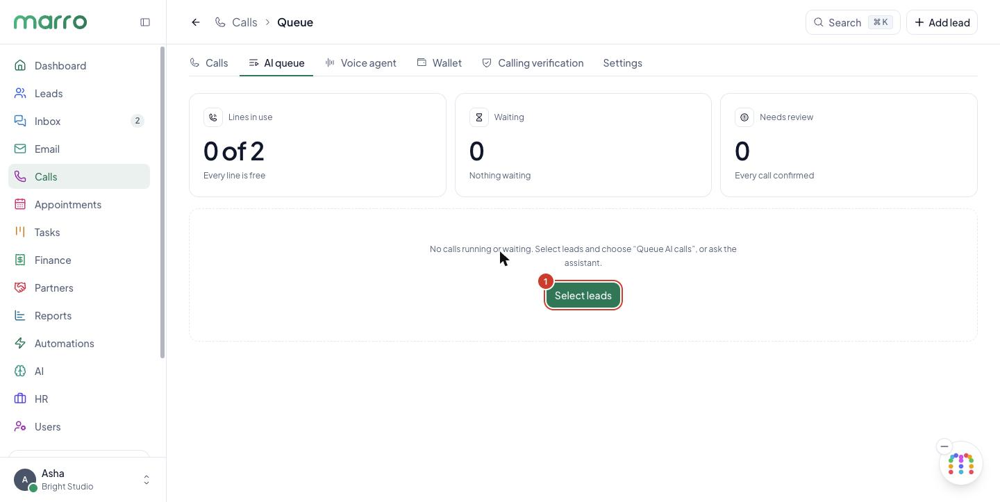

import { Flow } from "/snippets/flow.jsx";

When more AI calls are asked for than you have lines, the extra calls wait. Open **Calls → AI queue** to see them.

**Campaign backlog** counts confirmed bulk-call recipients waiting to enter the calling queue. It is shown while recipients are pending. Each organization can submit up to 200 campaign call requests per hour. When inbound answering is enabled and the organization has at least two lines, bulk calls keep one line free for incoming callers.

## What the queue shows

<Frame>
  
</Frame>

| Shown | Meaning |
| --- | --- |
| Lines in use | Calls running now. |
| Calls waiting | Calls that start when a line frees up. |
| Needs review | Calls whose result could not be confirmed. |

## Cancel a waiting call

<Steps>
  <Step title="Open the queue">Go to **Calls → AI queue**.</Step>
  <Step title="Find the call">Look under the calls waiting.</Step>
  <Step title="Cancel it">Choose to cancel it. Only waiting calls can be cancelled.</Step>
</Steps>

## How calls get in

<Flow steps={["Ten leads selected, or an automation", "Queue", "Free line", "AI call"]} />

Need more lines? See [Voice agent](/guides/voice-agent#request-more-lines).

## Ask Marro

<Card title="Try asking" icon="message-circle">
  *"What is waiting in the AI call queue?"*

  Marro lists the waiting calls and the lines in use.
</Card>
