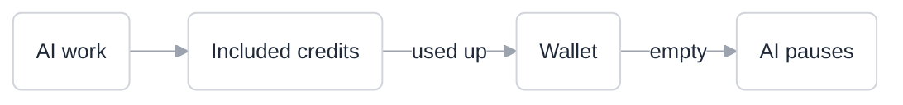
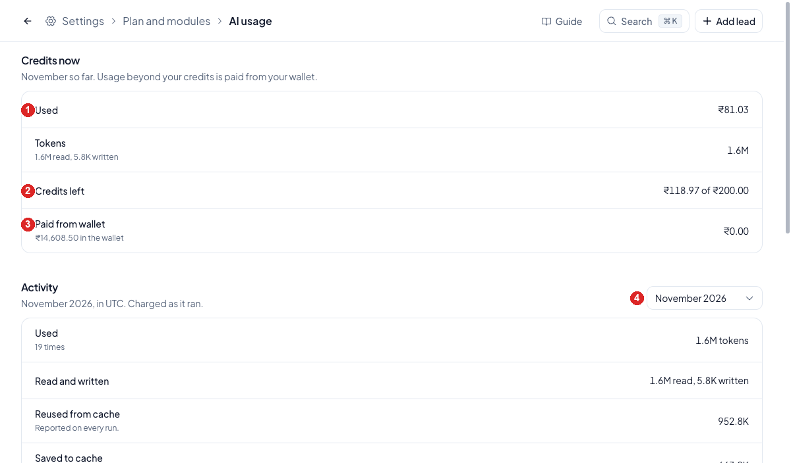

Your plan can include **AI credits** each month, in rupees. Agents, the assistant, AI replies, suggested replies and business knowledge draw on them. When credits run out, AI is paid from your **wallet**, the same one that pays for calls. With no included credits, the wallet pays from the start.

## See what you used

Open **Settings → Plan and modules → AI usage**.

<Frame>
  
</Frame>

1. **Used**: this month's cost, and the tokens below it.
2. **Credits left** of the month's credits.
3. **Paid from wallet**: usage beyond the credits.
4. The month to show under **Activity**.

**Credits now** in detail:

| Card | Shows |
| --- | --- |
| **Used** | This month's cost and input/output tokens. |
| **Credits left** | Remaining credits. They renew on the day your subscription started. The free trial has ₹200 for the whole trial. |
| **Paid from the wallet** | Usage beyond the credits, and the wallet balance. |

Administrators also see **Activity** for the current UTC month or any of the previous eleven:

- Runs and tokens, with a daily chart.
- Charges covered by credits, paid from the wallet, or left uncovered.
- Usage by feature: agents, AI replies, the assistant, suggested replies, briefings, call reviews and business knowledge.

**Credits now** always shows the current month. AI calling is reported separately.

## When credits run out

If credits are used and the wallet is empty, AI pauses.

The assistant asks you to add money. The rest of the CRM keeps working.

| Where | Note |
| --- | --- |
| **Inbox → Settings → Wallet** | Add money to the wallet |
| Wallet currency | Wallet payment for AI is available in INR only. If your wallet uses another currency, AI pauses when the credits run out |

## What each AI charge was for

In **Settings → Organization → Wallet → Top-ups and charges**, each AI charge says what it was for.

| Detail | Example |
| --- | --- |
| Kind of work | An assistant reply, a call review, a daily briefing, an agent working on a lead |
| Where | Web, App or WhatsApp |
| For whom | The lead, the person who asked and the chat name |
| Size | Tokens read and written |

Models and Marro's costs are never shown. AI calls are paid by the minute: see [AI calling](/guides/ai-calling).

## How a price is worked out

Each piece of work is priced in three steps. Short tasks cost very little.

<Steps>
  <Step title="Tokens counted">Tokens read and written, at your plan's AI rate.</Step>
  <Step title="Rounded up">To the paisa.</Step>
  <Step title="Credits first">Credits cover usage first. If a run crosses the limit, only the rest is billed to the wallet.</Step>
</Steps>

## Ask Marro

<Card title="Try asking" icon="message-circle">
  *"How much AI have we used this month?"*

  *"Show our AI activity for October 2026."*

  Marro reads your usage. It does not change prices or your allowance.
</Card>
