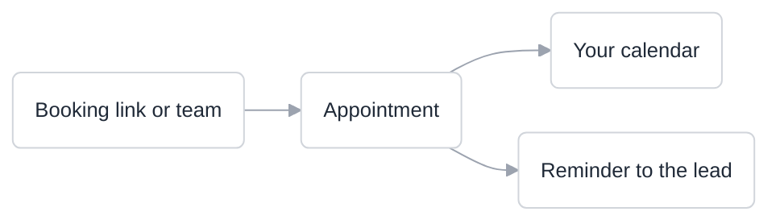
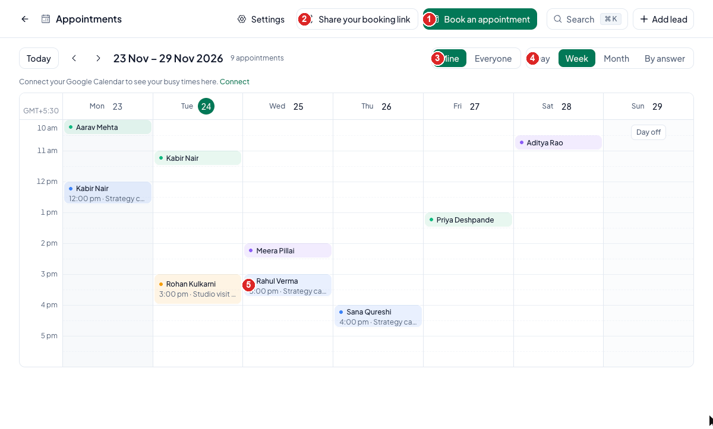
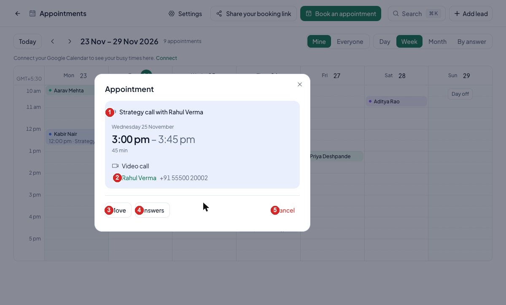
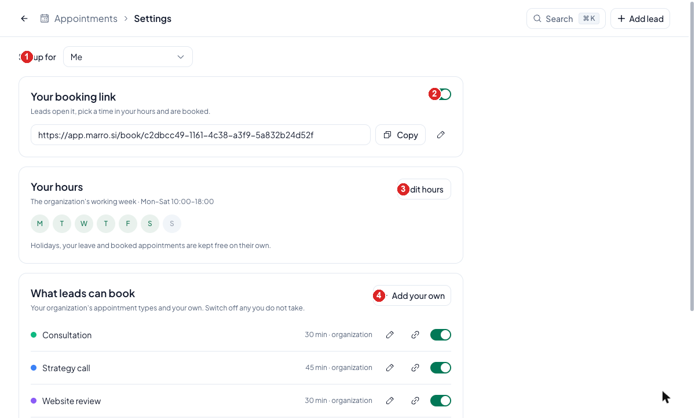
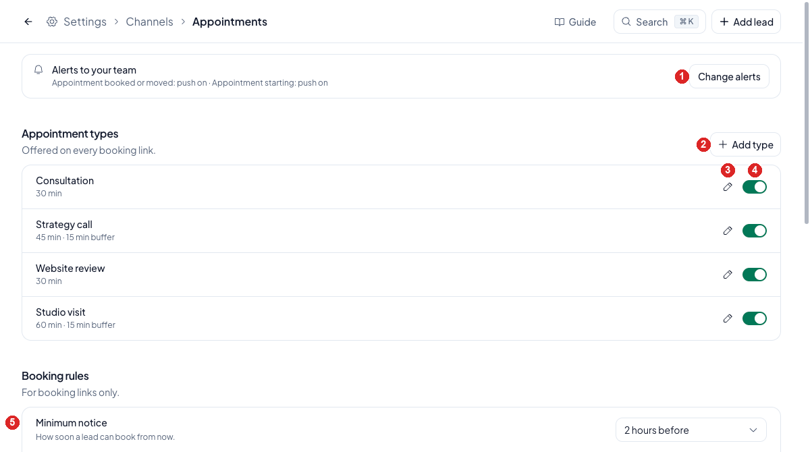

Your team, the assistant or leads themselves can book appointments. They go into your Google or Outlook calendar, and leads get a reminder before they start. Open **Appointments** in the sidebar.

## Your calendar

<Frame>
  
</Frame>

1. **Book an appointment**.
2. **Share your booking link** for leads to book themselves.
3. **Mine** or **Everyone** (if you can see everyone's).
4. **Day**, **Week**, **Month**, or **By answer** to group by a booking question.
5. Select an appointment to open it.

<Frame>
  
</Frame>

1. The type, and who it is with.
2. The lead: select their name to open them; the number calls them.
3. **Move** to another time.
4. **Answers** to the booking questions.
5. **Cancel**, with a reason. The lead is told through their invite.

## Book and manage

<Steps>
  <Step title="Book">
    Choose **Book an appointment**: the lead, the type, who takes it and a time. On a lead's page, use **More → Book appointment**.
  </Step>
  <Step title="Follow it">
    Upcoming appointments show above the lead's tabs. Mark one **Completed** or **No-show**, move it or cancel it.
  </Step>
  <Step title="Edit">
    **Edit details** changes the title, notes, place or link without moving it.
  </Step>
</Steps>

**More → Copy booking link** copies a link for that lead. The lead's **Follow-ups** tab lists every appointment. You see your week; if you can see everyone's follow-ups, switch to **Everyone**.

## Set up your own booking

On the Appointments page, open **Settings**:

<Frame>
  
</Frame>

1. Set up for yourself, or for someone in your team.
2. **Your booking link**: on, copy, or change its address.
3. **Edit hours**.
4. **Add your own** appointment type; switch off any you don't take.

| Setting | What it does |
| --- | --- |
| **Your booking link** | Switch it on and copy it. |
| **Weekly hours** | When leads can book you. They start as your organization's working week. |
| **What leads can book** | The appointment types you offer. |
| **Your calendars** | **Google Calendar** (Google Meet links) or **Outlook Calendar** (Teams links on work accounts). Busy times stay free. |

Leads are never offered times outside your hours, on holidays, on approved leave or over another appointment.

## For administrators

In **Settings → Channels → Appointments**:

<Frame>
  
</Frame>

1. **Alerts to your team** when an appointment is booked, moved or about to start. **Change alerts** opens Notifications.
2. **Add type**.
3. Edit a type: name, length and buffer.
4. Switch a type off to stop offering it.
5. **Booking rules**: how soon and how far ahead leads can book.

| Setting | What it does |
| --- | --- |
| Reminders | When they go and the WhatsApp template they use |
| Booking window | How soon and how far ahead leads can book |
| Types | The appointment types everyone offers |
| Team booking links | Give each booking to the next free team member in turn |

## What leads see

| Step | What happens |
| --- | --- |
| 1 | Opens the link, no sign-in, with your logo and colour |
| 2 | Picks a type and a time in their own time zone |
| 3 | Confirms, and can add it to their calendar |
| Later | **Move or cancel** it themselves |

A time that was just taken can't be booked twice.

## Automate it

<CardGroup cols={2}>
  <Card title="Triggers" icon="bolt">**An appointment is booked**, **An appointment is completed or a no-show**</Card>
  <Card title="Step" icon="link">**Send a booking link**</Card>
</CardGroup>

See [Automations](/guides/automations).
