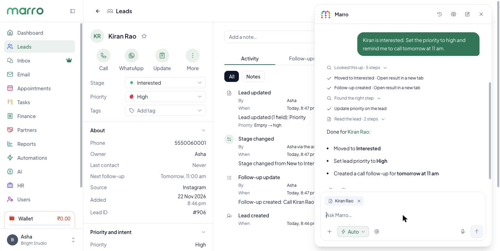
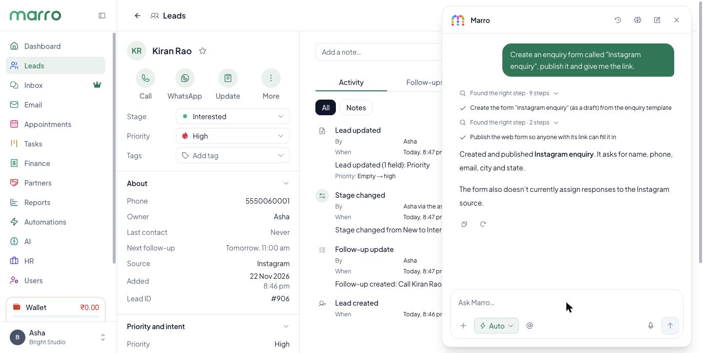

import { Flow } from "/snippets/flow.jsx";

Marro's assistant answers questions about your leads, chats, tasks and reports, and does the work: notes, follow-ups, calls, stage changes, messages and more. It acts as you, so it can only do what your role allows. It is part of Marro AI, on every plan.

If a business detail is missing or conflicting, it says what needs confirming. Ask explicitly if you want to see its sources or manage Business knowledge.

## Open it

| Where | How |
| --- | --- |
| Web | Press the mascot at the bottom right, or choose **Ask Marro** in the command menu. On a lead's page it knows which lead you mean |
| [Mobile app](/guides/mobile-app) | Open the assistant from the app |
| WhatsApp | See [On WhatsApp](#on-whatsapp) |

## Write a message

<Steps>
  <Step title="Use shortcuts">
    Type `/` for **My day**, **Find leads**, **Add a note**, **Book a follow-up**, **Log a call**, **Move stage**, **Assign**, **Pipeline** and more. You see only what your role can use.
  </Step>
  <Step title="Mention people">
    Type `@` to mention a lead or teammate.
  </Step>
  <Step title="Or speak">
    Press the microphone. **Stop** puts the words in the draft to edit; **Send** transcribes and sends.
  </Step>
</Steps>

You can send another message while Marro works. New instructions cancel any change still waiting for approval. **Stop** stops the reply.

## Command menu

<Steps>
  <Step title="Open it">Press `⌘K` on Mac or `Ctrl+K` on Windows. On a phone browser, tap the search icon.</Step>
  <Step title="Type">Find a page, a setting or **Add lead**. After two characters it also finds leads, contacts, companies and opportunities by name, phone or email, within your access.</Step>
  <Step title="Nothing matches?">Choose **Ask Marro** to turn your words into a draft.</Step>
</Steps>

## Approve changes

Use the approval menu beside the message box on the web.

<Frame>
  
</Frame>

| Mode | What happens |
| --- | --- |
| **Manual** (default) | Choose **Approve** or **Decline** for each change |
| **Auto** | Marro carries out routine changes. Deleting and other sensitive actions still ask |

Approving one change never approves later ones. Read-only questions need no approval.

<Frame>
  
</Frame>

<Frame>
  
</Frame>

<Card title="Try asking" icon="message-circle">
  *"Kiran is interested. Set the priority to high and remind me to call tomorrow at 11 am."*

  *"Create an enquiry form called Instagram enquiry, publish it and give me the link."*

  Marro changes the lead and books the follow-up in one reply, or builds and publishes the [form](/guides/forms).
</Card>

## On WhatsApp

Message the WhatsApp number your Marro alerts come from, from the phone number on your account. It works with the same permissions as the web.

| You | Marro |
| --- | --- |
| Need to approve a change | Sends **Approve** and **Cancel** buttons. "yes" or "no" also works |
| Send a voice note | Replies with a voice note |
| Send a photo or PDF | Reads it for that reply |
| Belong to several organizations | Asks which. Send `switch organization` to change |
| Have several accounts on one number | Asks which to use. Send `switch account` to choose again |
| Send `help`, `stop` or `start` | Shows what it can do, or turns it off or on for your number |

It only answers questions about your work in Marro, as Meta requires. The conversation is saved like any assistant chat.

### For administrators

Open **AI → Settings**, under **WhatsApp**:

| Setting | Choices |
| --- | --- |
| **Use the assistant from WhatsApp** | On or off for your organization |
| **Which number people message** | Marro's number, or your own WhatsApp Business number from **Settings → Integrations** |
| **Who can use it** | Everyone with the assistant, or chosen roles |

## What it can do

<CardGroup cols={2}>
  <Card title="Templates and broadcasts" icon="send">
    Give you figures, and edit a template with your approval.
  </Card>
  <Card title="Replies" icon="reply">
    Read and change **Inbox → Settings → Replies**: welcome and away messages, keyword replies.
  </Card>
  <Card title="Voice lines" icon="phone">
    Tell you how many AI calls can run at once and request more. See [AI calling](/guides/voice-agent#request-more-lines).
  </Card>
  <Card title="How-do-I questions" icon="circle-help">
    Answered from [Help and support](/guides/support), using no AI credits.
  </Card>
</CardGroup>

Ask things like *"How do I add a custom field?"* Marro looks up the web app's page names and controls and explains the steps. It does not see your screen. Enter passwords and sign-in codes only on their secure pages, never in chat.

## Your personal work agent

Ask **"What needs my update?"** to start a [personal check-in](/guides/personal-agent).

<Flow steps={["You ask", "Marro asks about overdue assigned work", "Records your status and next deadline", "Raises unresolved work with managers"]} />

These updates always need confirmation, even in Auto.

## Saved views

<CardGroup cols={2}>
  <Card title="Ask" icon="message-circle">*"Show my saved views"* or *"Open my view named Today on Follow-ups"*</Card>
  <Card title="Change" icon="pencil">Ask Marro to save, rename, change or delete a view, with the usual approval</Card>
</CardGroup>

| Good to know | |
| --- | --- |
| Private views | Stay private |
| Deleting a view | Never deletes records |

## Several changes at once

Ask *"Hide these eight fields"*. Marro groups 2–50 items into one review. You see the names and changes together, then approve or decline all.

| Result | What you see |
| --- | --- |
| **8 fields updated** | A line that opens to each item |
| A failed item | Its reason |
| A retry | Resumes only items that never started |

Messages, paid calls, payments and actions with their own confirmation keep those workflows.

## Delete records

<Flow steps={["Ask to delete", "Review lists what goes", "You approve", "Deleted"]} />

Every deletion needs your explicit approval, even in Auto. The review names what will go and ends with "This can't be undone." Archive is a separate choice that keeps a lead in **Leads → Archived**. Users, money, credentials and connections keep their own workflows.

## Open a page or build an automation

| Ask | Marro does |
| --- | --- |
| *"Take me to Inbox Settings"* | Opens the page |
| *"Open it"*, after Marro finds one lead | Opens that lead |
| *"Build an automation to assign new website enquiries to the sales team"* | Saves a draft that is switched off and opens its editor |

Turning it on is a separate decision. If you have unsaved edits, use **Open result in a new tab**.

## Longer requests

Marro can queue larger planning requests, such as *"inspect our incoming call setup and draft an automation"*.

<Steps>
  <Step title="Ask">Marro queues the request. You can leave and return to the same chat.</Step>
  <Step title="Approve">It waits for your approval before changing anything. **Stop answering** cancels queued or running work.</Step>
  <Step title="Come back">Ask **"Where did we leave off?"** Marro summarises your decisions and the approvals still waiting.</Step>
</Steps>

An accepted send is not proof of delivery.

## Get help from Marro's team

<Steps>
  <Step title="Type support">Starts a support conversation that uses no AI credits. Billing, payment, data-loss and security issues go straight to the team.</Step>
  <Step title="Approve the message">You approve the exact message, even in Auto. Leave out customer details and credentials.</Step>
</Steps>

[Help and support](/guides/support) also has a form.

## Personal memory

Marro can remember working preferences such as answer language. Open the memory view to inspect, edit or forget an item. Only you can see your memories.

| Rule | |
| --- | --- |
| Expiry | New memories expire after a year by default |
| Rejected | Credentials, contact details and sensitive identifiers |
| Priority | A memory never overrides current records or approvals |

## Use Marro for your goals

You do not need to know module names. Try:

<Card title="Try asking" icon="message-circle">
  *"We run a clinic. How can we make appointment administration easier?"*

  *"Which quotes need attention, and what should we do next?"*

  *"Invite this colleague with the appropriate role, then help me plan their setup."*

  Marro suggests practical options from your business profile and what your role and plan allow. It does not change settings or message customers just because you asked for ideas.
</Card>

Some steps need a secure page or you: signing in to a connection, entering a secret, choosing a file or accepting terms. Marro tells you the exact step.

## Report a slow response

<Steps>
  <Step title="Tell your administrator">The approximate time and the kind of task.</Step>
  <Step title="They check diagnostics">Diagnostics hold only timings and counts, never your message text.</Step>
</Steps>
