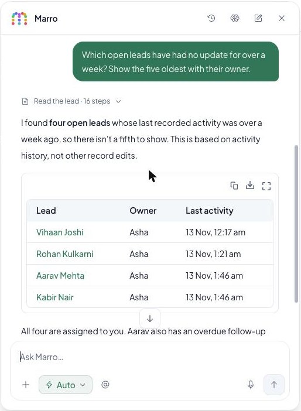
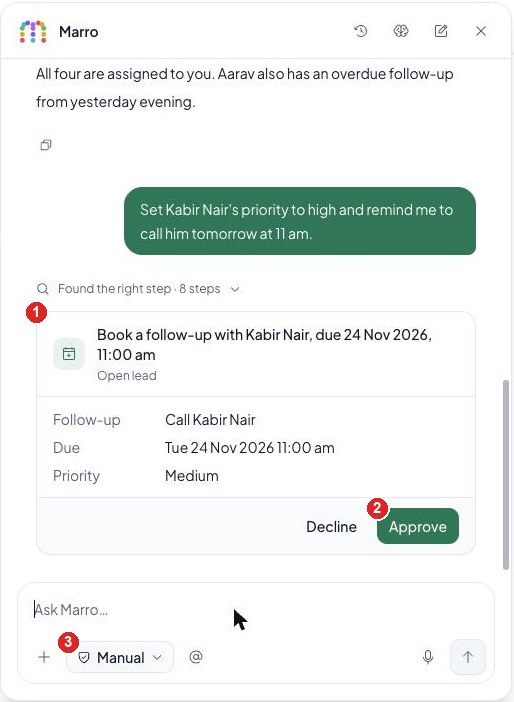
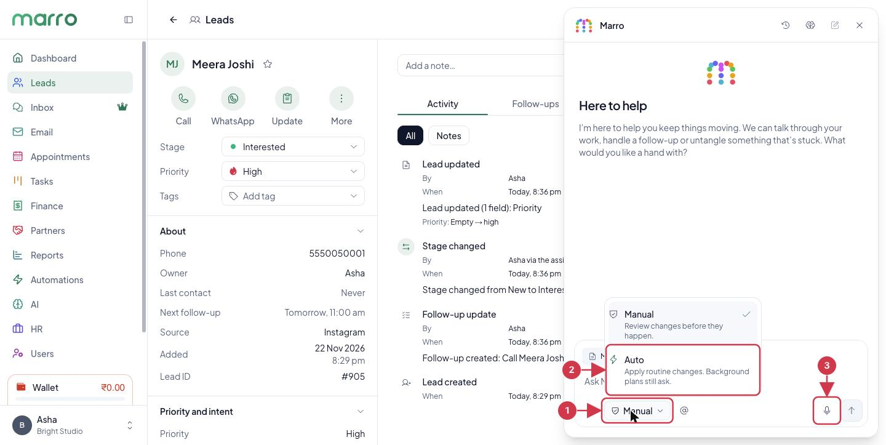

**Ask Marro** answers questions about your leads, chats, tasks and reports, and makes changes for you. It acts as you, so it only sees and does what your role allows.

| Where | How to open it |
| --- | --- |
| Web | The Marro button at the bottom right, or **Ask Marro** in the search menu (`⌘K` / `Ctrl+K`) |
| [Mobile app](/guides/mobile-app) | The Marro button in the middle of the tab bar |
| WhatsApp | Message Marro's number. See [WhatsApp assistant](/guides/whatsapp-assistant) |

## Ask a question

<Frame>
  
</Frame>

Ask in your own words. Lists come back as a table you can copy, download or open full screen. Click a name to open the record. Questions never change anything.

## Approve a change

<Frame>
  
</Frame>

1. Marro shows the change it wants to make.
2. Choose **Approve** or **Decline**. A request with two changes asks for each.
3. The mode button sets how often it asks:

| Mode | What happens |
| --- | --- |
| **Manual** | Every change waits for your **Approve** |
| **Auto** | Routine changes go straight through. Deleting, messaging customers, money and other sensitive actions still ask |

Approving one change never approves the next. A deletion names what goes and says it can't be undone.

When your organization has several WhatsApp numbers, ask Marro which numbers you have ("which WhatsApp numbers do we have?", "which number did Priya write to?"). A message to a lead goes from the number they last wrote to unless you name another, and the approval shows the number it will go from. An administrator can ask Marro to make a number the default or rename it; adding and disconnecting numbers stay on **Inbox → Settings**.

## Write a message

<Frame>
  
</Frame>

| Type or press | For |
| --- | --- |
| `/` or **+** | Shortcuts: **My day**, **Find leads**, **Add a note**, **Book a follow-up**, **Log a call**, **Move stage**, **Assign** |
| `@` | A lead or teammate |
| Microphone | Speak instead of typing |

You can send another message while Marro works. **Stop** ends the reply.

## What else it does

| Ask for | What happens |
| --- | --- |
| Many changes at once (2–50) | One review lists them all; approve or decline them together |
| A page | *"Take me to Inbox settings"* opens it |
| An automation | It saves a draft that is off and opens the editor |
| A bigger job | It keeps working if you leave. Ask *"Where did we leave off?"* |
| How to do something | It explains the steps in the app, using no AI credits |
| `support` | Starts a message to Marro's team, which you approve before it goes |
| Your preferences | It remembers things like answer language. Only you see them, and you can forget any |
| Your check-ins | *"What needs my update?"* starts a [personal check-in](/guides/personal-agent) |
| A business goal | *"We run a clinic. How can we make appointments easier?"* gives a few practical options from your business profile and what your role and plan allow. It changes nothing until you ask |

Never type passwords or sign-in codes into the chat. Marro tells you when a step needs a secure page or you. Some page operations are not yet available in chat; Marro says so precisely instead of claiming it can do everything.

## Try asking

<Card title="Try asking" icon="message-circle">
  *"Which open leads have had no update for over a week?"*

  *"Set Kabir Nair's priority to high and remind me to call him tomorrow at 11 am."*

  *"Create an enquiry form called Instagram enquiry, publish it and give me the link."*
</Card>
