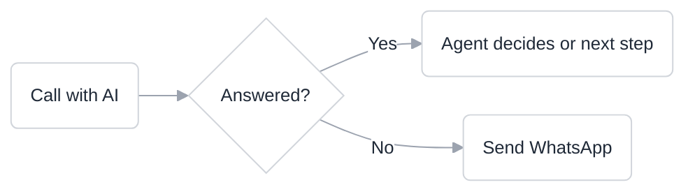

import { Flow } from "/snippets/flow.jsx";

An automation starts when something happens to a lead, or when the time comes, then runs its steps. Steps can wait, so one automation can follow a lead over days. Open **Automations** in the main menu.

<Flow steps={["Starts", "Conditions", "Steps", "Wait for a reply", "More steps"]} />

## Start one

<Steps>
  <Step title="Choose a starting point">
    **New automation**, a ready-made journey, or a WhatsApp recipe. Each opens the builder filled in.
  </Step>
  <Step title="Check and test">
    Change what you need, then use **Try on a lead**.
  </Step>
  <Step title="Switch on">
    Switch it on in the builder or in its row on the **Automations** page.
  </Step>
</Steps>

The builder shows steps on the canvas and as a list. Both are the same automation. On a phone you see the steps.

<Card title="Try asking" icon="message-circle">
  *"When a lead comes from Facebook, call them with AI in 5 minutes. If they don't answer, send the welcome WhatsApp and remind their owner tomorrow at 11"*

  Choose **Ask Marro** and it builds the steps from your own stages, people and templates, and shows them before saving. On a saved automation, **Change it with Marro** edits it and **Explain it** describes it. It uses your [AI credits](/guides/ai-usage).
</Card>

**Ready to use** lists automations for your industry and every business: a reminder the day before an appointment, a renewal reminder, birthday wishes, an invoice and payment link when a quote is accepted, a nudge when a follow-up is late. Answer what only you know and choose **Add automation**. It is added switched off.

## When it starts

| Kind | Examples |
| --- | --- |
| Lead | Created, updated, stage changes, assigned, becomes Hot, Warm or Cold |
| Activity | A call is logged, a note is added, a follow-up is created or done |
| Messages | A lead sends a message on WhatsApp, Instagram, Messenger, website chat, SMS or email |
| Money | A quote is sent, opened, accepted, declined or expires; an invoice is sent, paid or overdue; a payment is received |
| Other records | An opportunity is created, won, lost or changes stage; a custom object record changes ([Custom objects](/guides/custom-objects#automations)) |
| Web | A web form is submitted; a lead visits a page ([Website tracking](/guides/website-tracking)) |
| Appointments | Booked, or completed or a no-show |
| Calls | An AI call ends or is analysed; a call is analysed (see [After a call](#after-a-call)) |
| Another automation | Uses it |

Add conditions to narrow it: stage, pipeline, branch, tags, priority, days since last contact, message text, outside working hours and more.

### On a schedule or a date

| Start | Runs |
| --- | --- |
| On a schedule | Every day, on chosen weekdays or monthly, for every lead that meets its conditions |
| A date on the lead comes round | Days before, on or after a date field. **Every year** for birthdays |
| A follow-up is overdue | When it passes its due time, or hours after |
| No contact for a while | Nobody has called, messaged, emailed or met the lead for the days you choose |
| An appointment is coming up | A set time before it |
| An invoice is due soon | Days before an unpaid invoice's due date |

Each runs once per lead each time it comes round, from when you switch it on, and can start up to five minutes late. Use [Run for leads already here](#leads-already-here) for leads already in that state.

## What it does

<CardGroup cols={2}>
  <Card title="Change the lead" icon="pen">**Update fields**, **Change stage**, **Move to another pipeline**, **Assign**, **Tag the lead**, **Archive the lead**</Card>
  <Card title="Keep track" icon="list-check">**Add a note**, **Create a follow-up** (due after a time, or **At a time of day**)</Card>
  <Card title="Message" icon="message">WhatsApp template or reply, SMS, email, email template, **Reply on the same channel**, **Send a booking link**, **Send the portal link**</Card>
  <Card title="Tell your team" icon="bell">**Notify someone**: owner, people, **Teams**, **Roles** or the lead's branch. Anyone chosen hears once.</Card>
  <Card title="Money" icon="receipt">**Create and send a quote**, **Create and send an invoice**, **Send a payment link**. Prices come from your price list. See [Quotes and invoices](/guides/quotes-and-invoices).</Card>
  <Card title="Calls and AI" icon="phone">**Call with AI**, **Set the stage from the call**, **Book what was agreed on the call**, **Agent decides**</Card>
  <Card title="Records" icon="link">**Create record**, **Create opportunity**, **Move the lead's opportunities**, **Link records**, custom object steps</Card>
  <Card title="Connect out" icon="plug">**Add a row to a Google Sheet**, **Add the lead to a list**, **Send to a web address**, **Call an API**</Card>
</CardGroup>

- **Agent decides** reads the lead and takes the next step within your [agent permissions](/guides/agents#choose-what-they-may-do). Its ways on are **Acted** and **Did nothing**.
- **Send to a web address** signs each request with an `X-CRM-Signature` header. **Call an API** keeps the answer for later steps.
- Emails can name an invoice or quote (for example `{{invoice.link}}`, `{{quote.total}}`): choose from **Insert field**.

## Customers and records

| Step | What it does |
| --- | --- |
| **Create record** | Makes a company, contact or opportunity. Later steps can use it. Run twice, it makes it once. |
| **Create opportunity** | **The lead's opening opportunity** (reused if it exists) or **A new one each time**. **Skip when one is already open** avoids duplicates. Does nothing if Opportunities are off or the lead has no phone or email. |
| **Link records** | Points one record at another through a link field. The field must already exist. Never links twice. |
| **Move the lead's opportunities** | Moves them to one stage, or the stage you match to the lead's stage |
| **Set the lead's stage from the opportunity** | The reverse, from **An opportunity's stage changes** |

Moves made by automations never start other automations, so syncing both ways can't loop.

## Journeys

Steps that pause make an automation a journey.

| Step | What it does |
| --- | --- |
| **Wait** | A time, or until a time of day. In appointment automations, **Until before the appointment** follows moves and stops on cancel. |
| **Wait for a reply or a change** | A reply, stage change, follow-up done, field change or call logged. Two ways on: it happens, or not in time. |
| **If… otherwise…** | Sends each lead down the first way whose condition it matches |
| **Use another automation** | Runs a reusable one, then carries on |

Each automation is labelled **Instant**, **Journey** or **Reusable**. The **Automations** page shows how many are on, how many leads are waiting and how many runs failed. Filter, search and sort the table.

Under **Starts**, **Stop when the lead replies** removes a waiting lead as soon as they reply.

## Call with AI

- **Answered**: picked up, 10 seconds or more with words spoken.
- **Not answered**: rang out, cut short, not placed (calling off, or not a +91 number), or not ended after 2 hours.

Finish the sentence **Call them with AI…**. Under **More options**, add **Anything else for this call**, or switch off **Only call in working hours**. With it on (default), a lead who arrives outside **Settings → HR** hours is called next working day. The call is paid like any AI call and shows in **Calls**. Calls never start more AI calls. Try the ready-made **New lead: AI call in 5 minutes, WhatsApp if no answer**.

## After a call

While **Call reviewer** is on in [AI → Agents](/guides/agents), each recorded call (AI, [Cloud](/guides/cloud-calls) and Bridge) is read a few minutes after it ends, using your AI credit. Start from **A call is analysed**, choose the calls and outcomes, then use:

| Step | What it does |
| --- | --- |
| **Set the stage from the call** | Moves the lead to one of the stages you allow, only when the call clearly fits. The reason is noted, with **Put back** to undo. If unclear, the owner gets a follow-up. |
| **Book what was agreed on the call** | Books the day and time both sides agreed, with the lead owner, up to 90 days ahead. If unclear, the owner gets a follow-up. |

Ways on: **Moved** or **Booked**, and **Not clear**. A call with no recording can't be read. Ready-made starts: **Move the lead after every call**, **Book the appointment agreed on a call**, **Missed call: send a WhatsApp**, **Close leads that say they are not interested**.

## WhatsApp alerts to staff

Add **Notify someone**, set **How** to **WhatsApp**, then choose a **WhatsApp sender**.

| Sender | Use |
| --- | --- |
| **Marro** | Ready alerts: **Lead stage changed**, **Missed call**, **New lead assigned**, **Follow-up due**, **New task assigned**, **Lead converted** |
| **Your WhatsApp number** | An approved utility template. Turn on **Send staff alerts from this number** under **Inbox → Settings** |

Each person needs a WhatsApp number in their staff profile. **Settings → Notifications** also has a built-in missed-call alert: switch one off to avoid duplicates.

## If a step fails

Any step that does something can have an **If it fails** way on and **Try again up to** 3 times. **Call an API** and **Send to a web address** retry after 1 minute, 10 minutes, then an hour.

| Run result | Means |
| --- | --- |
| **Done** / **Done with a failed step** | Finished, with or without a failure |
| **Skipped a step** | With the reason, such as no phone number or opted out |
| **Failed** / **Waiting** | Stopped, or paused in a journey |
| **No change needed** | Nothing to change; not counted as skipped |

An email goes to the person who made the automation when one fails (see [Notifications](/guides/notifications)). **Run again** repeats a finished run for the same lead. If an email step's outcome can't be confirmed, Marro marks it uncertain and never resends it automatically: check the mailbox first.

## Test it

| Button | What happens |
| --- | --- |
| **Try on a lead** then **Test on this lead** | Shows what each step would do, skip and wait on. Nothing is sent or changed, and unsaved changes are included |
| **Run for real** | Runs the saved automation on that lead |

### Leads already here

An automation only runs for what happens from now on.

<Steps>
  <Step title="Press Run for leads already here">Runs it for up to 500 leads at a time that it has never run for, oldest first.</Step>
  <Step title="Or select leads">On **Leads**, choose **Bulk actions → Run an automation** (settings managers, up to 500).</Step>
</Steps>

Its conditions apply and its steps really happen. The number of automations depends on your plan: see **Settings → Subscription**.
