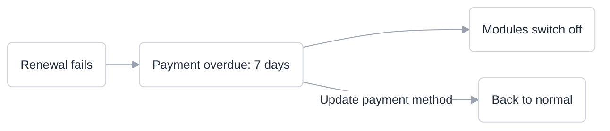

import { Flow } from "/snippets/flow.jsx";

Your subscription lives in **Settings → Subscription**. Only administrators see it.

<Flow steps={["14-day trial", "Choose a plan", "Pay", "Renews automatically"]} />

## The trial

| During the trial | |
| --- | --- |
| Length | **14 days** |
| Modules | Every module except calling (Cloud calls, call flows, AI calls) and the Inbox with broadcasts. Those need a paid plan |
| AI | ₹200 of credits, no payment method needed. If used up, AI pauses unless your INR wallet has funds |
| Choosing a plan | Never shortens the trial. The first payment is taken when it ends |
| If it ends with no plan | Modules pause. **Nothing is deleted** |

## Plans

Current prices are on [marro.si/pricing](https://www.marro.si/pricing), the same list checkout sells from. If it shows **Pricing temporarily unavailable**, email hello@marro.si.

| Plan | What it includes |
| --- | --- |
| Starter | Leads, customers, forms, import and export, the Inbox with one WhatsApp number, tasks, appointments, Cloud calls, catalogue and payment links, standard reports, 5 automations, the assistant |
| Growth | Starter plus AI agents and AI calls, call flows and ring groups, quotes, invoices and the customer portal, custom reports and dashboards, 3 custom objects, partners, the full API and webhooks, 25 automations, HR attendance and leave |
| Complete | Growth plus unlimited automations, up to 20 custom objects, forecast and scheduled reports, sub-partners, branches, company sign-on and provisioning, the activity log, all of HR, the largest AI allowance |

Each plan has monthly, quarterly and annual prices. Longer periods cost less than the same months paid monthly. A running subscription keeps the price it was bought at.

| | Starter | Growth | Complete |
| --- | --- | --- | --- |
| Full users included | 3 | 5 | 15 |
| AI included each month | ₹100 | ₹500 | ₹1,500 |

- Extra users have their own price: per month on monthly and quarterly billing, per year on annual.
- Partner logins never count as paid users. Two-step sign-in, roles and data export are on every plan.
- AI credit renews on the day your subscription started. Unused credit doesn't carry over. AI beyond it is paid from the wallet.
- Reaching a limit (custom objects, partner logins and so on) only stops adding more.

**What you pay** each period: plan price + extra users × extra-user price. The [calculator on the pricing page](https://www.marro.si/pricing#cost) works it out. Not included: Meta's WhatsApp message charges (billed by Meta to you, no Marro markup), AI beyond your plan, AI calls and business numbers (all from the [wallet](/guides/wallet)).

## Billing currency

<CardGroup cols={3}>
  <Card title="India and most countries" icon="indian-rupee">Rupees (INR), paid through Razorpay.</Card>
  <Card title="Australia" icon="globe">Australian dollars. Checkout isn't open yet.</Card>
  <Card title="United Kingdom" icon="pound-sterling">Pounds, before VAT. **UK billing is not open yet**: contact Marro to start your plan.</Card>
</CardGroup>

One currency per organization, set from its country, with no switch after purchase. Included AI use and wallet credit stay in INR.

## Choose a plan

<Steps>
  <Step title="Open Subscription">**Settings → Subscription**, then **Choose a plan**.</Step>
  <Step title="Pick a plan and period">**Monthly**, **quarterly** or **annual**.</Step>
  <Step title="Review the price">Marro shows plan, period, users, add-ons, modules, limits and the total each period.</Step>
  <Step title="Accept and continue">Razorpay opens: pay with **UPI AutoPay** or a **card**. Your bank may ask for a one-time approval.</Step>
</Steps>

The reviewed price is valid for 15 minutes. If it expires, choose **Refresh price**. Nothing is charged at a price you didn't see. The page says **Confirming your payment** until it is confirmed, then the plan's modules switch on. Later periods are charged automatically, and each charge is listed under **Payments** on the same page.

## Your terms stay put

What you bought is recorded with your subscription. A new price list applies only to new subscriptions: nobody is moved automatically.

| Button | What it does |
| --- | --- |
| **Review new terms** | Compares newer terms for your plan with yours, line by line. Moving is your choice |
| **Review new add-on terms** | Moves only that add-on. An add-on keeps its own terms otherwise |

## Extra users

| | |
| --- | --- |
| Never counted | Partners, customer-portal users, deactivated users |
| **Update billed users** | Appears when the active count differs from the billed count, with the price difference |
| Increase | Starts now |
| Reduction | Starts at renewal |

## Change plan or period

Choose **Change plan** and review the new terms beside your current ones before anything changes.

| Change | When it starts |
| --- | --- |
| Higher price, same period | After the prorated payment is taken |
| Lower plan, or a different period | At your next renewal |

When a lower plan starts, modules it doesn't include switch off. Their data is kept. Automations above the new limit keep running, but you can't switch on more.

**Prorated changes:** the review shows the unused-time difference, today's total, when it starts and the next amount. For example, a ₹1,000 increase halfway through a month costs ₹500. Razorpay needs a new mandate: authorise it, then pay the adjustment link (valid 16 minutes). Your current features continue until it is captured. Use **Check status** if confirmation is pending, and don't create another mandate to get past it. **Cancel renewal** is available from an open change.

## If a payment fails

Razorpay retries on its own. Choose **Update payment method** to approve a new mandate or card. **Nothing is deleted**: paying brings everything back.

When paid access ends after a cancellation or an overdue renewal, the workspace owner can receive one WhatsApp notice from Marro. It goes out after access ends and opens **Subscription** so the owner can check the account status. This notice is separate from trial reminders.

## Cancel and refunds

<Steps>
  <Step title="Cancel">Choose the red **Cancel subscription** button.</Step>
  <Step title="Review">Check the end date and no-refund policy, then **Continue to confirmation**.</Step>
  <Step title="Confirm">Type **CANCEL** and select **Cancel subscription**.</Step>
</Steps>

| | |
| --- | --- |
| After cancelling | The plan stays on until the end of the period you paid for, and nothing is deleted |
| Undo | Write to hello@marro.si before the period ends |
| During a trial | Cancelling stops the first payment |
| Refunds | Fees already paid are not refunded, and there are no part-period refunds |
| Price changes | At least 30 days' notice, and your price holds until the first renewal after that |

## Receipts

| Where | Shows |
| --- | --- |
| **Payments** on the subscription page | Each charge with amount, period and the Razorpay payment ID |
| Your email | Razorpay's own receipt |

## Wallet

<Card title="Wallet" icon="wallet" href="/guides/wallet">
  The prepaid balance for calls, business numbers and AI beyond your plan's credits. Your subscription isn't paid from it.
</Card>

## Plans assigned by Marro

| If Marro assigned your plan | |
| --- | --- |
| **Settings → Subscription** shows | The plan and its end date, with no payment option |
| To renew or move to automatic billing | Contact Marro |
| When access ends | Nothing is deleted |
