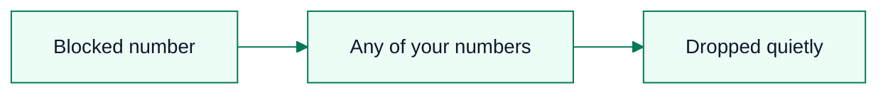

A blocked number cannot reach your business. Its WhatsApp messages and calls are dropped quietly: nobody is alerted, no lead is made, no automation or AI runs, and you are not charged.

The block belongs to your organization and the sender's number, so it still applies if you add or replace a number.

## Block a number

Choose **Block number** from:

| Where | How |
| --- | --- |
| WhatsApp chat in the Inbox | The **⋯** menu |
| A call in Calls | Open the call |
| A lead | **More** on its page |
| The Marro app | The **⋯** sheet of a chat |
| **Settings → Blocked numbers** | Type the number with its country code, add a reason, choose **Block** |

You confirm first, with an optional reason (up to 200 characters). Existing chats, leads and calls stay. A number that belongs to your team cannot be blocked.

## The list

**Settings → Blocked numbers** shows:

| Column | Shows |
| --- | --- |
| Number and reason | Who blocked it and why |
| When | Date blocked |
| Stopped | Messages and calls stopped |

Open a number to see what it tried. **Unblock** lets it through again at once.

## Who can block

| Setting | Who |
| --- | --- |
| **Only administrators** (default) | Administrators |
| **Any user with access** | Anyone who can open that chat, lead or call |

Only an administrator changes this setting or sees the full list.

## What is stopped

| Channel | Stopped |
| --- | --- |
| WhatsApp | Messages, on every connected number |
| Calls | AI calls and Cloud calls to your numbers, and calls from a provider you connected yourself |
| SMS | Messages to your SMS number. A STOP reply is still honoured |

Earlier messages the person received and group messages are not affected.

<Note>
  **Inbox → Settings → Blocked** is Meta's own list for one WhatsApp number. It covers only people who wrote in the last 24 hours, and not calls.
</Note>

## Ask Marro

<Card title="Try asking" icon="message-circle">
  *"Block 98480 12345"*

  *"Show blocked numbers"*

  For an administrator, Marro asks approval before it blocks or unblocks.
</Card>
