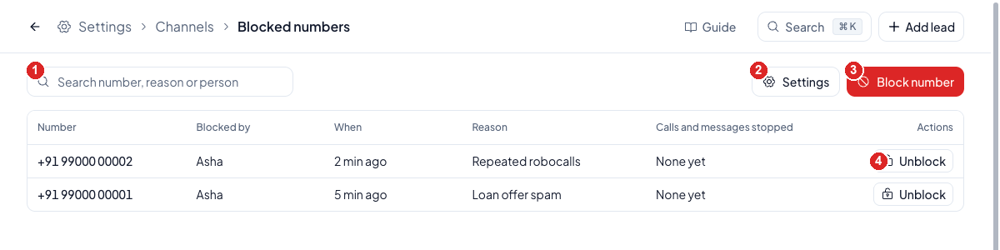
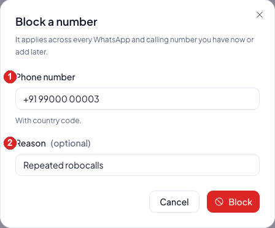
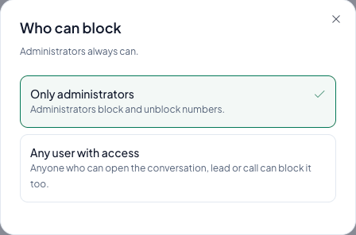

import { Flow } from "/snippets/flow.jsx";

A blocked number cannot reach your business. Its WhatsApp messages and calls are dropped quietly: nobody is alerted, no lead is made, no automation or AI runs, and you are not charged.

<Flow steps={["Blocked number", "Any of your numbers", "Dropped quietly"]} />

The block belongs to your organization and the sender's number, so it still applies if you add or replace a number.

## Block a number

Choose **Block number** from:

| Where | How |
| --- | --- |
| WhatsApp chat in the Inbox | The **⋯** menu |
| A call in Calls | Open the call |
| A lead | **More** on its page |
| The Marro app | The **⋯** sheet of a chat |
| **Settings → Blocked numbers** | **Block number** |

You confirm first, with an optional reason (up to 200 characters). Existing chats, leads and calls stay. A number that belongs to your team cannot be blocked.

## The list

<Frame>
  
</Frame>

1. Search a number, reason or person.
2. **Settings**: who can block (below).
3. **Block number**.
4. **Unblock** lets the number through again at once.

**Calls and messages stopped** counts what the number tried to send you since it was blocked: Marro dropped it and nobody was told. Click a number to see each one.

<Frame>
  
</Frame>

1. The number, with its country code.
2. A reason, if you want one. Your team sees it in the list.

## Who can block

Choose **Settings** on the list.

<Frame>
  
</Frame>

| Setting | Who |
| --- | --- |
| **Only administrators** (default) | Administrators |
| **Any user with access** | Anyone who can open that chat, lead or call |

Only an administrator changes this setting or sees the full list.

## What is stopped

| Channel | Stopped |
| --- | --- |
| WhatsApp | Messages, on every connected number |
| Calls | AI calls and Cloud calls to your numbers, and calls from a provider you connected yourself |
| SMS | Messages to your SMS number. A STOP reply is still honoured |

Earlier messages the person received and group messages are not affected.

<Note>
  **Inbox → Settings → Blocked** is Meta's own list for one WhatsApp number. It covers only people who wrote in the last 24 hours, and not calls.
</Note>

## Ask Marro

<Card title="Try asking" icon="message-circle">
  *"Block 98480 12345"*

  *"Show blocked numbers"*

  For an administrator, Marro asks approval before it blocks or unblocks.
</Card>
