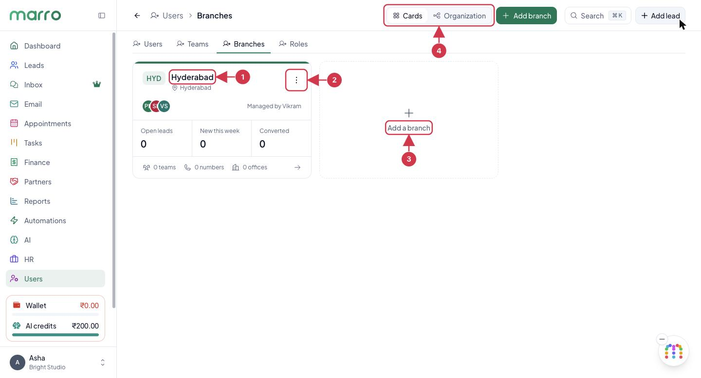
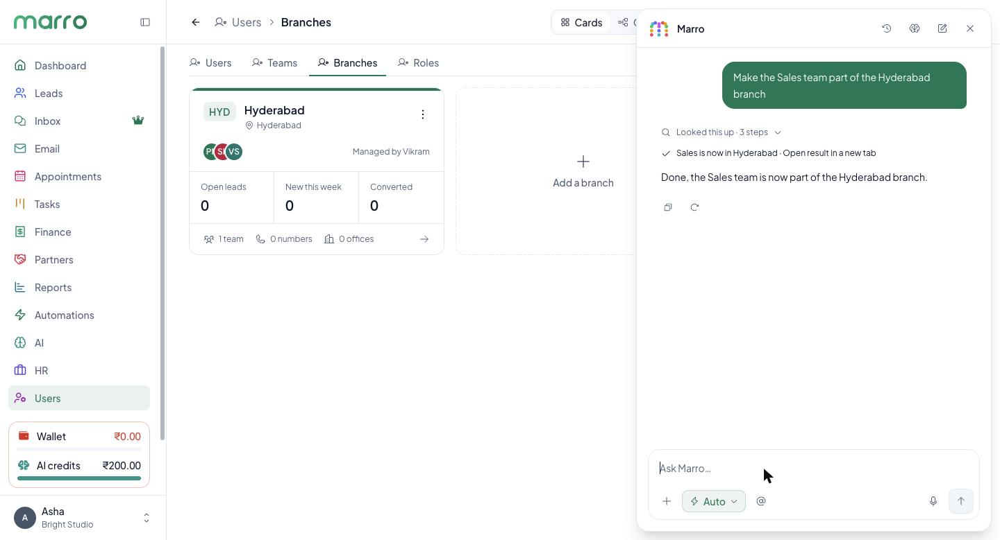

Branches are for businesses with more than one location, such as a clinic chain or an education group. Nothing changes, and every branch control stays hidden, until you add your first branch.

## Add a branch

An organization administrator opens **Users → Branches** and chooses **Add your first branch** (later, **Add branch**).

| Field | Detail |
| --- | --- |
| **Name** | Required |
| **City** | Optional |
| **Short code** | Made from the name, such as *BH* for Banjara Hills. Editable |
| **Colour** | A grey dot means another branch uses it |

The code and colour mark the branch on leads, calls and reports.

## Cards and the organization view

**Cards** shows each branch with its people, manager, this week's open leads, new leads and conversions, and its teams, calling numbers and offices.

<Frame>
  
</Frame>

1. Open a branch.
2. The branch's menu.
3. **Add a branch**.
4. The **Cards** and **Organization** switch.

**Organization** shows every branch side by side, plus **Head office** for people and teams in no branch. Drag a person or team to move them, or use **⋯ → Move … to**. Every move can be undone from its message.

## A branch's page

| Part | What you do |
| --- | --- |
| **People** | Each person works in one branch. **Add people** adds several from head office. **⋯ → Make manager** or **Remove**. A person can manage several branches |
| **Teams**, **Calling numbers**, **Offices** | **Add** brings in what you already have. Taking one from another branch says where it moves from |

**Edit branch** changes name, city, code or colour. **Archive** (card **⋯**) works once the branch has no people or calling numbers. Archived branches keep their history and can be restored.

## Leads and branches

The first that applies sets a lead's branch:

1. **By hand**: **More → Move to branch** on the lead, in bulk from the Leads list, a **Branch** column on import, or the API.
2. **The number they called**: a call to a branch's number creates the lead in that branch.
3. **Its owner**: a lead with no branch takes its owner's branch. A manager's own leads do not.

Assigning a lead to someone in another branch asks whether to move it too. Moves show in the lead's activity. Leads and Calls have a **Branch** filter and column.

## Who sees what

| Where | What it does |
| --- | --- |
| **Users → Roles** | Give a role **See their branch's leads**: the branch's own leads and leads owned by its people, in lists, search, reports, exports, the assistant and the API. It sits between **See their team's leads** and **See all leads** |
| Branch switcher | Anyone who sees more than one branch gets it at the top of the menu: **All branches** or one |

The switcher narrows Leads, Customers, Opportunities, Calls, Inbox, Tasks, the dashboard and reports. It never shows more than you could already see.

## Compare branches

**Reports → Branches** (with two or more branches) puts them side by side for a period. Download as CSV.

| Measure |
| --- |
| Leads in |
| Contacted |
| Converted |
| Conversion rate |
| Calls answered and missed |
| Typical first reply |

## Ask Marro

<Card title="Try asking" icon="message-circle">
  *"Add a branch called Hyderabad and make Vikram Shetty its manager"*

  *"Make the Sales team part of the Hyderabad branch"*

  Marro does it in one step and opens the branch.
</Card>

<Frame>
  
</Frame>
