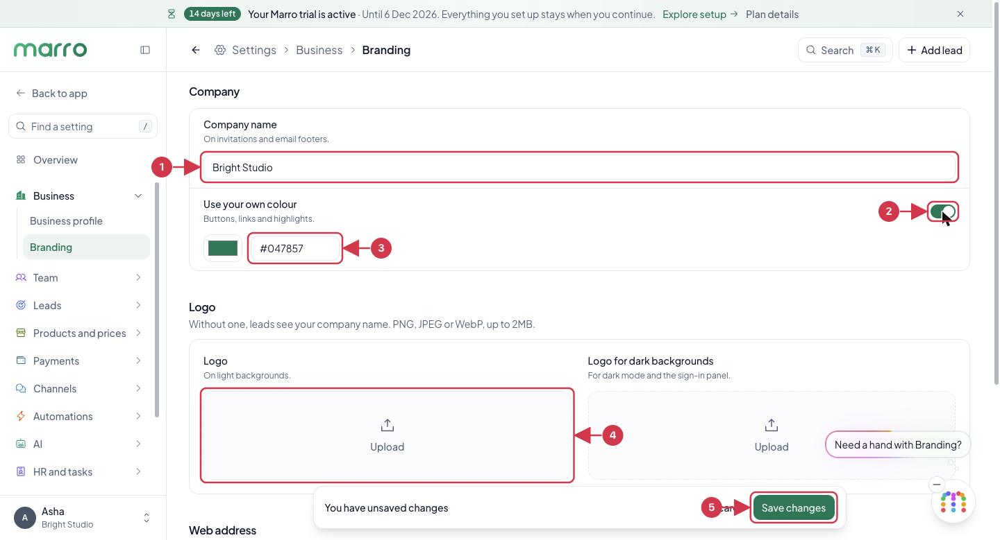
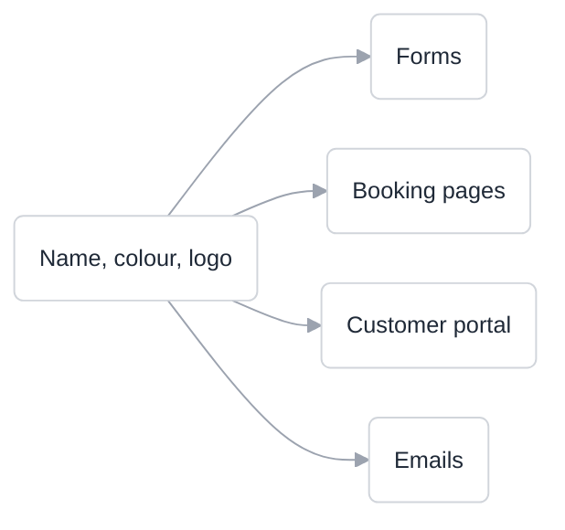

Open **Settings → Business → Branding**. Your name, colour and logo appear on forms, booking pages, the customer portal and emails.

## Set your brand

<Frame>
  
</Frame>

<Steps>
  <Step title="Company name">Type the name customers know you by.</Step>
  <Step title="Colour">Turn on **Use your own colour**, then type or pick it.</Step>
  <Step title="Logo">**Upload logo**. You can add one for dark backgrounds too.</Step>
  <Step title="Save">Choose **Save changes**.</Step>
</Steps>

## Where it shows

## Ask Marro

<Card title="Try asking" icon="message-circle">
  *"Change our brand colour to #0f766e"*

  Marro shows the change and asks before saving.
</Card>
