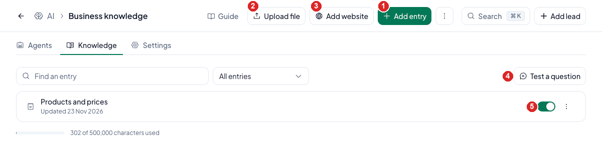
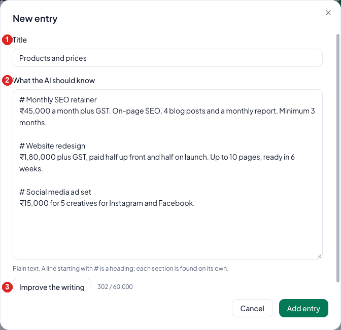
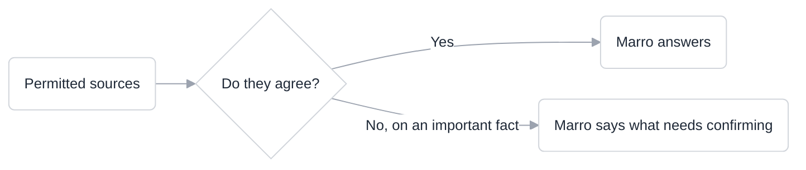

import { Flow } from "/snippets/flow.jsx";

Business knowledge is what you write down about your business for the AI. The assistant, suggested replies and agents use it. Agents check the catalogue first for prices. When it has no matching price, they can quote a price from an active knowledge entry visible to the audience. Include the item, amount, currency and billing period or unit. If the terms conflict or are unclear, the agent asks for clarification. Subscriptions, payments and appointment times come from their live records. If a fact cannot be confirmed, Marro says so.

Open **AI → Knowledge**. Administrators can use it by default; other roles can be given permission. It is part of Marro AI, on every plan. Without AI, what you wrote is kept and returns when AI is on.

<Flow steps={["Add entry, file or website", "Test a question", "AI uses it in answers"]} />

<Frame>
  
</Frame>

1. **Add entry**.
2. **Upload file**.
3. **Add website**.
4. **Test a question**: see what the AI finds for it.
5. Switch an entry off to keep it but stop the AI using it.

## Add knowledge

| Way | What to do |
| --- | --- |
| **Add entry** | A title and plain text. One topic per entry, as if briefing a new colleague |
| **Upload file** | `.txt` or `.md` up to 256 KB becomes an editable entry |
| **Add website** | See below |

<Frame>
  
</Frame>

1. **Title**: one topic per entry.
2. **What the AI should know**: plain text. A line starting with `#` is a heading, and each section is found on its own.
3. **Improve it with Marro** rewrites it more clearly.

For a PDF, JPEG or PNG (one file, up to 3 MiB), add the text you want agents to search. It starts switched off with staff visibility: review its text and access first. Choose **Extract text** to draft the text using your AI allowance. This sends the file for AI processing. Check names, prices and dates against the original, then **Use this version**.

## Add a website

<Steps>
  <Step title="Enter the address">
    Press **Add website**, enter a public website or section address, then **Start import**. You can leave while it runs.
  </Step>
  <Step title="Review the pages">
    Marro reads up to **100 pages**. Progress shows how many were imported or skipped. Switch off or delete any entry you don't want used.
  </Step>
</Steps>

- **Cancel** in the import row stops it. Pages already imported stay.
- For large sites, give a section such as your services or help pages.
- Marro respects robots.txt and skips files and repeated pages.
- A page built with scripts may have too little text. Paste its text into an entry.
- Importing again updates entries. The refresh button on an entry re-reads one page.
- Up to ten imports an hour, one at a time.

## Enhance with AI

<Steps>
  <Step title="Press Enhance with AI">While editing. It tidies the text into sections, keeping every fact. A missing figure, link or email is named.</Step>
  <Step title="Compare">An **Improved version** appears beside yours.</Step>
  <Step title="Choose">**Use this version** or **Keep mine**.</Step>
  <Step title="Save">Nothing saves until you press **Save**.</Step>
</Steps>

## Check what the AI will see

| Tool | Use |
| --- | --- |
| **Find an entry** and the filter | Search by title, file name or source address, 20 per page |
| **Test a question** | Shows the passages the AI would be given. Find it in **More for Business knowledge** if the library is empty |
| Switch an entry off | The AI stops using it. Nothing is deleted |

**Test a question** uses your own access, so it can show staff-only entries. Customer agents see only public ones.

## Limits

| Limit | Amount |
| --- | --- |
| One entry | 60,000 characters |
| Your organization | 500,000 characters and 300 entries |

## Access and validity

Open an entry's menu and choose **Access and validity**.

| Setting | What it does |
| --- | --- |
| **Staff and customer replies** | Allows customer-facing use. Existing entries keep their setting until reviewed |
| **Staff only** | Keeps it out of customer replies. Choose roles and branches; both must match. None selected means all staff |
| **Effective from**, **Expires on** | Limit when it can be used, from midnight in your timezone. Blank means no limit |
| **Replaced by** | Another entry supersedes this one. The old one is excluded from AI |
| **I reviewed these facts and confirm this revision is accurate** | Records your confirmation. Editing or refreshing the text clears it |

A review does not prove a payment succeeded, an appointment is free or a customer has a subscription. Marro checks live records for those, and checks a customer’s agreed quote separately from general pricing.

## Review voice pricing

Open **More for Business knowledge → Voice pricing review**, or press **Review** above the entries. It groups pricing problems from up to 200 completed calls in the last 30 days.

<Steps>
  <Step title="Review the issues">
    Missing or unclear prices, failed lookups and figures to verify.
  </Step>
  <Step title="Fix the catalogue">
    Press **Open catalogue** and correct it there.
  </Step>
  <Step title="Test it">
    Enter the exact item name and select **Test voice price**. You see the lookup in English, Hinglish and Telugu. No call is placed.
  </Step>
</Steps>

## Ask Marro

<Card title="Try asking" icon="message-circle">
  *"Show the voice pricing review"*

  *"Test the voice price for Gold facial"*

  Marro runs the review or the test. Drafted customer replies use customer-audience knowledge only.
</Card>

## When sources disagree

Answers stay conversational and don't name documents unless you ask to see sources.

Marro does not pick by date.
