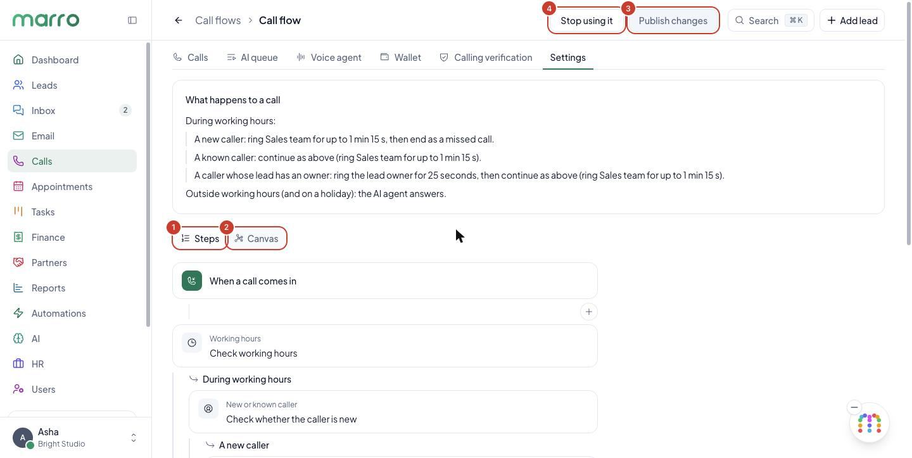
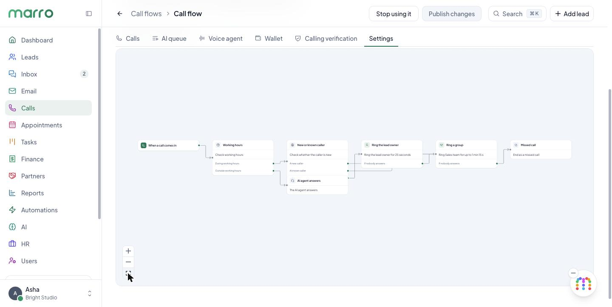
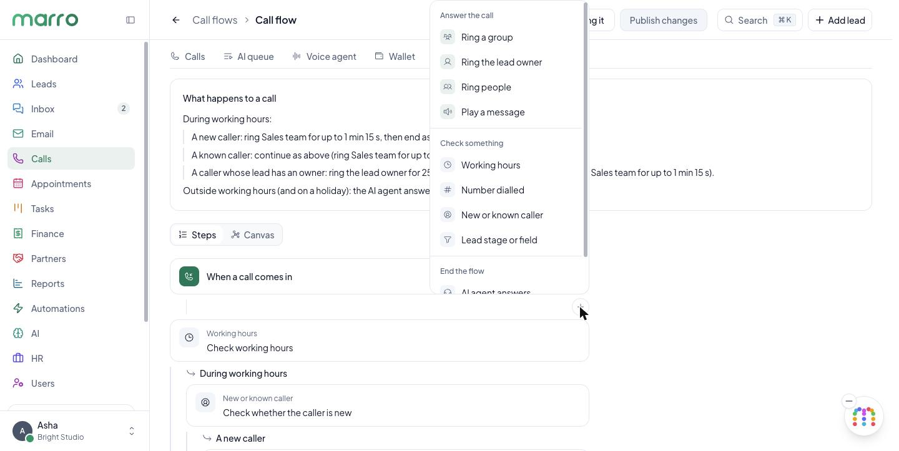

Most businesses only need [Who answers](/guides/who-answers). For menus or checks on new and known callers, open **Calls → Settings → More options → Call flows**.

## Step types

<Frame>
  
</Frame>

| Step | What it does |
| --- | --- |
| **Check something** | Working hours, the number dialled, new or known caller, owner, stage or source. |
| **Answer the call** | Ring a group or owner, hand to the AI agent, or play a message. |
| **End the flow** | A missed call with your alerts. |

## Steps or canvas

<Frame>
  
</Frame>

Build the flow as a list of steps, or on the canvas. Add a step from the menu.

<Frame>
  
</Frame>

## Publish or stop using it

<Steps>
  <Step title="Save draft">Changes nothing for callers.</Step>
  <Step title="Publish">Makes the flow live.</Step>
  <Step title="Stop using it">Goes back to your ordinary [Who answers](/guides/who-answers) settings.</Step>
</Steps>

Each call shows its path in plain words, such as *Dialled Shop A · rang Telugu team · answered by Priya*.

## Ask Marro

<Card title="Try asking" icon="message-circle">
  *"What does our call flow do after working hours?"*

  Marro reads the published flow back in plain words.
</Card>
