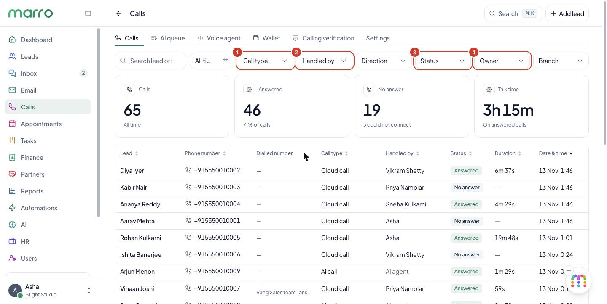
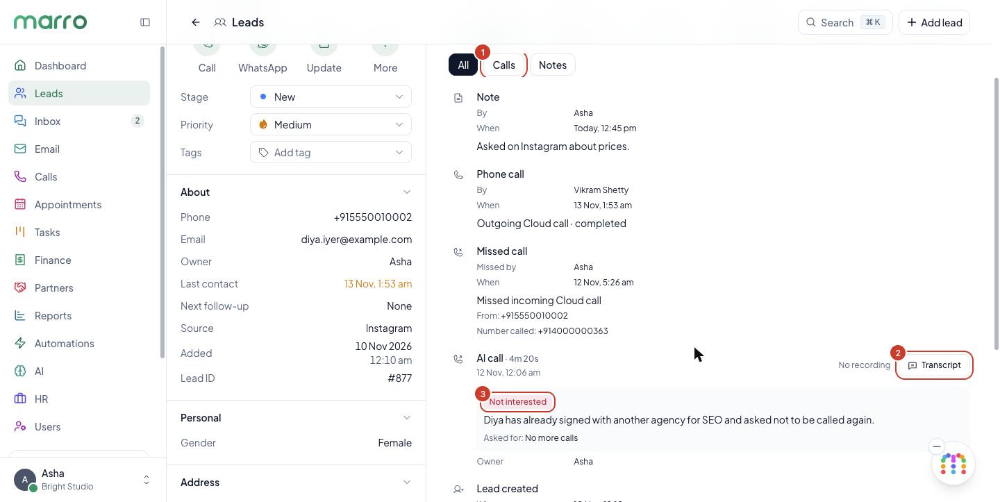
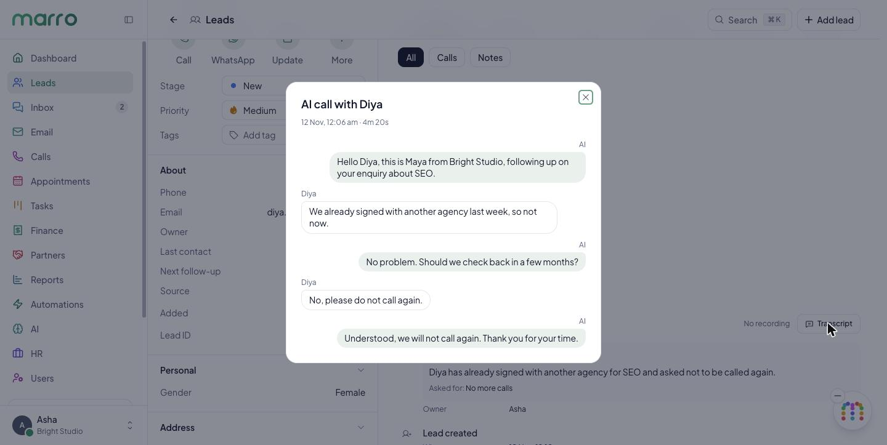
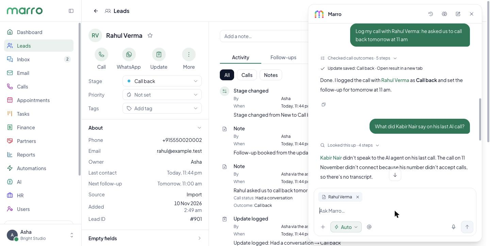

**Calls** in the sidebar is your call log: AI calls, Cloud calls and calls from a connected service such as MCube, Exotel or Tata Smartflo. Each person sees the calls of leads they can open.

## The Calls list

<Frame>
  
</Frame>

| Call type | Meaning |
| --- | --- |
| **AI call** | Your AI voice agent. |
| **Cloud call** | Your team, through your business number. |
| **Bridge call** | Your team, through a service you connected, for example **Bridge call · MCube**. |

Filter by date, type, handled by, direction, status (**Answered**, **Missed**, **No answer**, **Failed**, **In progress**, **Waiting**) and lead owner.

## A lead’s calls

<Frame>
  
</Frame>

Open the lead and go to **Activity → Calls**. Each call shows its path in plain words, its recording and its summary.

## Recording and transcript

<Frame>
  
</Frame>

<Steps>
  <Step title="Open the call">Select it in **Calls**, or on the lead’s **Activity → Calls**.</Step>
  <Step title="Choose Recording or Transcript">Request a transcript if AI access is on.</Step>
  <Step title="Choose Analyse call">You get a summary, objections, commitments and follow-up. It creates no notes or tasks.</Step>
</Steps>

## Log the result

<Frame>
  
</Frame>

After a call, record how it went from the lead, or ask Marro to do it.

<Steps>
  <Step title="Open Update">On the lead, click **Update**.</Step>
  <Step title="Pick the call status">**Had a conversation**, **Could not reach them**, **Wrong number** or **Language barrier**.</Step>
  <Step title="Pick the outcome">Add the follow-up date when the outcome books one.</Step>
  <Step title="Fill in the rest">Answer the fields your team asks for and add a note.</Step>
  <Step title="Save update">The lead moves to the stage that outcome leads to.</Step>
</Steps>

## Ask Marro

<Card title="Try asking" icon="message-circle">
  *"Log that I spoke to Ravi and he wants a callback tomorrow."*

  Marro prepares the note and follow-up for you to approve.
</Card>
