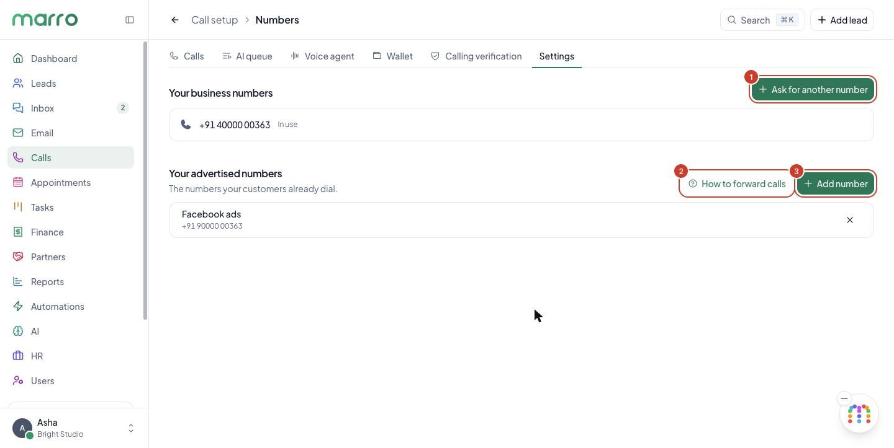
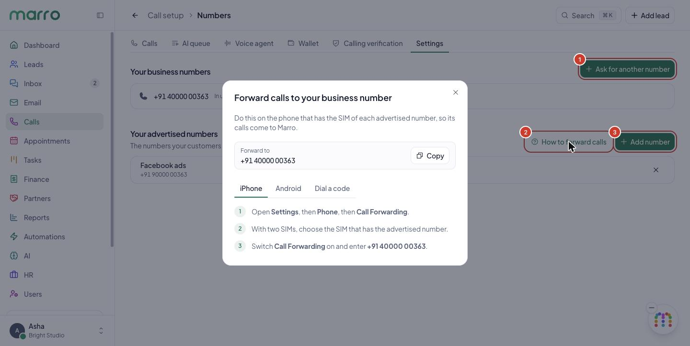

import { Flow } from "/snippets/flow.jsx";

Your business numbers are the numbers customers reach and your team calls from. Open **Calls → Settings → Numbers**.

## Your numbers

<Frame>
  
</Frame>

Each business number shows its **Renews on** date. Rent is taken from the wallet every month. If the wallet cannot pay, calls on that number stop, and a number left unpaid is released within 7 days and cannot be used again.

## Rent another number

<Steps>
  <Step title="Open Numbers">Go to **Calls → Settings → Numbers** and choose **Rent another number**.</Step>
  <Step title="Check the price">The first month comes from your wallet now.</Step>
  <Step title="Confirm">The number is set up straight away and you get an email.</Step>
</Steps>

At your limit, the button reads **Ask for another number**. Marro looks at it and emails you.

## Keep your advertised number

Customers keep dialling the number you advertise. Add each one under **Your advertised numbers** with a label. Marro will not ring those numbers, so a call cannot loop back.

<Flow steps={["Customer dials your advertised number", "Your network forwards it", "Business number in Marro", "Your team answers"]} />

- Outgoing calls show your business number, not the advertised one.
- Several advertised numbers can forward to one business number. If the network passes it on, the call shows **Dialled +91 …**. Make a test call to check yours.

## Forward calls to Marro

<Frame>
  
</Frame>

<Steps>
  <Step title="Open your phone settings">On the SIM that has the advertised number, go to **Settings → Calls → Call forwarding**.</Step>
  <Step title="Forward to your business number">Enter your business number and turn forwarding on.</Step>
  <Step title="Test it">Call your advertised number from another phone.</Step>
</Steps>

## Ask Marro

<Card title="Try asking" icon="message-circle">
  *"Which numbers do we have and when do they renew?"*

  Marro lists your business and advertised numbers with their renewal dates.
</Card>
