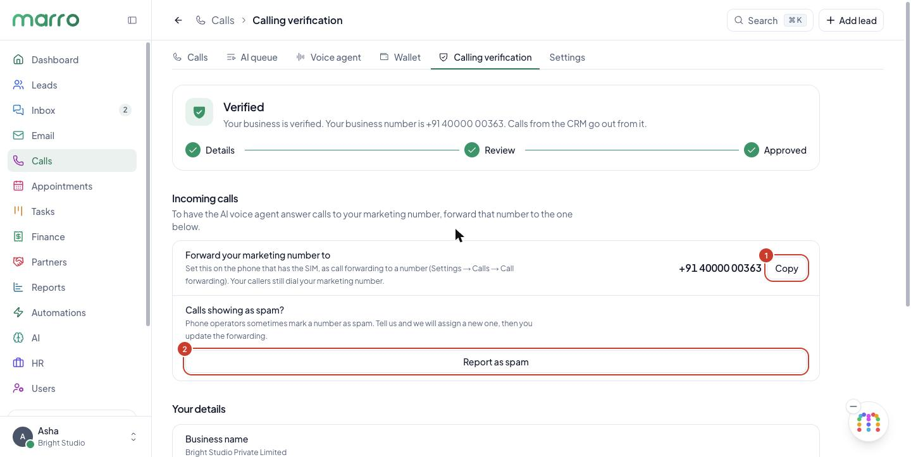

import { Flow } from "/snippets/flow.jsx";

Calling needs your business verified first. Open **Settings → Voice → Calling verification** (you need permission to manage settings).

## Details, review, approved

<Frame>
  
</Frame>

Most Indian businesses are checked automatically within minutes. The page shows **Verified**, or **Changes needed** with the reason. We email you the result.

## Send your details

<Steps>
  <Step title="Choose your registration">Enter a **GSTIN**, **CIN**, **LLPIN** or **Udyam number** in India, or your **ABN** in Australia. Working on your own? Register free on the Udyam portal.</Step>
  <Step title="Add business details">Registered name and address, an authorised person, and what you will use AI calls for.</Step>
  <Step title="Attach the certificate">PDF, JPEG or PNG, up to 5 MB, signed and sealed by an authorised signatory. Only Marro’s team can open it.</Step>
  <Step title="Business number">Leave **Get a business number** ticked to have one set up, at the monthly price shown, paid from your [wallet](/guides/billing).</Step>
  <Step title="Confirm the calling rules">You call people who enquired or agreed to hear from you, respect the Do Not Disturb register, and call between 9 am and 9 pm.</Step>
</Steps>

## Forward your marketing number

To have the agent answer your advertised number, forward it (phone **Settings → Calls → Call forwarding**) to the Marro number under **Incoming calls**.

<Steps>
  <Step title="Copy the number">Find it under **Incoming calls** on this page.</Step>
  <Step title="Forward your marketing number">In your phone’s call forwarding settings.</Step>
</Steps>

## Report as spam

If an operator marks your number as spam, report it here:

<Flow steps={["Report as spam", "New number assigned", "Update your forwarding by the date shown", "Forwarding confirmed"]} />

Calls to the old number still reach you until that date.

## Ask Marro

<Card title="Try asking" icon="message-circle">
  *"Is our calling verification approved?"*

  Marro tells you the status and what is still needed.
</Card>
