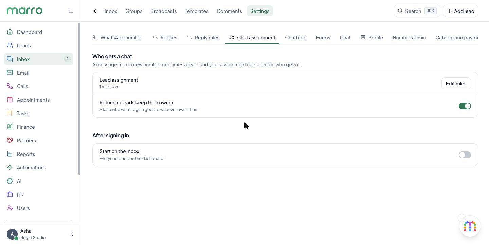

**Inbox → Settings → Team & chat → Chat assignment** decides who gets a chat when someone writes. A message from a new number becomes a lead, and your assignment rules decide who gets it.

## Who gets a chat

<Frame>
  
</Frame>

## The two settings

| Setting | What it does |
| --- | --- |
| **Lead assignment** | Shows how many rules are on. **Edit rules** opens **Settings → Assignment → Rules**. With none on, new chats wait until someone assigns them. Without permission, ask an administrator |
| **Returning leads keep their owner** | On: a lead who writes again goes to whoever owns them. Off: they are handed out as if new |

## Change it

<Steps>
  <Step title="Open the page">Go to **Inbox → Settings → Team & chat → Chat assignment**.</Step>
  <Step title="Edit the rules">Press **Edit rules** to change who gets leads.</Step>
  <Step title="Choose for returning leads">Switch **Returning leads keep their owner** on or off.</Step>
</Steps>

## Ask Marro

<Card title="Try asking" icon="message-circle">
  *"Who owns this chat?"*

  *"Give this chat back to its owner"*

  Marro asks your approval before assigning.
</Card>
