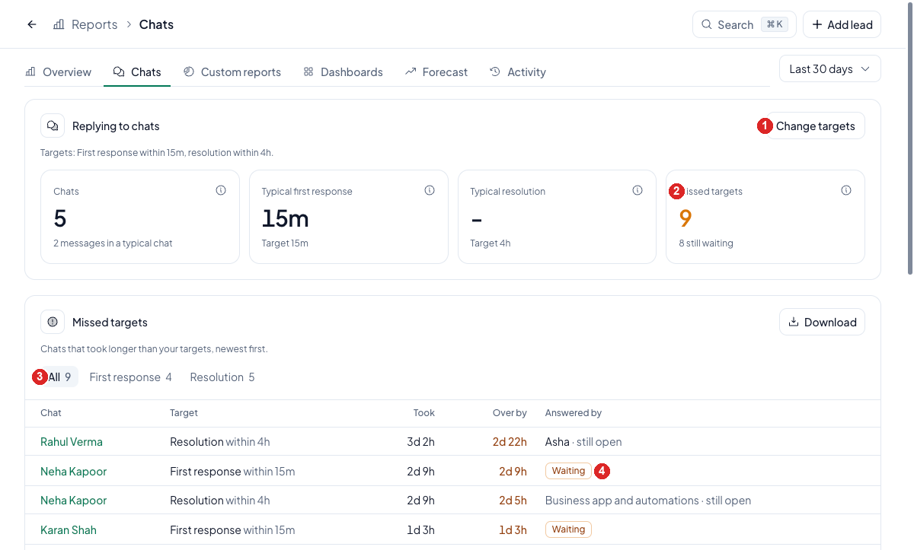

Open **Reports → Chats** to see how long customers wait for a first reply, how long chats take to close, and how many messages each needs. It is for people who can see all leads, because it names who answered.

<Frame>
  
</Frame>

1. **Change targets**.
2. **Missed targets**: how many chats went over, and how many are still waiting.
3. Show all, or only first response or resolution.
4. **Waiting**: nobody has replied yet.

## What is counted

A chat is counted when a customer starts waiting: their first message, or their first message after a chat was closed. Only chats that **started** in the period you choose are counted.

| Measure | What it is |
| --- | --- |
| **First response** | Time to the first reply from a person. Replies typed on the WhatsApp Business app count. Automatic replies, the AI receptionist and welcome or away messages don't |
| **Resolution** | Time until someone closes the chat |
| **Messages per chat** | Every message in that stretch, both ways |

Figures show the typical (median) time, so one very slow chat doesn't distort them. You see them **by person** and, with more than one WhatsApp number, **by number**.

## Set targets

Administrators set targets in minutes. Leave a box empty for no target. Nothing counts as missed until you set one.

| Setting | Effect |
| --- | --- |
| **First response** target | Minutes allowed for a first reply |
| **Resolution** target | Minutes allowed to close |
| **Count business hours only** | Counts just Monday to Saturday, 10:00 to 18:00, in your organization's time zone |

## Missed targets

The **Missed targets** list shows each chat that went over, newest first.

| Column | Shows |
| --- | --- |
| Took | How long it took, or has taken so far |
| Over by | How far past the target |
| Answered by | Who replied, **Waiting** if nobody has, and **still open** if it is not closed |

Replies from the WhatsApp Business app or an automation show as **Business app and automations**. Select a chat to open it. **Download** saves the list.

## Notes, locations and contacts

<CardGroup cols={3}>
  <Card title="Internal notes" icon="note-pencil">Under a conversation. Team only, never sent. Mention a colleague with **Mention** (or `@`) to notify them.</Card>
  <Card title="Location" icon="map-pin">Opens in your maps app. Send one with the pin button next to the message box.</Card>
  <Card title="Contact" icon="address-book">Shows numbers with a **Copy** button.</Card>
</CardGroup>

Sending a location or contact needs an open 24-hour window.

## Ask Marro

<Card title="Try asking" icon="message-circle">
  *"How fast did we reply to chats this week?"*

  *"Set the first response target to 15 minutes."*

  Marro answers from the report and asks you to approve any change.
</Card>
