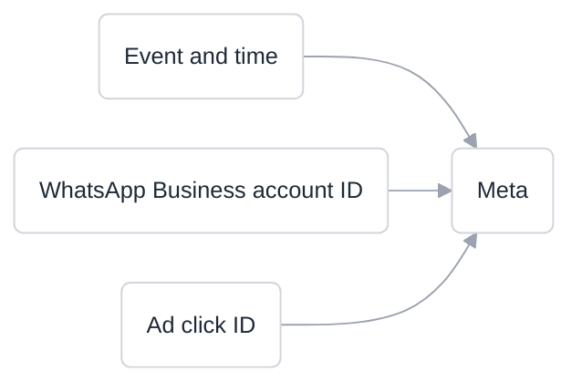

When someone taps your click-to-WhatsApp ad and messages you, Marro keeps the ad with the lead: its headline, link and, where Meta gives one, the ad's click ID. A chat that did not come from an ad shows no ad.

## On the lead and in the chat

| Where | Shows |
| --- | --- |
| Lead's **Ad source** | Headline, **Open the ad**, and whether a click ID was kept |
| The chat | **From an ad** with the headline above the reply box |
| Lead's **Sent to Meta** | If sending is on: chat started, qualified lead, purchase, each waiting, sent, not sent (with reason) or too old to send |

Ads shown in WhatsApp Status carry no click ID, so their results can't be sent to Meta.

## Reports → Ads

For the period you pick, each ad shows:

| Column | Meaning |
| --- | --- |
| Chats started | A lead counts under the ad of its first click-to-WhatsApp chat |
| Stage | Where those leads are |
| Won | How many are won |
| Events sent | Events sent to Meta |
| Cost per chat, cost per win | Only if you entered spend |

To see costs, an administrator who sees every lead enters a month's spend per ad under the table (the ad ID is under each headline). Marro does not read spend from Meta.

## Send results to Meta

Off until an administrator turns it on in **Reports → Ads → Send results to Meta**.

<Steps>
  <Step title="Choose the WhatsApp number">
    The one you run ads for. Its access token needs Meta's `whatsapp_business_management` and `whatsapp_business_manage_events` permissions.
  </Step>
  <Step title="Find the dataset">
    Press **Find**. Meta returns the dataset linked to your WhatsApp Business account, or makes one. You can paste its ID instead.
  </Step>
  <Step title="Choose the stages">
    Pick the stage for a **qualified lead** and for a **purchase**. A lead entering it is sent once.
  </Step>
  <Step title="Confirm and turn on">
    Confirm your customers agreed to their ad activity being shared with Meta, then turn on **Send results to Meta**. Try a test event code from Events Manager first, then clear it.
  </Step>
</Steps>

## What is sent

- A purchase includes its value when the lead has paid payments. Never the person's name, number or messages.
- Only leads from an ad with a click ID. Earlier chats are never sent, and Meta refuses events older than 7 days.
- Each event goes once per lead. If Meta can't be reached, Marro retries after 1 minute, 5 minutes, 30 minutes, 2 hours and 8 hours. A refusal shows as not sent with the reason, and **Try failed again** appears once you fix it.
- Businesses in health and other sensitive industries are never sent, because Meta forbids it.
- Meta bills you directly for WhatsApp messages. This adds no charge.

Google Ads and TikTok are not connected: Google's offline upload accepts only Google click IDs, which a WhatsApp chat does not carry.

## Ask Marro

<Card title="Try asking" icon="message-circle">
  *"Which ad brought the most chats this month?"*

  *"Is sending to Meta on, and how many failed?"*

  Marro can also change settings, enter spend or retry failed events after you approve. It never shows an access token.
</Card>
