Cloud calls connect your team’s phones with leads. Incoming calls reach your team or an [AI voice agent](/guides/ai-calling). An organization administrator sets it up in **Calls → Settings**.

## Set up your calls

**Call setup** has five steps. Each says whether it is done, being handled by Marro, or yours to do.

<Frame>
  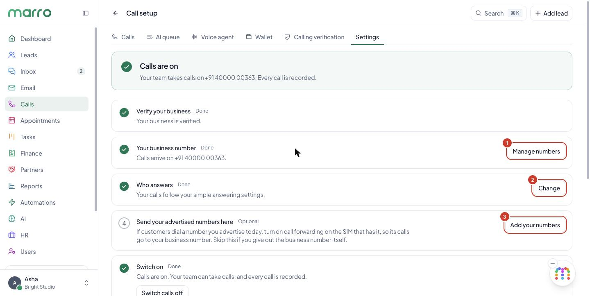
</Frame>

<Steps>
  <Step title="Verify your business">Calls need your business registration. We email you when it is checked.</Step>
  <Step title="Your business number">Marro sets it up once you are verified and emails you. Nothing to do.</Step>
  <Step title="Who answers">Choose who gets your calls.</Step>
  <Step title="Send your advertised numbers here">Optional.</Step>
  <Step title="Switch on">Choose **Switch calls on**, then call your business number from another phone to try it.</Step>
</Steps>

**Switch calls off** stops calls reaching your team and keeps everything you set up. **More options** has greeting and waiting music, call flows, ring groups and rules for one number.

<Frame>
  
</Frame>

## Rent another number

<Steps>
  <Step title="Open Numbers">Go to **Calls → Settings → Numbers** and choose **Rent another number**.</Step>
  <Step title="Check the price">The first month comes from your wallet now.</Step>
  <Step title="Confirm">The number is set up straight away and you get an email.</Step>
</Steps>

- Rent is taken from the wallet every month. **Renews on** shows the date.
- If the wallet cannot pay, calls on that number stop. A number left unpaid is released within 7 days and cannot be used again.
- At your limit, the button reads **Ask for another number**. Marro looks at it and emails you.

## Keep your marketing number

Customers keep dialling the number you advertise. Turn on call forwarding on that SIM (phone **Settings → Calls → Call forwarding**) to your business number.

<Frame>
  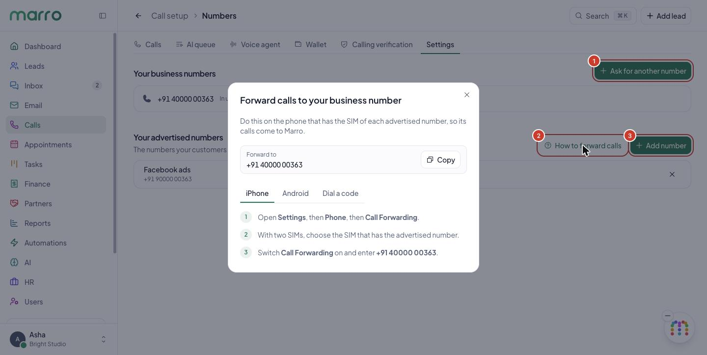
</Frame>

- Outgoing calls show your business number, not the advertised one.
- Several advertised numbers can forward to one business number. If the network passes it on, the call shows **Dialled +91 …**. Make a test call to check yours.
- In **Numbers → Your advertised numbers**, add each forwarding number with a label. Marro will not ring those numbers, so a call cannot loop back.

<Frame>
  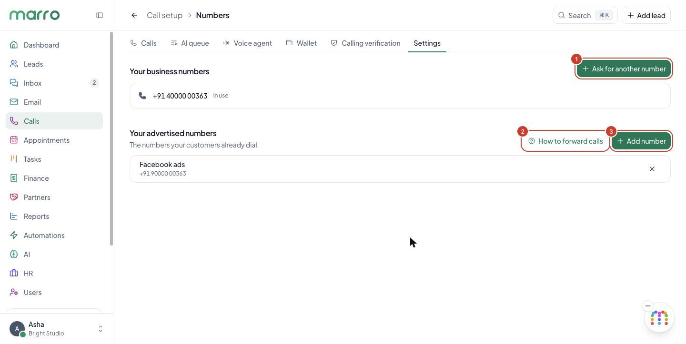
</Frame>

## Choose who answers

**Calls → Settings → Who answers** is one list of rules. The first rule that matches the number called is used. The last rule covers every other call.

<Frame>
  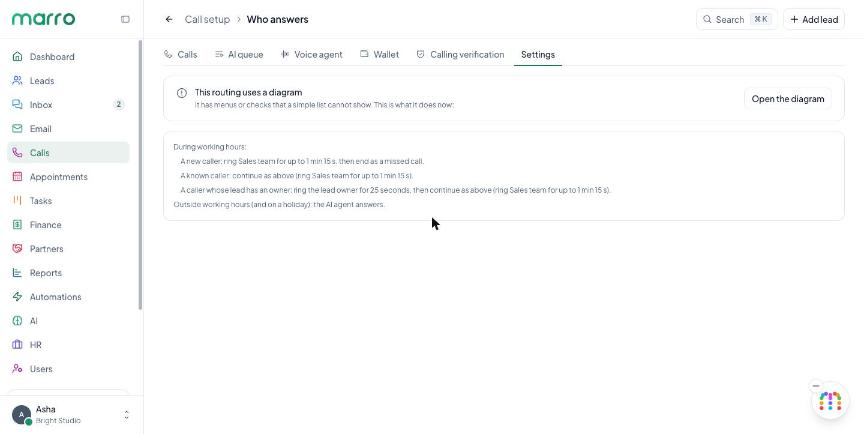
</Frame>

| Setting | What it does |
| --- | --- |
| **If the call is to** | Pick numbers. Each number can ring a different team. |
| **The call goes to** | Staff, the AI agent, or nobody (a missed call). |
| **Ring** | A team, a ring group, the lead’s owner or chosen people, and **Give up after**. |
| **Ring someone else first** | Adds a second step if nobody answers. |
| **Different outside working hours and on holidays** | Another handling for those times. Hours come from your HR working week and holidays. |

Choose **Save and use these rules**. Fix anything shown at the bottom first, such as a rule with no numbers or ringing over five minutes. People need active access and a registered phone number. Busy or away staff are skipped.

## Ring groups

A ring group is a named list of staff, such as *Shop A*. To use a team you already have, choose the team instead.

<Frame>
  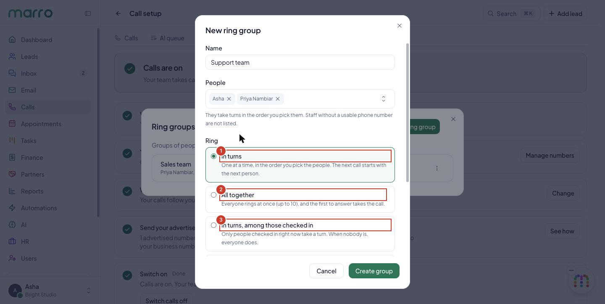
</Frame>

1. Open **More options → Ring groups** and choose **Add ring group**.
2. Add a **Name**, pick the **People** and **Ring for**.
3. In **Who answers**, choose **A ring group**.

| Ring style | How it rings |
| --- | --- |
| **In turns** | One person at a time. |
| **All together** | Everyone, up to 10. |
| **In turns, among those checked in** | Only people checked in. |
| **Fewest calls today** | Whoever has answered the fewest. |
| **The lead's owner first** | The owner, then the rest in turns. |

A group still in use cannot be deleted.

## Call flows

Most businesses only need **Who answers**. For menus or checks on new and known callers, open **More options → Call flows**.

<Frame>
  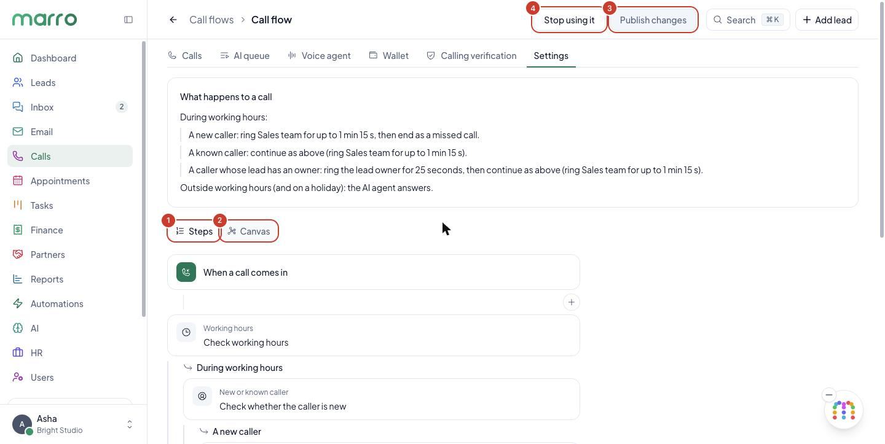
</Frame>

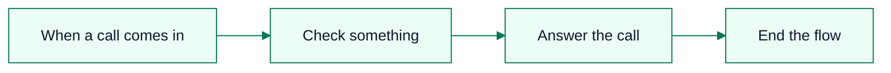

- **Check something:** working hours, the number dialled, new or known caller, owner, stage or source.
- **Answer the call:** ring a group or owner, hand to the AI agent, or play a message.
- **End the flow:** a missed call with your alerts.

**Save draft** changes nothing for callers. **Publish** makes it live. **Stop using it** goes back to ordinary settings. Each call shows its path in plain words, such as *Dialled Shop A · rang Telugu team · answered by Priya*.

## Greeting and waiting music

<Frame>
  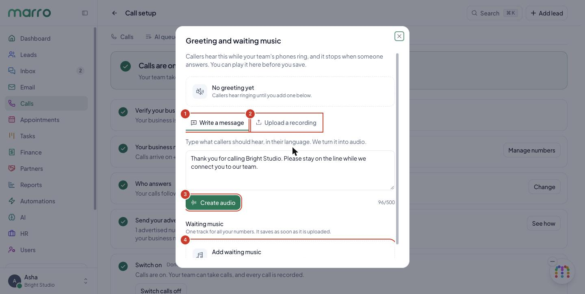
</Frame>

- **Greeting:** type a message and choose **Create audio**, or upload an MP3 or WAV up to 5 MB.
- **Waiting music:** **More options → Greeting and waiting music → Add waiting music**. One MP3 or WAV, at least five seconds, up to 5 MB.
- Callers hear them while staff ring. Press play to hear what callers hear.

## Missed calls

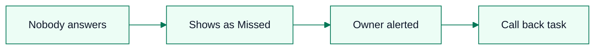

- A new number creates a lead with source **Phone call**.
- The lead’s owner is alerted by email, WhatsApp and the app.
- With the voicemail pilot on, Marro can record a message and creates a **Call back missed caller** task.

## Call a lead

Open the lead, choose **Call**, then **Cloud call**. Your registered phone rings first. Answer it, and the lead’s phone rings. The lead sees your business number.

<Frame>
  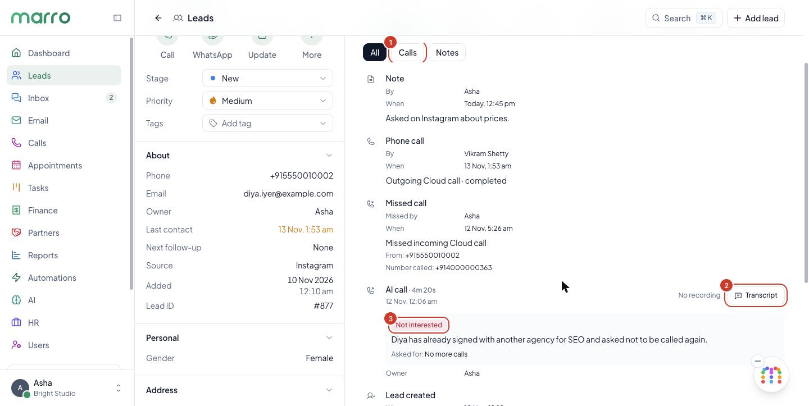
</Frame>

If a request seems stuck, check its saved status before calling again. The first call may already be ringing. **Calls** lists every call you can see: [see your calls](/guides/ai-calling#see-your-calls).

## Charges and the wallet

| When | What happens |
| --- | --- |
| Call starts | 10 minutes are set aside from the wallet. |
| Call goes on | The next 10 are set aside, up to 60 minutes. |
| Wallet runs low | Both sides hear the call will end soon. Add money and it carries on. |
| Call ends | Only the call charge is taken. The rest is freed. |

Charges read **Cloud call answered, 44 s**, **Cloud call not answered** or **Cloud call did not connect: nothing charged**.

## Recordings and analysis

Connected calls are recorded, without an announcement. Recordings are private to people with access to that lead.

<Frame>
  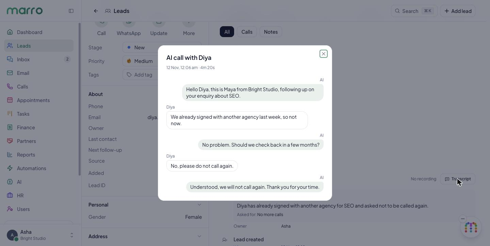
</Frame>

1. On the lead’s **Activity → Calls**, choose **Recording** or **Transcript**.
2. Request a transcript if AI access is on.
3. Choose **Analyse call** for a summary, objections, commitments and follow-up. It creates no notes or tasks.

If **Call reviewer** is on in [AI → Agents](/guides/agents), each recorded call is read automatically for [automations](/guides/automations#after-a-call).

## Ask Marro

<Frame>
  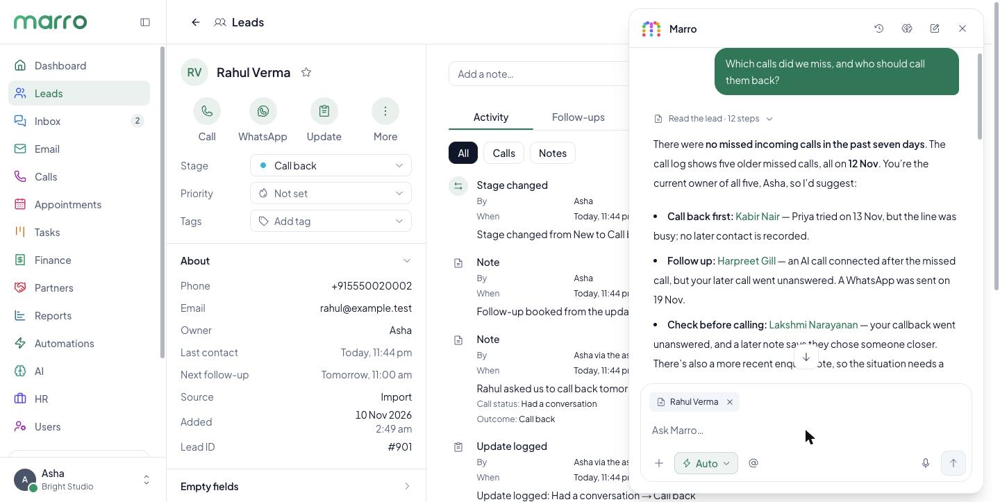
</Frame>

<Card title="Try asking" icon="message-circle">
  *"Which calls did we miss today and who should call back?"*

  Marro lists missed calls and who owns each lead.
</Card>
