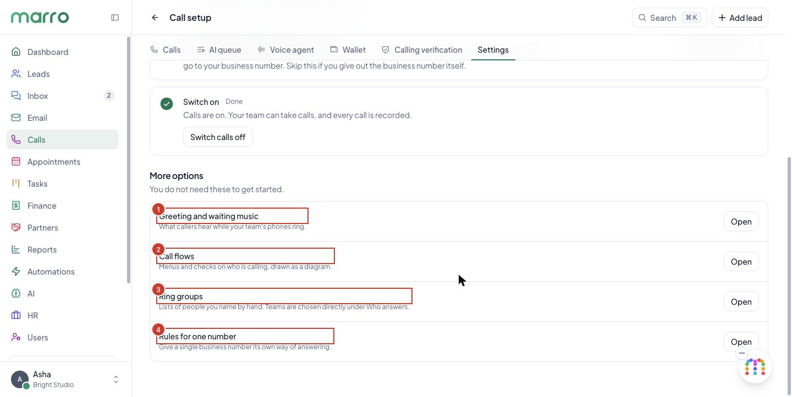

import { Flow } from "/snippets/flow.jsx";

Cloud calls connect your team’s phones with leads. Incoming calls reach your team or an [AI voice agent](/guides/ai-calling). An organization administrator sets it up in **Calls → Settings**.

## Set up your calls

**Call setup** has five steps. Each says whether it is done, being handled by Marro, or yours to do.

<Frame>
  
</Frame>

<Steps>
  <Step title="Verify your business">Calls need your business registration. We email you when it is checked.</Step>
  <Step title="Your business number">Marro sets it up once you are verified and emails you. Nothing to do. See [Business numbers](/guides/call-numbers).</Step>
  <Step title="Who answers">Choose who gets your calls. See [Who answers](/guides/who-answers).</Step>
  <Step title="Send your advertised numbers here">Optional. See [Business numbers](/guides/call-numbers).</Step>
  <Step title="Switch on">Choose **Switch calls on**, then call your business number from another phone to try it.</Step>
</Steps>

**Switch calls off** stops calls reaching your team and keeps everything you set up.

## Each setting has its own guide

<Frame>
  
</Frame>

<CardGroup cols={2}>
  <Card title="Who answers" icon="phone-incoming" href="/guides/who-answers">Choose who gets each call.</Card>
  <Card title="Business numbers" icon="hash" href="/guides/call-numbers">Rent numbers, advertised numbers, forwarding.</Card>
  <Card title="Greeting and music" icon="music" href="/guides/greeting-and-music">What callers hear while staff ring.</Card>
  <Card title="Ring groups" icon="users" href="/guides/ring-groups">Named lists of staff and five ring styles.</Card>
  <Card title="Call flows" icon="git-branch" href="/guides/call-flows">Menus and checks for new and known callers.</Card>
  <Card title="Rules for one number" icon="settings" href="/guides/rules-for-one-number">Give one number its own handling.</Card>
  <Card title="Call log" icon="list" href="/guides/call-log">Every call, filters, transcripts.</Card>
</CardGroup>

## Missed calls

<Flow steps={["Nobody answers", "Shows as Missed", "Owner alerted", "Call back task"]} />

- A new number creates a lead with source **Phone call**.
- The lead’s owner is alerted by email, WhatsApp and the app.
- With the voicemail pilot on, Marro can record a message and creates a **Call back missed caller** task.

## Call a lead

Open the lead, choose **Call**, then **Cloud call**. Your registered phone rings first. Answer it, and the lead’s phone rings. The lead sees your business number.

<Frame>
  
</Frame>

If a request seems stuck, check its saved status before calling again. The first call may already be ringing. **Calls** lists every call you can see: [the call log](/guides/call-log).

## Charges and the wallet

| When | What happens |
| --- | --- |
| Call starts | 10 minutes are set aside from the wallet. |
| Call goes on | The next 10 are set aside, up to 60 minutes. |
| Wallet runs low | Both sides hear the call will end soon. Add money and it carries on. |
| Call ends | Only the call charge is taken. The rest is freed. |

Charges read **Cloud call answered, 44 s**, **Cloud call not answered** or **Cloud call did not connect: nothing charged**.

## Recordings and analysis

Connected calls are recorded, without an announcement. Recordings are private to people with access to that lead. In the web app, both sides of a stereo recording play through either ear; the original channels are kept for transcription and analysis.

<Frame>
  
</Frame>

<Steps>
  <Step title="Open the call">On the lead’s **Activity → Calls**, choose **Recording** or **Transcript**.</Step>
  <Step title="Request a transcript">Needs AI access on.</Step>
  <Step title="Analyse the call">You get a summary, objections, commitments and follow-up. It creates no notes or tasks. More in [Call log](/guides/call-log).</Step>
</Steps>

If **Call reviewer** is on in [AI → Agents](/guides/agents), each recorded call is read automatically for [automations](/guides/automations#after-a-call).

## Ask Marro

<Frame>
  
</Frame>

<Card title="Try asking" icon="message-circle">
  *"Which calls did we miss today and who should call back?"*

  Marro lists missed calls and who owns each lead.
</Card>
