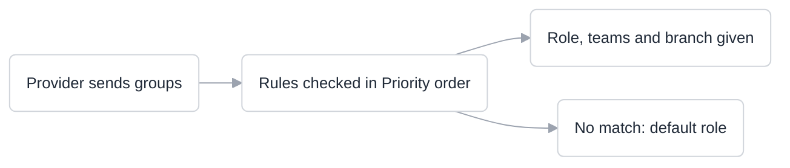

import { Flow } from "/snippets/flow.jsx";

An organization administrator manages this in **Settings → Team → Sign-in security**. If it isn't in your plan, the page shows which plan has it. Every change asks you to confirm it is you and is recorded in the activity log. With the Activity log, **Sign-in activity** shows every sign-in, failure and change, with a CSV export.

<Flow steps={["Add connection", "Prove your domain", "Set rules", "Team signs in with company account"]} />

## Connect your identity provider

Any OpenID Connect provider works: Microsoft Entra ID, Google Workspace, Okta, OneLogin, JumpCloud, Keycloak and others.

<Steps>
  <Step title="Add connection">Choose **Add connection** and your **Identity provider**. Marro shows the steps and the redirect address to copy into your provider.</Step>
  <Step title="Enter details">The **Issuer**, **Client ID** and **Client secret**. The secret is stored encrypted and never shown again.</Step>
  <Step title="Test and turn on">Choose **Test connection** and sign in. Check the details it received, then **Turn on**.</Step>
</Steps>

Turning off or deleting a connection, removing a domain, revoking a token and **Sign everyone out** each ask you to confirm first.

Not the person who manages your provider? **Send link** gives an IT colleague a seven-day setup link that can add and test connections and domains, and nothing else. **Cancel link** any time.

## Prove your email domain

1. **Add a domain**, such as *yourclinic.in*.
2. Add the DNS record Marro shows, then **Check record**.

Public domains such as gmail.com can't be claimed. For **New company sign-ins** from people not yet in Marro, choose per domain:

| Choice | Result |
| --- | --- |
| Join | They join straight away |
| Ask to join | You **Let in** or **Decline** |
| Not let in | They can't join |

## Rules for your team

| Rule | Choices |
| --- | --- |
| Who must use your provider | Everyone, or **For chosen roles** |
| Others may use | Password with a code or passkey, and a code by WhatsApp or email in the app |
| **Break-glass owners** | At least one owner with a passkey, so a provider outage never locks you out |
| Admins | Use a passkey or authenticator app |
| Sessions | How long they last, and when an idle one ends |
| Allowed IP ranges | Empty allows anywhere. **Add my address** adds yours |
| **Sign everyone out** | Ends every session on the web and in the app |

## Roles from your groups

Group rules give people a role, teams and a branch from the groups your provider sends (**Groups claim**).

Choose **Add rule** per group.

## Keep accounts in step (SCIM)

<Steps>
  <Step title="Create token">In **Provisioning**, **Create token** gives your provider the SCIM address and a token.</Step>
  <Step title="Provider syncs">It adds, updates and deactivates people in Marro. Deactivating someone signs them out everywhere.</Step>
  <Step title="Revoke">**Revoke** stops a token.</Step>
</Steps>

## Sign in

<CardGroup cols={2}>
  <Card title="On the web" icon="browser">Choose **Continue with company SSO** below the Google and Microsoft buttons and enter your work email. For a code, choose **Sign in with a mobile number**.</Card>
  <Card title="In the app" icon="mobile">**Continue with company SSO** asks for your work email, opens your provider and brings you back signed in. If new people need an admin's OK, the app says your request was sent.</Card>
</CardGroup>

## Two-step after company sign-in

| Who signs in | Second step |
| --- | --- |
| Your provider already asked for a second factor | Marro doesn't ask for its own code, on the web or in the app |
| Providers that don't report it, such as Google Workspace | Sign in as before: Marro asks for your authenticator code if you set one up |
| Platform administrators | Always give Marro's own code |

## Confirm it's you with your company

Some changes, such as sign-in settings, ask you to confirm first.

<Steps>
  <Step title="Continue with your company">Choose **Continue with** and your connection's name.</Step>
  <Step title="Sign in again">At your provider. Marro returns you to the same page.</Step>
  <Step title="Make the change">You then have five minutes.</Step>
</Steps>

If you have no password, authenticator or passkey in Marro, this is the only way. Your provider must sign you in afresh. Only the company account linked to you can confirm.
