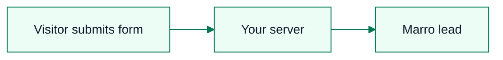

import Capture from "/snippets/generated/capture.mdx";

<Steps>
  <Step title="Create a Website form key">
    In Marro, open **Settings → Integrations → API keys → New key → Website form**. Copy the key.
  </Step>
  <Step title="Store it on your server">
    Save it as an environment variable, for example `MARRO_API_KEY`. In WordPress, define it in `wp-config.php`.
  </Step>
  <Step title="Send each enquiry from your server">
    Your form posts to your own server, which sends the enquiry to Marro with the key, using the code below. `name` and `phone` are required.
  </Step>
  <Step title="Add your own fields">
    Send other details in `fields`, using the keys in **Settings → Leads and sales → Lead setup → Fields** or from [List lead fields](/api-reference/reference/list-fields).
  </Step>
  <Step title="Test it">
    Submit your form once. The lead should appear in Marro with the enquiry on its timeline.
  </Step>
</Steps>

<Warning>
  Never call the API from browser JavaScript. Anyone could read the key from the page.
</Warning>

<Capture />
