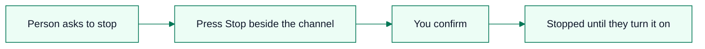

Every marketing email links to the person's own preference page. They choose what you may send, then press **Save**, or **Unsubscribe from all marketing**. Opening the page changes nothing.

## What each choice stops

| Choice | When off |
| --- | --- |
| **Marketing email** | No campaign or email sequence goes to that address. |
| **WhatsApp marketing** | Marketing-category templates are not sent. Utility and authentication templates, and replies in an open chat, still go. |
| **SMS marketing** | Automations send no SMS. A message a team member sends still goes. |

Always reaches them: replies to their messages, receipts, invoices, payment messages, and appointment confirmations and reminders.

Someone who replied **STOP** on WhatsApp or SMS gets nothing on that channel until they reply **START**. The page says so instead of offering a switch.

## For your team

Each lead's page, on the web and in the app, has a **Marketing** section in the left panel. It shows email, WhatsApp and SMS as allowed or stopped, when and how, and the campaign emails sent.

Only the person can turn marketing back on, from their own page.

## Ask Marro

<Card title="Try asking" icon="message-circle">
  *"Asha asked to stop marketing email"*

  *"What has this lead stopped, and which campaigns were they sent?"*

  Marro asks you to confirm before recording a stop.
</Card>
