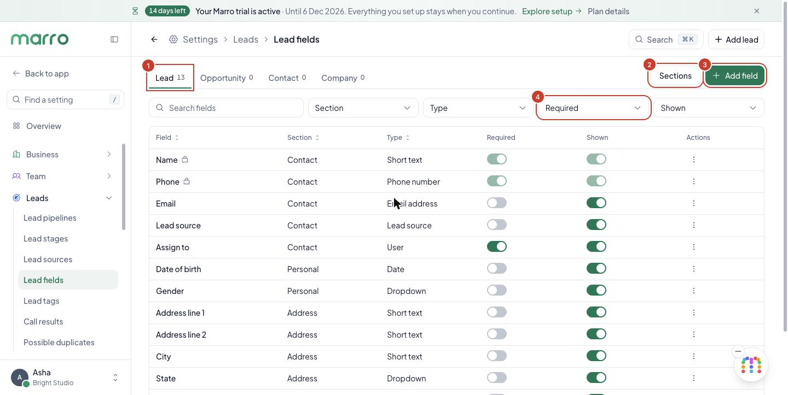
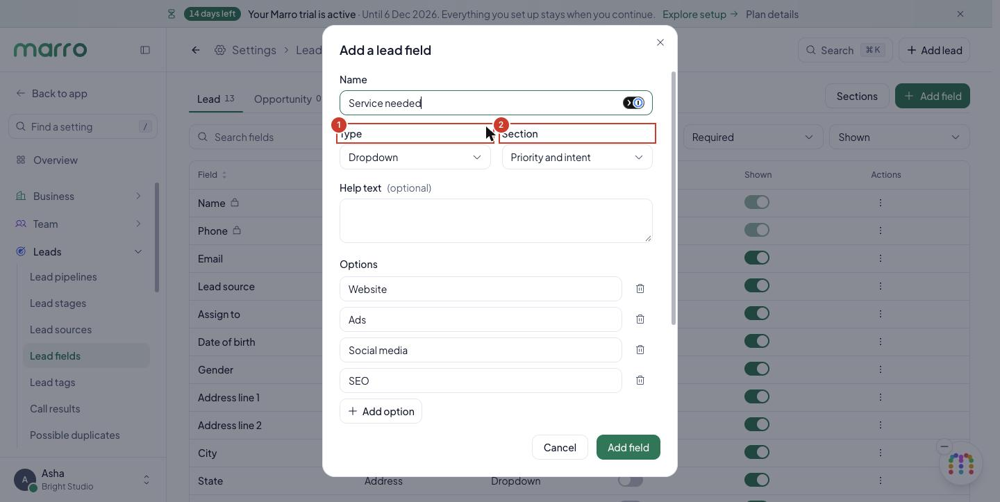
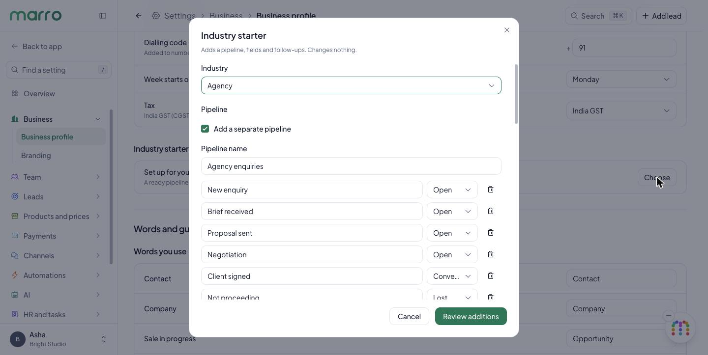

Fields are what you record about a lead: its budget, the service it wants, a date to call back. Open **Settings → Leads → Lead fields**.

<Frame>
  
</Frame>

1. **Pick the record**: Lead, Opportunity, Contact or Company. Each has its own fields.
2. **Sections** group the form: rename, reorder or add them.
3. **Add field** adds a new one.
4. Each field has two switches: **Required** (must be filled in) and **Shown** (on the form, or hidden).

Name and Phone are always there (lock icon).

## Add a field

<Frame>
  
</Frame>

1. **Name** it, for example *Service needed*.
2. Choose a **Type** (1). It can't be changed later.
3. Choose the **Section** (2) it sits in.
4. For a dropdown or multiple choice, add the **Options** (3).
5. Optional: **Help text**, **Required when adding** or **editing**, and **Show only after**, which shows it only when another field has a certain answer.

| Type | For |
| --- | --- |
| Short text, Long text | Names, notes |
| Number | Budgets, counts |
| Date | Birthdays, deadlines |
| Phone number, Email address, Link | Ways to reach someone |
| Dropdown, Multiple choice | One or several answers from a list |
| Yes / no | A simple tick |
| Record link | Another lead, contact, company, opportunity or user |

New fields show up on the add and edit forms, on the lead's page and as list columns.

## Hide, delete or restore

- **Hide** a field with its **Shown** switch. Saved answers stay.
- **Delete** a custom field from its menu. If leads have answers in it, Marro shows how many and asks you to type the field's name.
- Changed your mind? **Recently deleted → Restore** brings it back with its answers for 30 days.
- Built-in fields (name, phone, email, source, owner and the address) can't be deleted.

## Fields for your industry

Pick your industry in **Settings → Business → Business profile** to see suggested fields, for example *Property type*, *Budget* and *Location* for real estate. You choose which to add; nothing is added on its own.

<Frame>
  
</Frame>

## Record links

A **Record link** field points to another record, such as the company a contact works at. Choose what it links to and whether it holds one or several. Type a name, email or phone to pick the record; click the name to open it.

## Ask Marro

*"Add a dropdown field Service needed with Website, Ads, Social media and SEO"* or *"Set Neha's budget to 50,000"*. Marro shows the change and asks before saving.

## For developers

Read and write custom fields through the API: [list a record type's fields](/api-reference/customers/list-record-fields), [create](/api-reference/customers/create-record) and [update](/api-reference/customers/update-record) records. Fields on [custom objects](/guides/custom-objects) work the same way.
