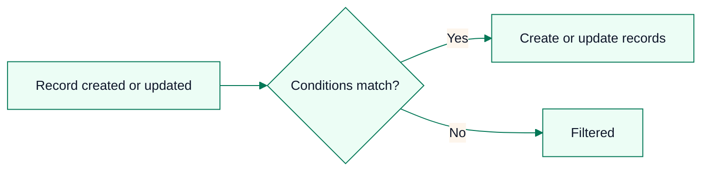

<Note>
Workflow screens are built and awaiting review and release. They are not live yet.
</Note>

A custom-object workflow creates or updates a record when another record is created or updated. For example, a new application creates a service job, or an application marked Ready moves its own status to Processing. These are internal record changes. They contact no customer.

Open **Settings → Custom objects → Workflows**.

## Build a workflow

<Steps>
  <Step title="Pick the source">
    Choose an existing object and whether it starts on creation or update. Optional conditions compare named fields with exact values.
  </Step>
  <Step title="Add steps">
    For each step, choose an existing object and fields. Give a value, or copy it from a source field of the same type.
  </Step>
  <Step title="Choose update targets">
    The source record, a record you select, or one created earlier in the same workflow.
  </Step>
  <Step title="Review and save">
    **Review and save** shows the whole workflow and its consequences. Confirm within ten minutes; editing cancels the review.
  </Step>
</Steps>

It never creates objects or fields, guesses records or people, or sets record links.

## Approval

| Rule | Detail |
| --- | --- |
| Individual approval | Every configuration needs a signed human approval, even when Ask Marro is on Auto |
| Scope | It allows future matching internal record changes only, not messages or payments |
| Revoked when | Schema, access, role, module or lifecycle changes. Review again |

If a save result is unclear, use **Read saved workflow** and check **Runs** before trying again.

## Limits

| Limit | Value |
| --- | --- |
| Steps in a run | 10 |
| Active workflows per object | 20 |
| Old records | Not processed when you save or enable |

A run saves all its changes together: if a step fails, earlier changes roll back. Changes made by a workflow don't start other workflows. Runs show as **filtered** (conditions didn't match) or **failed** (access or version refused).

## Ask Marro

<Card title="Try asking" icon="message-circle">
  *"Show my object workflows and their recent runs"*

  *"When an application is created, create a service job"*

  Marro previews the whole workflow and you approve it. It sends no outreach or payments and adds no fields.
</Card>
