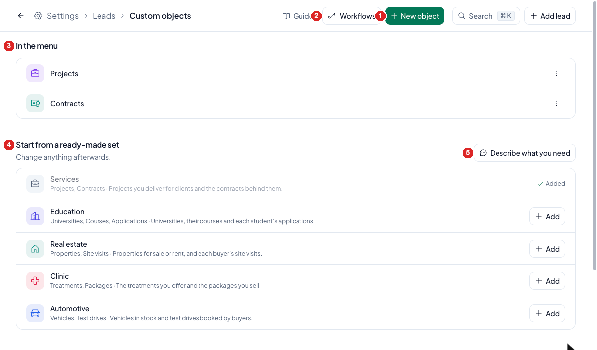
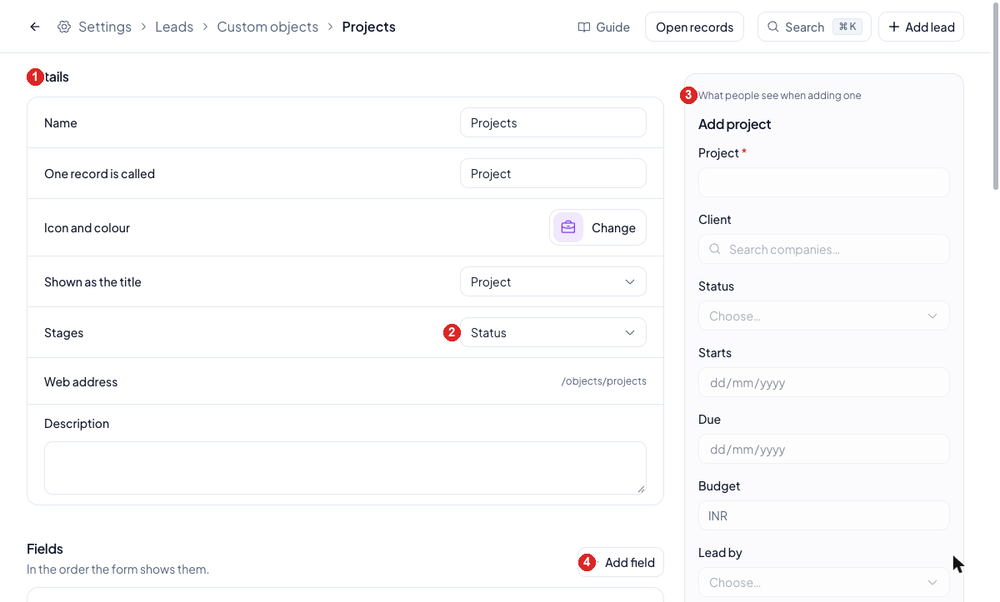
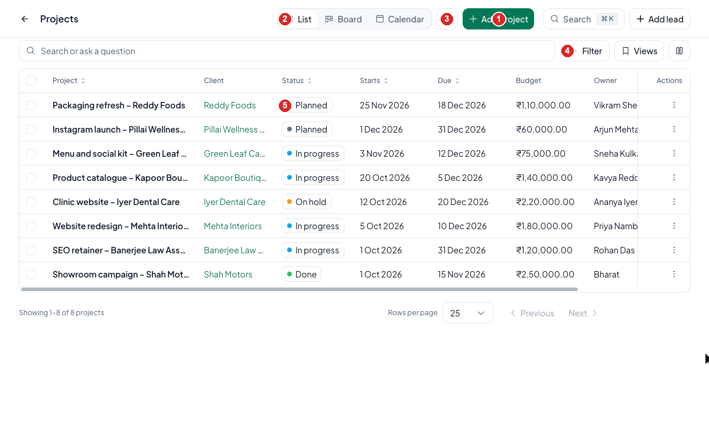
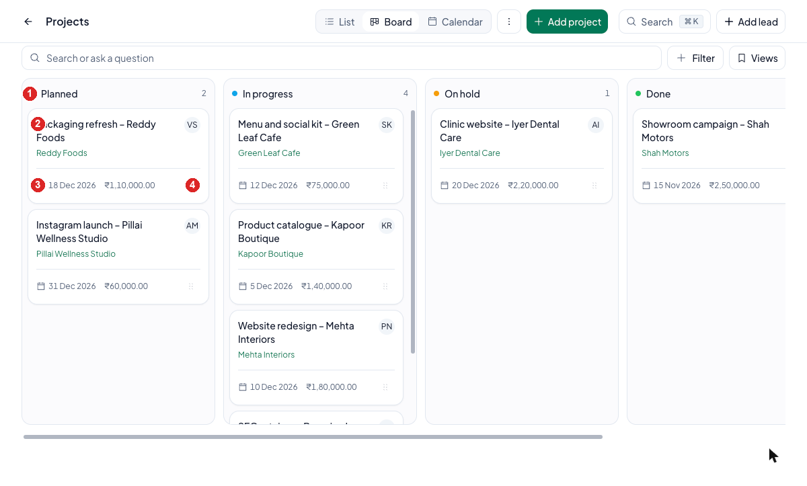
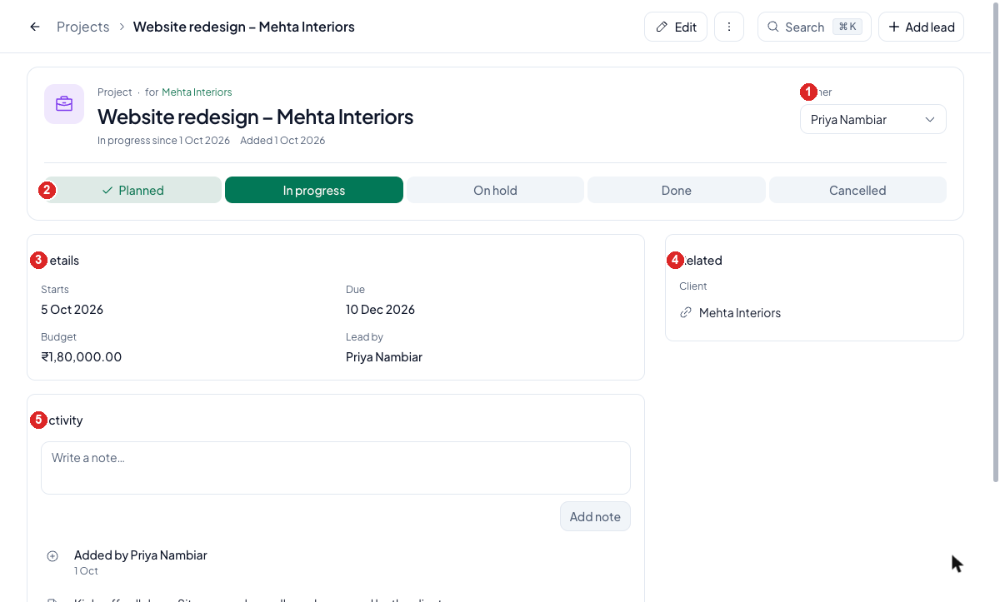

import { Flow } from "/snippets/flow.jsx";

A custom object is a kind of record Marro does not have built in: Vehicles for a car dealer, Courses for an education consultancy, Properties for an estate agent. Each gets its own place in the menu, a list like Leads, a board, a calendar and a page per record. The object is the kind (Vehicles); each entry is a record (one vehicle).

<Frame>
  
</Frame>

1. **New object**.
2. **Workflows**: update records automatically when a record of an object changes.
3. **In the menu**: your objects. The menu on each changes or archives it.
4. **Start from a ready-made set**: **Add** creates its objects and fields, which you can change afterwards.
5. **Describe what you need**, and Marro suggests the objects.

## Add an object

Administrators open [Settings → Custom objects](https://app.marro.si/settings/objects).

<Steps>
  <Step title="New object">
    Press **New object**.
  </Step>
  <Step title="Name it">
    Use the plural, such as **Vehicles**. **One record is called** fills in the singular.
  </Step>
  <Step title="Icon and colour">
    They show in the menu, like built-in places.
  </Step>
  <Step title="Add fields">
    Every object starts with one field for the record's name. Add the rest on the object's page.
  </Step>
</Steps>

Faster routes:

| Way | What it does |
| --- | --- |
| **Start from a ready-made set** | Sets for education, real estate, clinics, automotive and services. **Add** shows every object, field and stage before anything changes |
| **Describe what you need** | Tell Marro, in the app or on WhatsApp, what you keep track of. It proposes objects, fields, links and stages. Nothing is added until you approve |

## Fields

<Frame>
  
</Frame>

1. **Details**: the name, what one record is called, its icon and colour.
2. **Stages**: the dropdown whose choices are the stages.
3. The preview shows the form as people will see it.
4. **Add field**.

| Type | For |
| --- | --- |
| Short text, Long text, Number, Date, Phone number, Email address, Link | The basics |
| Dropdown, Multiple choice | Choices, each with an optional colour |
| Yes / no | A tick |
| Money, Percent, Date and time | Money uses a currency you choose |
| Person in your team | A staff member |
| Link to another record | A lead, contact, company, opportunity, team member or another object's record. One or several |

Each field can have help text, be required when adding or editing, be hidden, or show only when another field has a certain answer. The type can't change later.

- **Filled in to start with**: new records start with that value.
- **No two records the same**: stops a repeated value such as a registration number, ignoring capitals and spaces. It covers every record, including ones you can't see. Existing duplicates must be fixed first.
- Move fields with **⋯**. The preview shows the form as people will see it.
- Deleting a field keeps its values for 30 days: type its name to confirm, restore from **Recently deleted**.

## Stages

Add a dropdown field with the stages as choices, then choose it under **Details → Stages**. Each stage has a colour and counts as going, won or lost.

<Flow steps={["Draft", "Submitted", "Accepted", "Enrolled"]} />

The board then groups by stage, the record shows its stage and time in it, and every change is in its activity. A link with details of its own, such as a student applying to a course, works best as its own object (Applications) linked to both.

## Who can see it

Under **Who can see it**, each role has:

| Setting | Options |
| --- | --- |
| **Sees** | Nothing, own, team's, branch's or all records |
| **Add**, **Edit**, **Delete**, **Download** | Each on or off |

Administrators always see everything. Partners can't open custom objects. Access to an object gives no access to leads.

## Work with records

<Frame>
  
</Frame>

1. **Add project** (each object names its own).
2. **List**, **Board** or **Calendar**.
3. **⋯**: **Show archived**, **Import**, **Download**, **Recycle bin**, settings.
4. **Filter** and **Views**.
5. Click a value to change it. Tick records to change, assign, archive or delete up to 50 at once.

<Frame>
  
</Frame>

1. A column per stage, with its count.
2. The title and owner's initials.
3. The fields chosen for cards (**How records show**: up to three).
4. Drag a card to another column to move it.

<Frame>
  
</Frame>

1. **Owner**: change it here.
2. The stages: click one to move the record.
3. **Details**: every field.
4. **Related**: what it links to, and what links to it (a project's contracts).
5. **Activity**: notes and every change.

If someone else changed a record while you edited, saving is refused so nothing is lost. Records linked to a lead also show Call and WhatsApp buttons, follow-ups, documents and the latest calls, chats and emails.

## Recycle bin, import and download

| Action | Detail |
| --- | --- |
| **Delete** | To the recycle bin (**⋯ → Recycle bin**). **Bring back** within 30 days |
| **Import** | CSV up to 1,000 rows. Match columns, check, import. Mark a field **No two records the same** and choose **Update the one with the same …** to update instead of add. Failed rows can be downloaded with reasons |
| **Download** | CSV as filtered on screen, up to 50,000 rows. Needs **Download** permission |

## Reports and automations

<CardGroup cols={2}>
  <Card title="Reports" icon="chart-column">
    Each object is a source in [custom reports](/guides/custom-reports): count, add up or average its fields, grouped by dropdowns, owner, dates or the linked lead.
  </Card>
  <Card title="Automations" icon="bolt">
    [Automations](/guides/automations) can start when a record is added, changes or changes stage, for each linked lead. Steps: **Add a custom object record** and **Change the lead's custom object records**.
  </Card>
</CardGroup>

Webhooks (Zapier, Make, n8n) can be sent when a record is added, changes, moves stage or is deleted. A [website form](/guides/connect-a-website) can add a record instead of a lead.

## Limits

| Plan | Objects | Records |
| --- | --- | --- |
| **Growth** | 3 | 50,000 |
| **Complete** | Up to 20 | 500,000 |

Each object has up to 100 fields. Records count across all objects, including archived and recycle-bin ones. At a limit, everything stays usable and only adding is refused. **Settings → Custom objects → Usage** shows what you use.

## Ask Marro

<Card title="Try asking" icon="message-circle">
  *"I run a driving school; I need Vehicles, Instructors and Lesson bookings"*

  *"Add a Status dropdown to Vehicles with Available, Sold and In service"*

  Marro can find and read records, and, after you approve, add and change them, their fields, menu order and access. It follows the same access rules as the screens.
</Card>

## For developers

Keys with the custom object scopes can:

<CardGroup cols={2}>
  <Card title="List objects" icon="list" href="/api-reference/custom-objects/list-custom-objects" />
  <Card title="List records" icon="table" href="/api-reference/custom-objects/list-object-records" />
  <Card title="Read a record" icon="eye" href="/api-reference/custom-objects/get-object-record" />
  <Card title="Add a record" icon="plus" href="/api-reference/custom-objects/create-object-record" />
  <Card title="Change a record" icon="pencil" href="/api-reference/custom-objects/update-object-record" />
  <Card title="Delete a record" icon="trash" href="/api-reference/custom-objects/delete-object-record" />
</CardGroup>

Send an `Idempotency-Key` when adding so a retry never adds twice.
