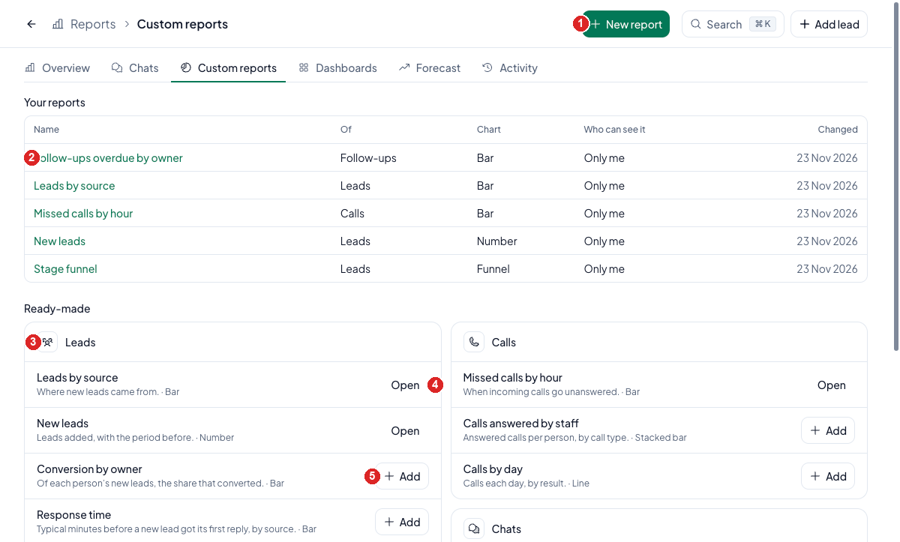
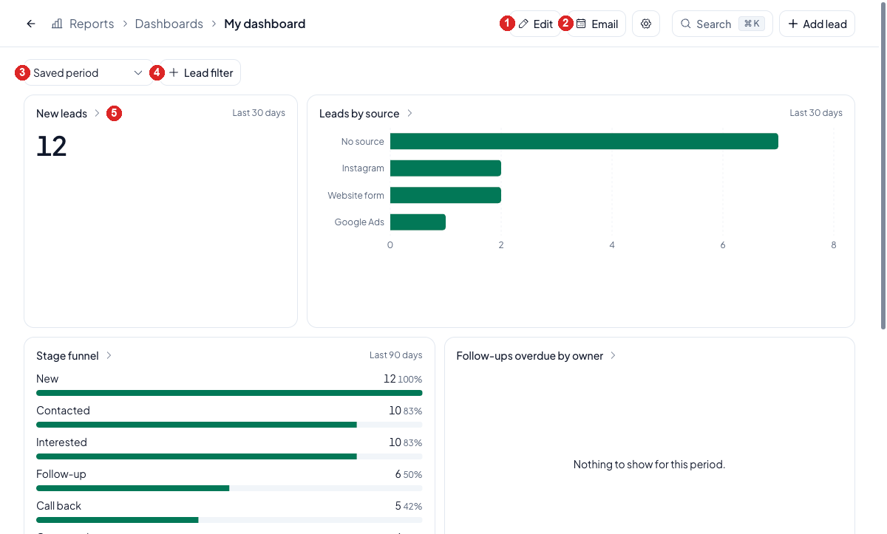

import { Flow } from "/snippets/flow.jsx";

**Reports → Custom reports** lists your saved reports and **Ready-made** ones to start from. **Reports → Dashboards** puts saved reports side by side.

<Frame>
  
</Frame>

1. **New report**.
2. **Your reports**: select one to open it.
3. **Ready-made**, grouped by what they count.
4. **Open**: a ready-made report you already added.
5. **Add** makes your own copy and opens it.

<CardGroup cols={2}>
  <Card title="Report" icon="chart-bar">One question, one chart.</Card>
  <Card title="Dashboard" icon="layout-dashboard">Saved reports as cards, with one period and filters.</Card>
</CardGroup>

## Build a report

Choose **New report**, or open a ready-made one and change it. The preview updates as you go.

| Setting | Choices |
| --- | --- |
| **Report on** | Leads, calls, follow-ups and tasks, appointments, WhatsApp chats, [website visits](/guides/website-tracking#reports) or your [custom objects](/guides/custom-objects#reports). Only what your role can use is offered. |
| **Measure** | A count, a sum or average of a number field, a conversion (**The share that reached** a stage, **Of leads that reached** another) or first-response time. |
| **Group by**, **Split by** | Stage, source, owner, team, branch, pipeline, a field's options, or date by day, week or month. |
| **Only** | **Add a condition**, the same ones as Leads filters. |
| **When** | The date it counts by and the **Period**, including a custom range. |
| **Chart** | A number, bars, stacked bars, a line, a donut, a funnel or a table. |

Give it a **Name** and save. **Save as new** keeps the original.

## Who sees what

<Flow steps={["Shared report", "Each viewer", "Sees only their own leads, team or branch"]} />

- **Who can see it** keeps a report to yourself or shares it with roles.
- Sharing needs the **Manage reports** permission. Admin and the ready-made Manager role have it; other roles don't get it on their own, so tick it in **Users → Roles**.
- Sharing never widens anyone's access to leads.

## Dashboards

<Frame>
  
</Frame>

1. **Edit**: add, drag and resize cards.
2. **Email** it on a schedule.
3. One period for every card, or each card's own (**Saved period**).
4. **Lead filter** for every card.
5. Select a card's title to open that report.

With no dashboards yet, **Start from ready-made reports** builds one with new leads, leads by source, the stage funnel, overdue follow-ups and missed calls by hour.

<Steps>
  <Step title="Add a report">To a dashboard, from the report.</Step>
  <Step title="Arrange">Drag cards to arrange them and resize them.</Step>
  <Step title="Set the home dashboard">In **Dashboard settings**, someone with **Manage reports** sets **Home dashboard for** a role to be what those people see first.</Step>
</Steps>

**Manage reports** is not added to existing roles on its own: tick it for each role in **Users → Roles**.

## Download and email

| You want to | Do this |
| --- | --- |
| Keep a copy | Download any report as CSV |
| Get it regularly | **Email on a schedule** sends a report or dashboard **Every day** or **Every week** to the people under **Send to**. Each person gets their own figures, only for reports they may open |
| Schedule for yourself | Anyone can |
| Send to others | Needs **Manage reports** |

## Ask Marro

<Card title="Try asking" icon="message-circle">
  *"Show leads by source this month"*

  *"What is our first-response time by owner?"*

  Marro reads your reports within your own access.
</Card>
