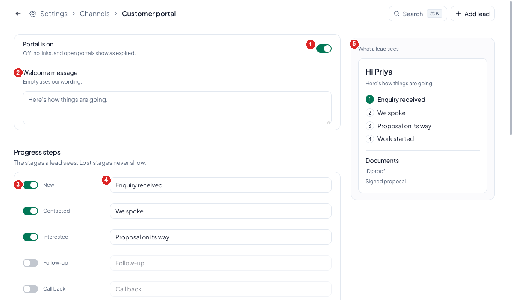
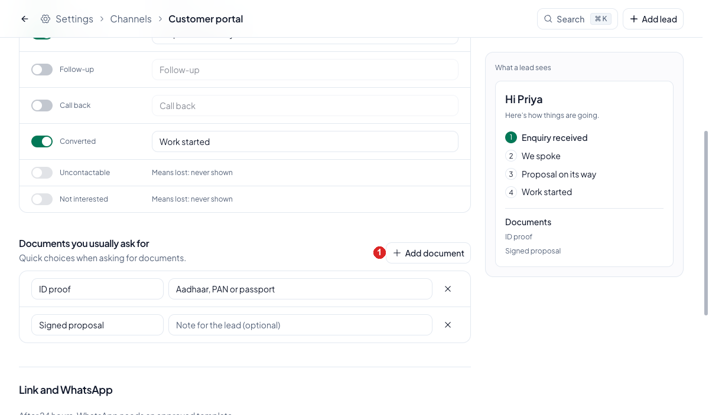
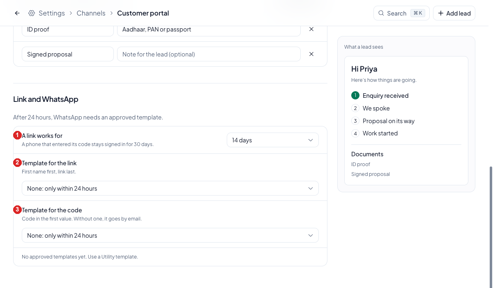

The customer portal gives each lead their own page. They open it from a link, confirm it's them with a code sent to their phone, and see how things are going, upload the documents you asked for, and message your team. Set it up in **Settings → Channels → Customer portal**.

<Frame>
  
</Frame>

1. **Portal is on**. Off, no links are sent and open portals show as expired.
2. **Welcome message**: left empty, it says *Here's how things are going.*
3. **Progress steps**: switch on the stages a lead sees.
4. What each step is called in the portal, such as **We spoke** for *Contacted*.
5. **What a lead sees**, as you change it.

<Note>
Lost stages, such as *Not interested*, never show. Opportunity pipelines are not listed: the portal follows the lead.
</Note>

## Documents you usually ask for

<Frame>
  
</Frame>

**Add document** (1) for each one you ask for often, with a note for the lead. They become quick choices when you ask a lead for documents on [the lead page](/guides/lead-page).

## Link and WhatsApp

<Frame>
  
</Frame>

1. **A link works for** 7 to 90 days. A phone that entered its code stays signed in for 30 days.
2. **Template for the link**: an approved WhatsApp template, the lead's first name first and the link last.
3. **Template for the code**: the code in the first value. Without one, the code goes by email.

<Warning>
WhatsApp only allows free messages within 24 hours of the lead's last message. After that, the link and the code need approved Utility templates. See [WhatsApp templates](/guides/whatsapp-templates).
</Warning>

## Send a lead their link

On the lead's page, the **Customer portal** card has **Send link** (WhatsApp, or email without a number), and in its menu **Copy link to share**. Messages the lead sends in the portal show there too, with a reply box. Asking for documents can send the link in the same step.
