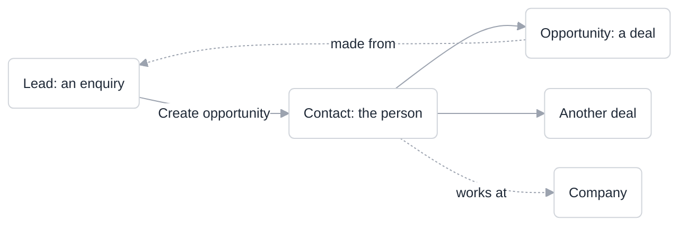

**Customers** holds your **contacts** (people) and **companies**. A contact is made for you when you create an opportunity from a lead. Open **Leads → Customers**.

## Leads, contacts and opportunities

| Record | What it is | Where it moves |
| --- | --- | --- |
| **Lead** | Someone who got in touch: an enquiry to follow up | Lead stages: calls, chats, follow-ups |
| **Contact** | The same person as a customer, made once and reused | Stays; holds their deals and money |
| **Company** | The business a contact works at (optional) | Groups its contacts and their deals |
| **Opportunity** | One deal: a value, a stage, a close date | Opportunity stages, such as Discovery → Converted |

- Creating an opportunity from a lead makes the contact (or reuses one with the same email or phone) and remembers the lead it came from.
- The lead is never changed. It keeps its own stage and history; an [automation](/guides/opportunities#make-one-automatically) can keep the two in step.
- One contact can have many opportunities: a website now, a retainer later.

## A contact

<Frame>
  
</Frame>

1. **Edit contact** changes the details.
2. **New quote** starts a quote for them.
3. **New opportunity** starts a deal for them.
4. Their **Opportunities** and their **Finance**: quoted, invoiced, paid and due.

**Lead** opens the lead they came from.

## A company

<Frame>
  
</Frame>

1. **New contact** adds someone who works there.
2. Its **Contacts**.
3. Its **Opportunities**, from all its contacts.

## Lists

| Tab | Shows | Row ⋯ menu |
| --- | --- | --- |
| **Contacts** | Name, email, phone, company, owner | Open, Edit |
| **Companies** | Name, website, email, phone, owner | Open, Edit |

**Link existing lead** makes a contact and a first opportunity from a lead, once; the lead and its history stay as they are. **Download** saves the list.

## Ask Marro

<Card title="Try asking" icon="message-circle">
  *"Add a company Mehta Interiors with Aarav Mehta as its contact"*

  *"Show everything we have quoted to Aarav Mehta"*
</Card>

## For developers

<Card title="Customers in the API" icon="code" href="/api-reference/customers/list-records">Contacts, companies and opportunities share the customer records API.</Card>
