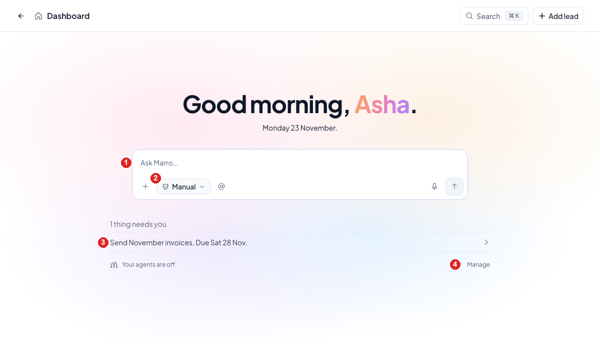

The **Dashboard** is the first page after you sign in. It greets you, shows today's date on your organization's clock, and puts what needs you under one box.

<Frame>
  
</Frame>

1. **Ask Marro**: ask about your leads, or ask for a change. The page turns into the chat.
2. **Manual** or **Auto**. **Manual** shows each change for you to approve. **Auto** makes routine changes straight away; plans an agent runs in the background still ask.
3. **Things that need you**: the leads Marro picked for you today (call, message or follow up, and why), then your open tasks with their due dates. Click one to start a chat about it.
4. **Your agents**: whether your agents are working, and **Manage** to open them. Only people who manage settings see this line.

<Note>
Nothing on this list is made up. With no leads to work and no open tasks, the list is empty.
</Note>

## Your team's dashboard

Someone who manages reports can choose a report dashboard for each role. It then shows below the box for everyone in that role, with their own figures. See [Custom reports](/guides/custom-reports#dashboards).

## Without the assistant

If your organization has no AI, the box is replaced by links to **Leads**, **Follow-ups** and **Tasks**.
