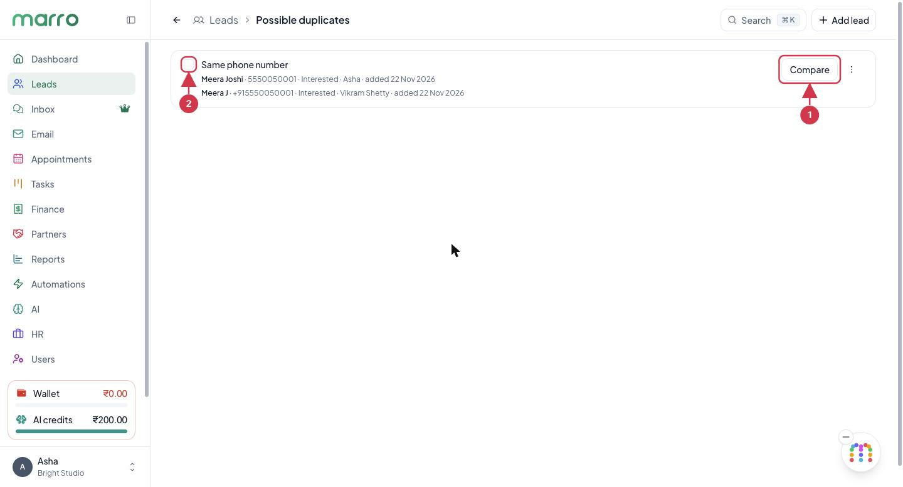
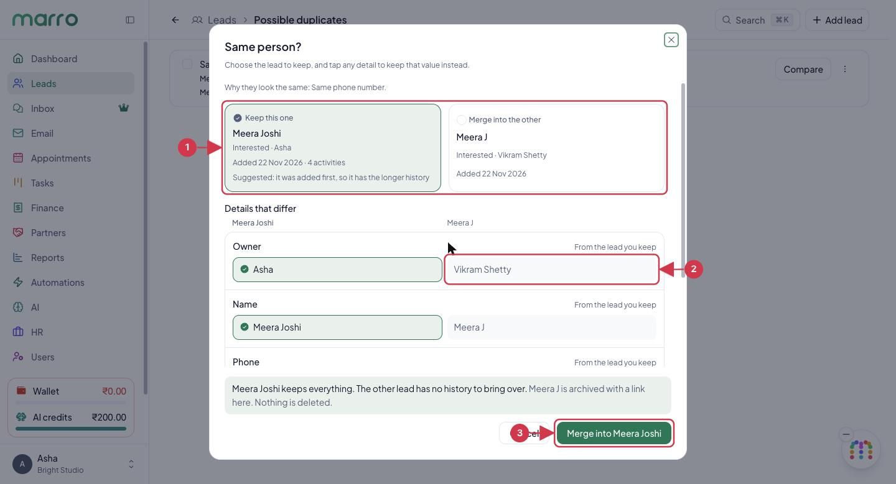

Marro lists pairs of leads with the same phone or email, or a similar name. Open **Leads → Possible duplicates**.

<Frame>
  
</Frame>

Pairs are listed most certain first. **Compare** opens a pair.

## Compare and merge

<Frame>
  
</Frame>

<Steps>
  <Step title="Compare">Open a pair. The lead to keep is suggested: the one with the longer history.</Step>
  <Step title="Choose values">Tap a value from the other lead to keep it instead.</Step>
  <Step title="Merge">Choose **Merge**.</Step>
</Steps>

## What happens to the other lead

| Lead | Result |
| --- | --- |
| Kept | Has the values you chose |
| Other | Archived with a link to the kept lead. Nothing is deleted |

## Catch them earlier

| When | What you see |
| --- | --- |
| You add a lead whose phone is already on a lead | **This looks like a lead you already have**, with a link to it |
| Two leads already share a phone or email | They appear on this page to merge |

See [Leads](/guides/leads#add-a-lead).

## Ask Marro

<Card title="Try asking" icon="message-circle">
  *"Merge Meera J into Meera Joshi"*

  Marro shows what it will change and asks before merging.
</Card>
