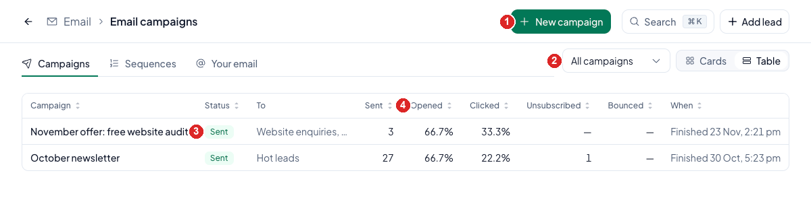
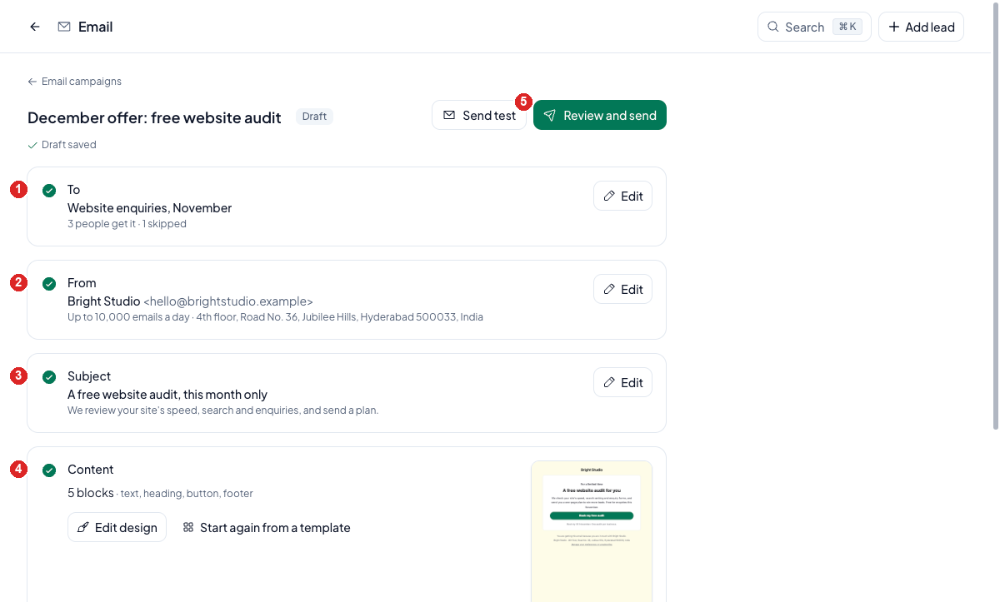
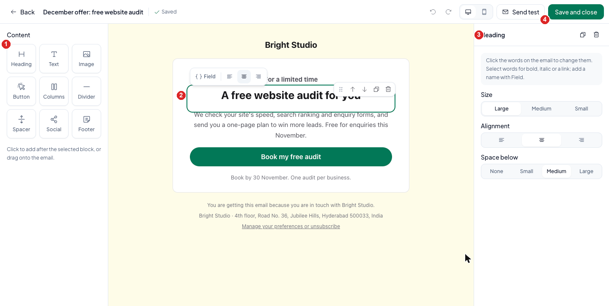
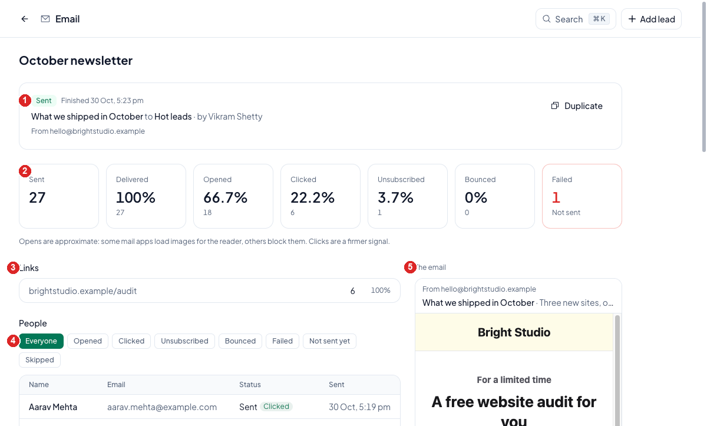

An email campaign is one email to everyone on a lead list: a newsletter, an offer, an announcement. Open **Email → Campaigns**. It comes with **Email sequences** in your plan, for roles with **Send email campaigns** (Admin always has it).

Before the first one you need a sending address in **Settings → Email sending** (Gmail, Outlook or your own mail server) and a list on **Leads → Lists**.

## Your campaigns

<Frame>
  
</Frame>

1. **New campaign**.
2. Filter by status, and show them as **Cards** or a **Table**.
3. Status: *draft*, *scheduled*, *sending*, *paused*, *sent*, *stopped*.
4. Results: sent, opened, clicked, unsubscribed, bounced.

## Write it

<Frame>
  
</Frame>

1. **To**: a list. You see how many get it, and who is left out and why: no email, your own team, a duplicate address, unsubscribed or bounced before.
2. **From**: the sending email address and its daily limit.
3. **Subject**, and optional preview text.
4. **Content**: **Design email**, from a blank page or one of six designs.
5. **Send test** (up to five addresses, marked [Test]), then **Review and send**. Until everything is ready it reads "N things left".

The draft saves itself. **Send settings** chooses **Send now** or **Schedule**, and whether opens and clicks are counted.

## Design the email

<Frame>
  
</Frame>

1. **Content**: heading, text, image, button, columns, divider, spacer, social links, footer. Click to add after the selected block, or drag.
2. The email as it is sent. Click words to type; **Field** adds the person's name.
3. The selected block's settings, or the whole email's style: colours, width, font, logo.
4. **Save and close**. **Send test**, undo and the phone preview are beside it.

A block that would stop sending, such as a button without a link, is outlined in red. The footer always carries your organization, any saved footer address, and **Manage your preferences or unsubscribe**.

## The report

<Frame>
  
</Frame>

1. Status, subject, list and who sent it. **Duplicate** copies it into a new draft.
2. **Sent**, **Delivered**, **Opened**, **Clicked**, **Unsubscribed**, **Bounced**, **Failed**. Opens are approximate; clicks are firmer.
3. **Links** and how many clicked each.
4. **People**, filtered by what happened, with the reason when one failed or was skipped.
5. The email as it went.

While it sends you can **Pause**, **Carry on** or **Stop**. If every email would fail the same way (the address needs connecting again, the mail server is down) it pauses with the reason and nobody is lost.

| Sending address | Emails a day, by default |
| --- | --- |
| Gmail | 500 |
| Outlook | 1,000 |
| Your own mail server | 10,000 |

<Note>In Australia, Canada, the United Kingdom, the United Arab Emirates and Vietnam you confirm on each campaign that the people agreed to marketing email from you.</Note>

<Tip>A free address (gmail.com, outlook.com) often lands in spam at companies. Use one on your own domain; **Domain authentication → Check** on **From** shows SPF, DKIM and DMARC.</Tip>

## Ask Marro

<Card title="Try asking" icon="message-circle">
  *"How did last week's newsletter do?"*

  *"Write a draft offer email for the November list"*

  Marro lists campaigns, shows numbers, writes drafts, sends tests or pauses one. Sending always waits for your approval, even in Auto.
</Card>
