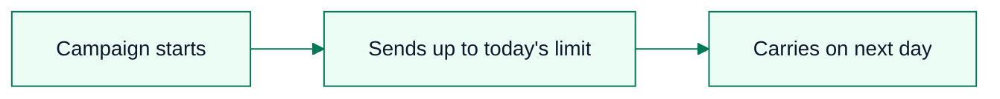

An email campaign is one email sent to everyone on a lead list: a newsletter, an offer, an announcement. Open **Email → Campaigns**. It comes with **Email sequences** in your plan.

People whose role has **Send email campaigns** can write and send. Admin always has it, and so does the ready-made Social Media Manager role. Other roles get it when an admin ticks it on **Users → Roles**.

## Before the first campaign

<CardGroup cols={3}>
  <Card title="Sending address" icon="envelope">
    Set in **Settings → Email sending**: Gmail, Outlook or your own mail server. Never a person's own mailbox. Replies come back to it.
  </Card>
  <Card title="Postal address" icon="location-dot">
    The law asks for it at the foot of every marketing email. Add it once under **From** on the campaign page.
  </Card>
  <Card title="A lead list" icon="list">
    Make one on **Leads → Lists**: fixed, or a saved filter. A list's menu has **Email this list…**.
  </Card>
</CardGroup>

## Write it

Press **New campaign** for a checklist. Each card shows a green tick when done. The draft saves itself.

| Card | What to do |
| --- | --- |
| **To** | Choose a list. You see how many get it, and who is left out and why |
| **From** | The sending address, its daily limit and your postal address |
| **Subject** | Subject and optional preview text, with inbox preview. **Field** adds the person's first name |
| **Content** | **Design email** |
| **Send settings** | **Send now** or **Schedule**, and whether to count opens and clicks |

**Review and send** reads "N things left" until nothing is missing. Click it to see the list.

People left out: no email address, your own team, the same address as another lead, unsubscribed from marketing email, or bounced before.

## Design the email

**Design email** opens the gallery: start blank, or from one of six designs (newsletter, announcement, offer, event invite, simple letter, two-column update), or **Your recent emails**.

| Where | What it holds |
| --- | --- |
| Left, **Content** | Blocks: heading, text, image, button, columns, divider, spacer, social links, footer. Click or drag onto the email |
| Middle | The email as it is sent. Click words to type. **Field** adds first name, full name, lead owner's first name or organization name |
| Right | The selected block's settings. With nothing selected, the email's style: colours, width, font, logo |

Hover a block to move, duplicate or delete it. **Undo**, **Redo**, **Send test** and the computer and phone preview are at the top. Anything that stops sending, such as a button without a link, is outlined in red.

## Test and review

<Steps>
  <Step title="Send test">
    Up to five addresses. It is marked [Test], uses sample values, tracks nothing and records nothing on leads. If an address belongs to a lead you must choose **Send anyway**. Limit: 30 tests an hour.
  </Step>
  <Step title="Check delivery">
    Reaches Gmail but not company inboxes? On **From**, a free address (gmail.com, outlook.com, yahoo) often lands in spam at companies: connect an address on your own domain. **Domain authentication → Check** shows SPF, DKIM and DMARC as pass, warning or fail. DNS changes can take a few hours.
  </Step>
  <Step title="Review and send">
    See the email, who gets it, how long it will take and when. Confirm the number of people, the list and the sending address.
  </Step>
</Steps>

In Australia, Canada, the United Kingdom, the United Arab Emirates and Vietnam you confirm, on each campaign, that the people agreed to marketing email from you (or bought from you recently and were given a way to say no).

## How fast it goes

| Sending address | Daily limit by default |
| --- | --- |
| Gmail | 500 |
| Outlook | 1,000 |
| Your own mail server | 10,000 |

**Edit** on the **From** card sets your own. Every campaign shares the room. People who unsubscribe, bounce or whose lead is deleted or archived before their turn are skipped.

## The report

It updates while the campaign sends.

| Part | Shows |
| --- | --- |
| **Sent**, **Delivered**, **Opened**, **Clicked**, **Unsubscribed**, **Bounced** | Shares and counts. Opens are approximate; clicks are firmer |
| **Links** | Each link and how many clicked |
| **People** | Everyone it went to, with the reason when one failed or was skipped |

**Pause**, **Carry on** and **Stop** (people not yet sent to are skipped). **Duplicate** copies a campaign into a new draft. A lead's **Campaigns** tab lists what they were sent.

If every email would fail the same way (the sending address needs connecting again, or your mail server is unreachable), the campaign pauses with the reason and nobody is lost. Fix it and press **Carry on**. An address that doesn't exist is never emailed again.

## What every email carries

| Item | Detail |
| --- | --- |
| Organization name and postal address | With why the person gets the email |
| **Manage your preferences or unsubscribe** | Opens their [preference page](/guides/contact-preferences) |
| One-click unsubscribe | Shown by mail apps such as Gmail beside the sender |

## Ask Marro

<Card title="Try asking" icon="message-circle">
  *"How did last week's newsletter do?"*

  *"Write a draft offer email for the August list"*

  Marro lists campaigns, shows numbers, writes drafts, sends tests or pauses one. Sending always waits for your approval, even in Auto.
</Card>
