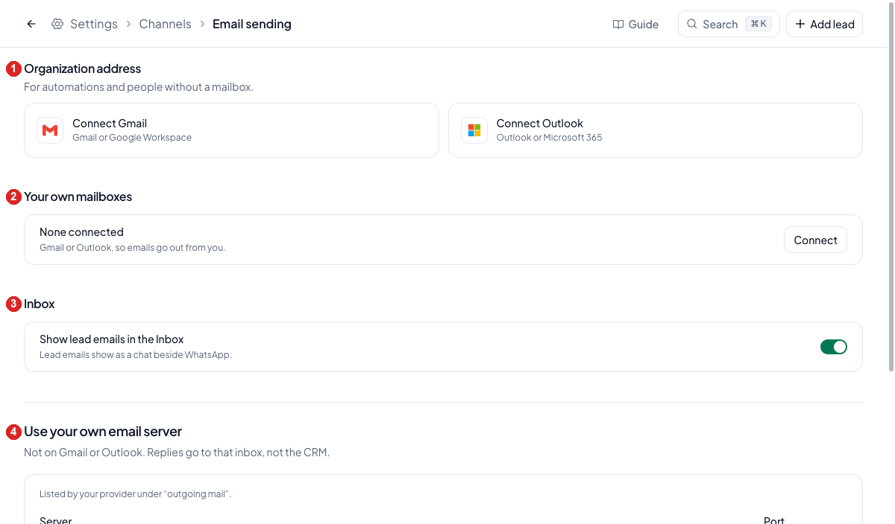

import { Flow } from "/snippets/flow.jsx";

**Settings → Channels → Email sending** sets the shared address that sends lead emails when nobody's own mailbox does. You need permission to manage the organization.

<Frame>
  
</Frame>

1. **Organization address**: **Connect Gmail** or **Connect Outlook**.
2. **Your own mailboxes**: how many people have connected theirs.
3. **Show lead emails in the Inbox**.
4. **Use your own email server**, if you are not on Gmail or Outlook.

## The organization address

<Flow steps={["Automation or person without a mailbox", "Organization address", "Lead"]} />

It is used by automations without a lead owner, and by anyone without a connected mailbox. With no address set, automations cannot email leads.

## Connect it

<Steps>
  <Step title="Open the page">Go to **Settings → Channels → Email sending** and find **Organization address**.</Step>
  <Step title="Choose how">Connect a shared **Gmail** or **Outlook** mailbox, or open **Use your own email server** if you are not on Gmail or Outlook. Replies to your own server go to that inbox, not the CRM.</Step>
  <Step title="Send a test">Press **Send test email** to check it works.</Step>
</Steps>

If Google or Microsoft stops access, the page says the address **needs reconnecting**. Disconnecting means automations and people without their own email cannot email leads; emails already sent stay.

## Other settings on this page

| Setting | What it does |
| --- | --- |
| **Your own mailboxes** | Shows how many are connected. **Connect** or **Manage** opens [your mailboxes](/guides/email) |
| **Show lead emails in the Inbox** | Lead emails show as a chat beside WhatsApp. Off keeps them on the lead page only |

## Ask Marro

<Card title="Try asking" icon="message-circle">
  *"Which address do automations send from?"*

  *"Send a test email"*

  Marro shows sending changes first. Connecting and disconnecting are done on the web.
</Card>
