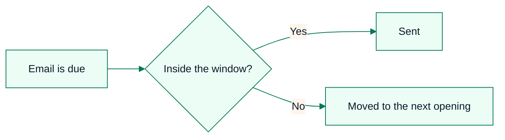

<Note>The backend for sending windows is ready. Screens and release are pending.</Note>

A sending window says when a sequence's due emails may go out. Saving a window enrolls no lead and sends no email.

## Choose a window

| Choice | Meaning |
| --- | --- |
| **Unrestricted** | Due emails go at any time. An unconfigured sequence shows **Unrestricted (unconfigured)**. |
| Weekly window | At least one weekday and one same-day time interval, applied to every chosen weekday. |

- Opening times are included, closing times are not: 09:00–17:00 includes 09:00 and excludes 17:00.
- Intervals must be in order. Touching, overlapping and overnight intervals are rejected, not merged. Split overnight periods into same-day ones.
- Times use your organization's saved time zone, not the recipient's.

## Who can change it

| Who | Can |
| --- | --- |
| Organization administrator with CRM and settings access | Review and save windows |
| Support view, partner accounts, automated agents | Cannot |

Review the sequence, window, time zone, days and times before confirming. A person's approval is needed even when the assistant is set to **Auto**.

## What changes for enrollments

| Topic | What happens |
| --- | --- |
| Schedule and time zone | Each enrollment keeps the ones it was enrolled with. A later window change affects only new enrollments |
| Step delays | Still run from the previous email; the window can only postpone the send after that |
| Enrollment preview | Shows the schedule that will be frozen. If anything changes before you confirm, review again |
| No opening in the next fifteen days | The enrollment pauses for review |
| Other safeguards | Unsubscribes, replies and bookings are checked first. An email already being sent when a window closes may still finish |

There is no holiday calendar or recipient time zone in this feature.
