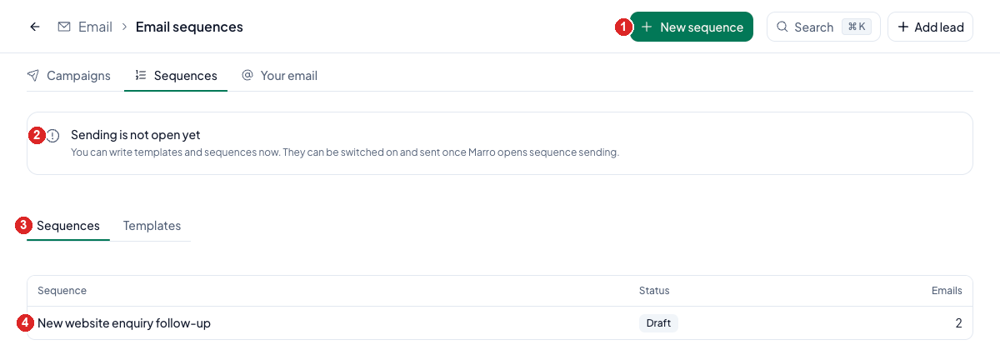
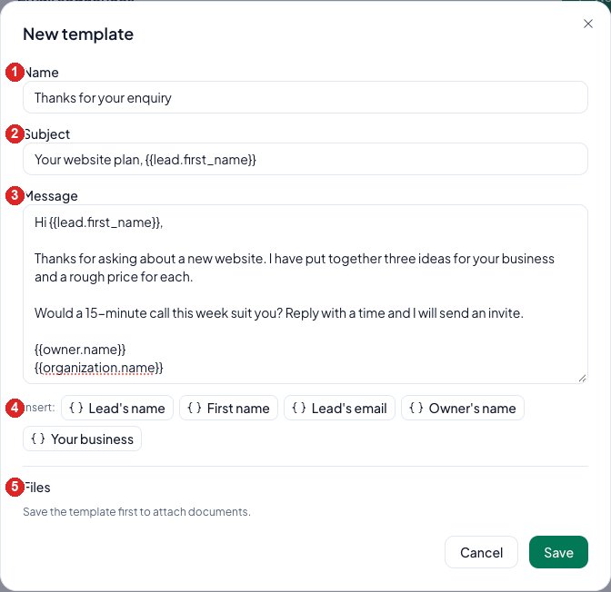
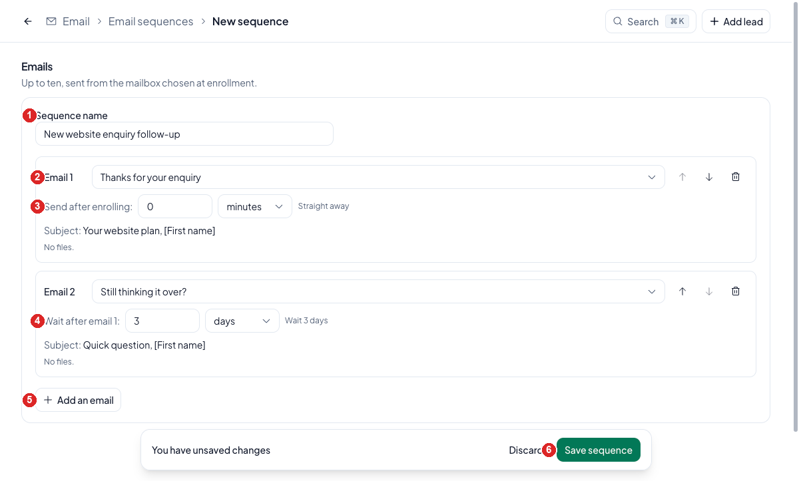
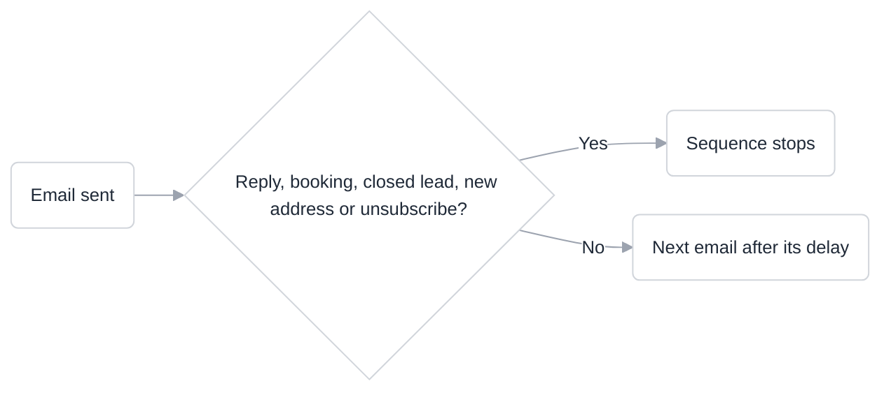
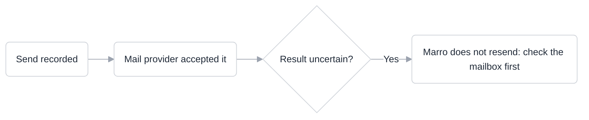

A sales template is a reusable subject and message. A sequence puts up to ten of them in order, with a delay before each. Administrators prepare both in **Email → Sequences**.

<Frame>
  
</Frame>

1. **New sequence** (on **Templates**, **New template**).
2. While **Sending is not open yet** shows, you can write templates and sequences; switching one on waits until Marro opens sequence sending.
3. **Sequences** and **Templates**.
4. Each sequence with its status and number of emails.

## Templates

<Frame>
  
</Frame>

1. **Name**, for you.
2. **Subject**.
3. **Message**.
4. **Insert**: the lead's name, first name or email, the owner's name and your business's name. They are filled in when the email goes.
5. **Files**: save the template first, then attach private documents.

| Topic | What to know |
| --- | --- |
| Personalise | With the lead's name, first name or email, the owner's name and the organization's name |
| Formatting | The same as email on a lead: paragraphs, bold, italic, lists and links |
| Saving a sequence | Copies its templates' wording. Editing a template later does not change it. Resave and reactivate the sequence to use new wording |
| People already enrolled | Keep the version they started with |

## Build a sequence

<Frame>
  
</Frame>

1. **Sequence name**.
2. Each email's template.
3. The first email's wait after enrolling (0 sends it straight away).
4. Every later email's wait after the one before.
5. **Add an email**, up to ten. Arrows reorder them.
6. **Save sequence**, then **Switch on**.

## Start a sequence

<Steps>
  <Step title="Choose">**Enroll a lead**: search by name, email or phone, and pick a connected mailbox that can read replies. A lead who can't be enrolled is greyed with why: *Closed*, *No email* or *Unsubscribed*.</Step>
  <Step title="Review">Check the recipient, sending address, messages, delays and sending hours with timezone. Saving a draft sends nothing.</Step>
  <Step title="Approve">Starting always needs your explicit approval. **Enroll several** starts a reviewed batch: see [batch enrollment](/guides/email-sequence-batches).</Step>
</Steps>

A first email with no delay goes right after enrolment, unless a [sending window](/guides/email-sequence-sending-windows) postpones it. Later delays start after the previous send is accepted.

## When follow-ups stop

- Replies are found when the mailbox syncs, not instantly.
- Unsubscribe stops every sequence for that address in your organization.
- A disconnected sender, changed sending address or stale reply sync pauses the work.
- You can pause or stop an enrollment. An email already being sent may still finish.

## On a lead's page

The **Campaigns** tab lists the sequences the lead is in:

| Shown | |
| --- | --- |
| Emails sent | |
| Next send | When the next goes |
| Why it stopped | Replied, booked, unsubscribed or finished |

## Send results

A recorded send means the mail provider accepted it, not that it reached the inbox.

[Email tracking](/guides/email-tracking) does not apply to automatic sequences.

## Private attachments

Use **Change files** on a template to attach existing private documents.

| Limit | Value |
| --- | --- |
| Files per step | 5 |
| Each file | 5 MiB |
| Total per step | 10 MiB |

- Each step needs an explicit choice, even **No files**.
- Saved selections do not change if the template or document changes later.
- If a file goes missing or access is lost, the enrollment pauses. **Resume** shows the saved review and **Check status** shows where it stands. Changed files need a new enrollment.

## Ask Marro

<Card title="Try asking" icon="message-circle">
  *"Show the Welcome sequence and who is enrolled"*

  *"Resume the paused enrollment for Neha Kapoor"*

  Marro reads freely and asks you to approve any start, resume or change.
</Card>
