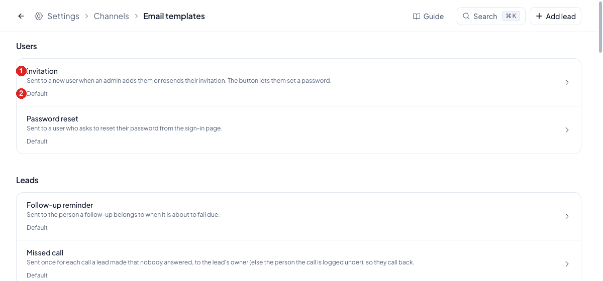
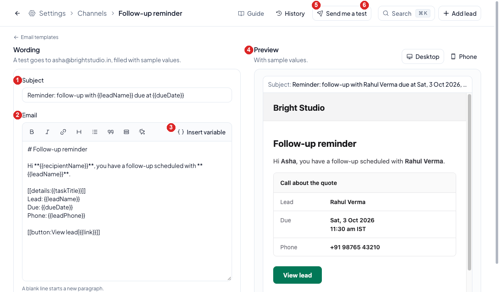

**Settings → Channels → Email templates** holds the wording of every email the CRM sends in your name. You need permission to manage the organization.

## What Marro sends

| Sent by | What |
| --- | --- |
| Marro (notifications@marro.si) | Invitations, password resets, reminders, assignments, mentions, HR updates, portal links, appointment reminders, alerts |
| Your mailbox | Emails to leads, and an automation's emails to leads |

Without a connected mailbox, an email to a lead is sent by Marro and replies still reach you.

<Frame>
  
</Frame>

1. Each email, with when it is sent and to whom.
2. **Default** until you change it.

## Change the wording

<Steps>
  <Step title="Open the page">Go to **Settings → Channels → Email templates** and choose the email.</Step>
  <Step title="Edit">Change the subject and message. Besides bold, links and lists, the editor has two blocks, shown below.</Step>
  <Step title="Save">Save. Marro uses the new wording from then on.</Step>
</Steps>

<Frame>
  
</Frame>

1. **Subject**.
2. **Email**: the message, with blocks such as the details panel and the button.
3. **Insert variable**, such as the lead's name.
4. **Preview**, filled with sample values, on desktop or phone.
5. **Send me a test** to your own address.
6. **History**: earlier versions.

## Blocks

| Block | Write |
| --- | --- |
| Details panel | `[[details:Title]]`, then one `Label: value` line per fact |
| Button | `[[button:Label\|{{link}}]]` |

## Ask Marro

<Card title="Try asking" icon="message-circle">
  *"Which emails does Marro send in our name?"*

  Marro reads the templates. Edit them on the web.
</Card>
