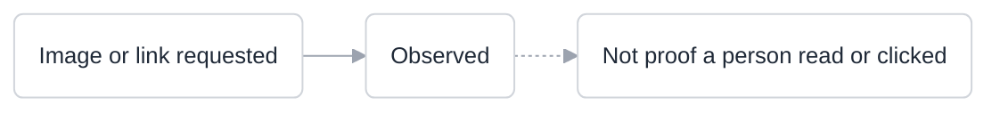

<Note>
Not released yet. The feature is off, and the settings and composer controls are still pending.
</Note>

An administrator can allow observations on individually reviewed sales email. It starts off. It never applies to system emails, sign-in messages, invitations, inbound mail, automatic sequences or messages written by an agent.

## How a send works

<Steps>
  <Step title="Review">
    The message, the From mailbox, the image option and the selected links.
  </Step>
  <Step title="Approve that one send">
    The approval expires after ten minutes and can't be reused.
  </Step>
</Steps>

| Part | What happens |
| --- | --- |
| Link | Goes through Marro, then on to the exact reviewed public HTTPS address |
| Image | A hidden transparent image is added |
| Opt-out, private, document, portal, payment and access links | Never tracked |
| Plain text and unsubscribe headers | Unchanged |
| Missing configuration, permission or consent | The original email is sent |

## What it does not prove

- Providers can preload images and scanners can open links. It does not prove who, or that the email arrived.
- Link figures count selected links seen at least once, not people or total clicks.

## Who sees it

| Rule | Detail |
| --- | --- |
| Who can use it | The person assigned to the lead, or an administrator. Team and partner access do not widen this |
| Personal mailbox | Figures stay private to its owner, even from administrators |
| Revoked | Changing settings, a mailbox's sender or connection, or closing or suspending the organization |
| Tokens | Expire after ninety days |

## Ask Marro

<Card title="Try asking" icon="message-circle">
  *"How did my last email to Neha do?"*

  Marro summarises visible totals. It cannot turn observations on or approve a send. Never paste approval handles or observation links into a chat.
</Card>
