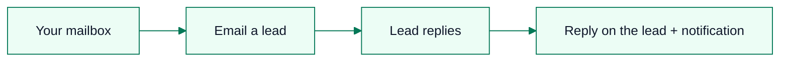
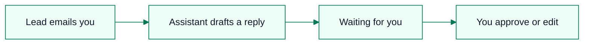

Connect your own mailbox and emails to leads go out from your address. Replies come back onto the lead, and you get a notification. Only emails with your leads are kept in Marro; the rest of your mailbox is never stored.

## Connect your mailboxes

<Steps>
  <Step title="Open Your email">
    Go to **Email → Your email**.
  </Step>
  <Step title="Connect">
    Choose **Connect Gmail** or **Connect Outlook** and sign in on Google's or Microsoft's own page. Marro never sees your password.
  </Step>
</Steps>

You can connect up to five mailboxes, and an address only once per organization. **Add mailbox** connects another.

| Action | What it does |
| --- | --- |
| **Make default** | New emails, automations on your leads and the assistant use it unless you pick another |
| **Needs reconnecting** | Google or Microsoft stopped access. Reconnect with the same address |
| Disconnect | Marro stops using it and forgets its sign-in. Emails already on leads stay |

## Email a lead

<Steps>
  <Step title="Press Email">
    In the action row at the top of the lead's page (shown when the lead has an email address).
  </Step>
  <Step title="Choose From">
    With more than one mailbox, pick which one sends. A reply uses the mailbox the conversation came in on.
  </Step>
</Steps>

In **Chats**, a lead's emails sit beside their WhatsApp messages with the same From choice.

## The organization address

People who manage the organization set a shared sending address in **Settings → Email sending**.

| Sending address can be | |
| --- | --- |
| A shared mailbox | Gmail or Outlook |
| Your own email server | |

It is used by automations without a lead owner, and by anyone without a connected mailbox. **Send test email** checks it works.

## Emails Marro sends

| Sent by | What |
| --- | --- |
| Marro (notifications@marro.si) | Invitations, password resets, reminders, assignments, mentions, HR updates, portal links, appointment reminders, alerts |
| Your mailbox | Emails to leads, and an automation's emails to leads |

Without a connected mailbox, an email to a lead is sent by Marro and replies still reach you. Change Marro's wording in **Settings → Email templates**. Besides bold, links and lists, the editor has:

| Block | Write |
| --- | --- |
| Details panel | `[[details:Title]]`, then one `Label: value` line per fact |
| Button | `[[button:Label|{{link}}]]` |

## Email assistant

<Steps>
  <Step title="Set it up">
    On **Email → Your email**, choose **Set up an Email assistant**, or pick the **Email assistant** template in **AI → Agents**. Connecting a mailbox alone never switches an agent on.
  </Step>
  <Step title="Review and switch on">
    It starts with **Email → Ask me first**. Review the instructions, then **Save, off** or **Switch on**.
  </Step>
  <Step title="Approve replies">
    Drafts appear in **Waiting for you**. Edit the body, approve or dismiss. Only the owner of a personal mailbox can approve its reply.
  </Step>
</Steps>

- To let it answer routine questions, change its **Email** ability to **On its own**. It still asks for review for sensitive requests (complaints, refunds, negotiation, security, legal, medical), missing knowledge, limits or working hours.
- It replies from the mailbox that received the email, in the same thread. A newer email, a staff reply or a paused agent stops a pending reply.
- Automated replies, newsletters, group emails, attachments and replies older than one day need a person.

## Email sequences

<CardGroup cols={2}>
  <Card title="Email sequences and sales templates" icon="mail" href="/guides/email-sequences">Reusable sales templates and timed follow-ups, being prepared and not enabled for sending yet</Card>
  <Card title="Optional email observations" icon="eye" href="/guides/email-tracking" />
</CardGroup>

## Ask Marro

<Card title="Try asking" icon="message-circle">
  *"List my connected mailboxes"*

  *"Email Neha from my Outlook mailbox"*

  Marro shows sending and default changes first. Connecting, reconnecting and disconnecting a mailbox are done on the web only.
</Card>
