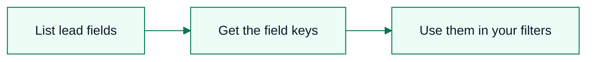

import Filtering from "/snippets/generated/filtering.mdx";

## Filter through the API

Field keys come from [List lead fields](/api-reference/reference/list-fields).

<Filtering />

## Saved views

Use **Views** in the toolbar on Leads, Customers, Opportunities, Follow-ups or Activity.

<Steps>
  <Step title="Set your filters">Filter the list as you like.</Step>
  <Step title="Save">Choose **Save as new view** and name it.</Step>
  <Step title="Share if needed">Choose **Share with organization**. Views start private.</Step>
</Steps>

## Use and manage a view

| Action | What it does |
| --- | --- |
| Pick a view | Returns to it. A dot means filters differ from the saved view |
| **Save changes** | Updates the view |
| **Close view** | Shows the full list |
| **Rename or share**, **Delete view** | Manage it. Deleting keeps every record |

Only the owner, or an administrator for a shared view, can change or delete it. A shared view follows each viewer's own permissions. Views also appear in the command menu (**Ctrl/Cmd+K**).

On Leads, saved views are your refreshing **Lead Lists**. They keep filters, sorting, page size, extra columns, pipeline and table or board choice, not the page you were on.

## Ask Marro

<Card title="Try asking" icon="message-circle">
  *"Show my saved views"*

  *"Share the Pune leads view with the team"*

  Marro asks before it creates, renames, shares or deletes a view.
</Card>
