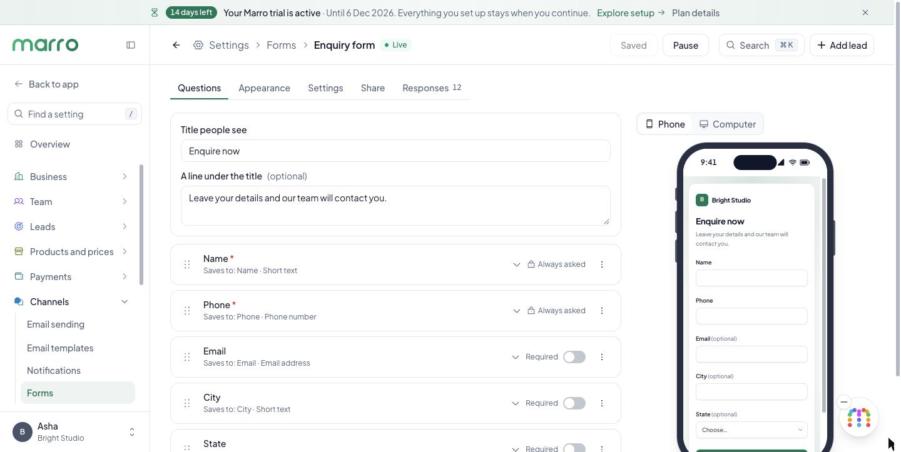
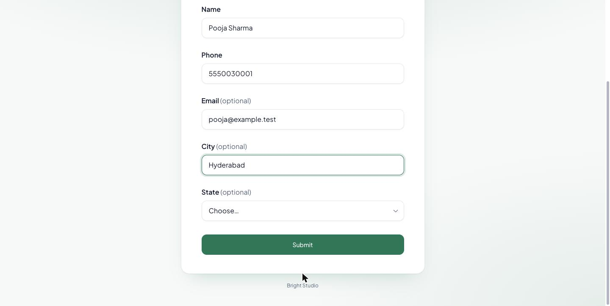
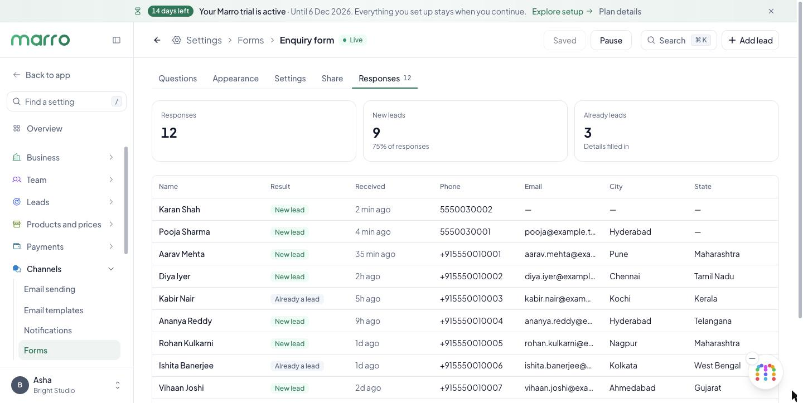

Open **Settings → Channels → Forms**. Every form is a row with its status (**Live**, **Paused** or **Draft**), how many
responses it has had, the lead source its new leads get, and when it was created and last changed. Search by name and
filter by status or lead source. Tick several forms to publish, pause or delete them together; a form that has
responses is kept with its results, so pause it instead.

A form takes responses only while it is **Live**. Pausing one form closes its link; the others are not affected.

## Make a form

Choose **New form** and start from a template (an enquiry form, a detailed request in steps, a document upload, or an
industry starter) or a blank form. Every form starts as a draft that only your team can see.

<Frame>
  
</Frame>

On **Questions**, each question says which lead field it **saves to**. Add a section to start a new step; the builder
shows where each step begins. Name and phone are always asked.

<Frame>
  
</Frame>

## Choose how it looks

On **Appearance**:

- **Layout:** **Card** (the form on a card over a background), **Split** (a picture on one side, the form on the other)
  or **Full page**.
- **How questions appear:** **All questions** (split into steps by your sections) or **One at a time** (one question
  per screen with progress; Enter moves on).
- **Background:** your brand tint, plain, or a picture. Split and a picture background need a picture: PNG, JPEG or
  WebP up to 2 MB.
- **Style:** corners, font, logo size and alignment, then the brand colour, logo and how the form sits inside your
  website.

The preview beside the settings shows the form on a phone or a computer. **Open preview** shows the saved form full
screen. Nothing is sent from a preview.

## Where new leads go

On **Settings**, choose the **Lead source** new leads get. Choose **New source…** to create one there. Choose who new
leads go to (or let your assignment rules decide) and, with several pipelines, which pipeline they start in.

Someone who is already a lead keeps their owner and details: the form fills in only what is empty, and the lead's
timeline says what was filled and what was answered differently. An email sent on a public form is not added to an
existing lead; add it yourself if it is theirs. Every answer stays on the form's **Responses**.

## Publish and share

Choose **Publish**. On **Share**, copy the link, send it on WhatsApp, download the QR code, or copy the snippet for your
website. See [Connect a website](/guides/connect-a-website) to send your own website form's enquiries instead.

<Frame>
  
</Frame>

<Frame>
  
</Frame>

## Responses

The form's **Responses** tab counts responses, how many became new leads and how many were already leads. Below, every response is a row: the name (opening the lead), whether it was a new lead, when it came in, one column per question, and where it came from. On a phone each response is a card that opens to its answers. The tab fetches new responses each time you open it.

<Frame>
  
</Frame>
