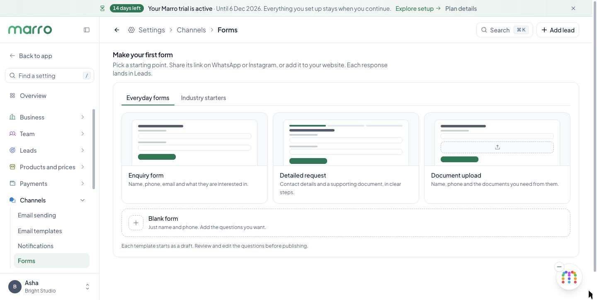
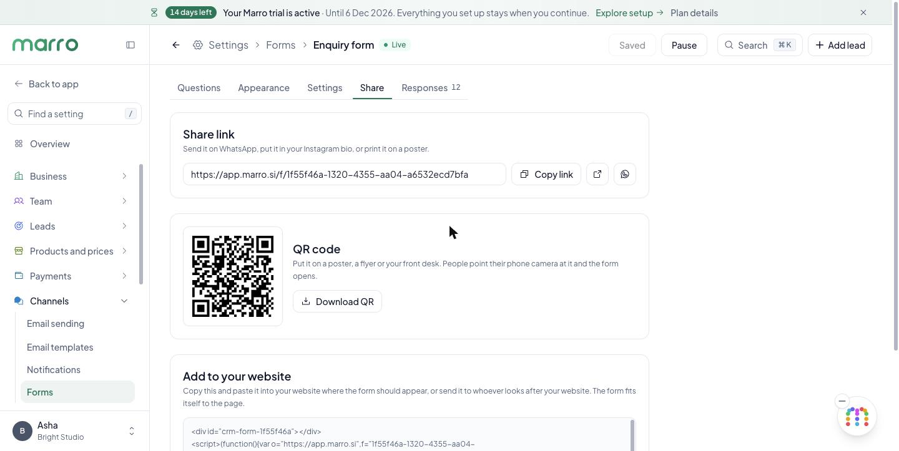
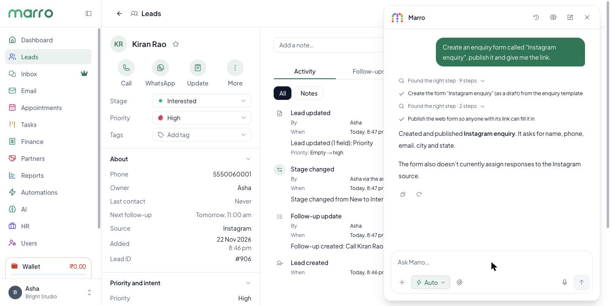

Open **Settings → Channels → Forms**. Each form is a row with its status (**Live**, **Paused** or **Draft**), responses, lead source and dates. Search by name, filter by status or source, or tick several forms to publish, pause or delete together.

A form takes responses only while it is **Live**. A form with responses is kept with its results, so pause it instead of deleting.

## Make a form

Choose **New form** and start from a template (an enquiry form, a detailed request in steps, a document upload, or an industry starter) or a blank form. Every form starts as a draft only your team can see.

<Frame>
  
</Frame>

On **Questions**, each question says which lead field it **saves to**. Add a section to start a new step. Name and phone are always asked.

<Frame>
  
</Frame>

## Choose how it looks

On **Appearance**:

| Setting | Choices |
| --- | --- |
| **Layout** | **Card**, **Split** (picture beside the form), **Full page** |
| **How questions appear** | **All questions** in steps, or **One at a time** |
| **Background** | Brand tint, plain, or a picture (PNG, JPEG or WebP, up to 2 MB) |
| **Style** | Corners, font, logo, brand colour |

The preview shows a phone or computer view. Nothing is sent from a preview.

## Where new leads go

On **Settings**:

<Steps>
  <Step title="Lead source">
    Choose one, or **New source…** to create it.
  </Step>
  <Step title="Owner">
    Choose who gets new leads, or let your assignment rules decide.
  </Step>
  <Step title="Pipeline">
    With several pipelines, choose where they start.
  </Step>
</Steps>

Someone who is already a lead keeps their owner and details. The form fills only what is empty, and the timeline records it. An email from a public form is not added to an existing lead. Every answer stays on **Responses**.

## Publish and share

Choose **Publish**. On **Share**, copy the link, send it on WhatsApp, download the QR code or copy the website snippet. To send your own website form's enquiries instead, see [Connect a website](/guides/connect-a-website).

<Frame>
  
</Frame>

<Frame>
  
</Frame>

## Responses

**Responses** counts responses, new leads and existing leads. Each row shows the name (opens the lead), when it came in, one column per question and the source. On a phone each is a card.

<Frame>
  
</Frame>

## Ask Marro

<Frame>
  
</Frame>

<Card title="Try asking" icon="message-circle">
  *"Create an enquiry form and publish it"*

  Marro builds the form, publishes it and gives you the link.
</Card>
