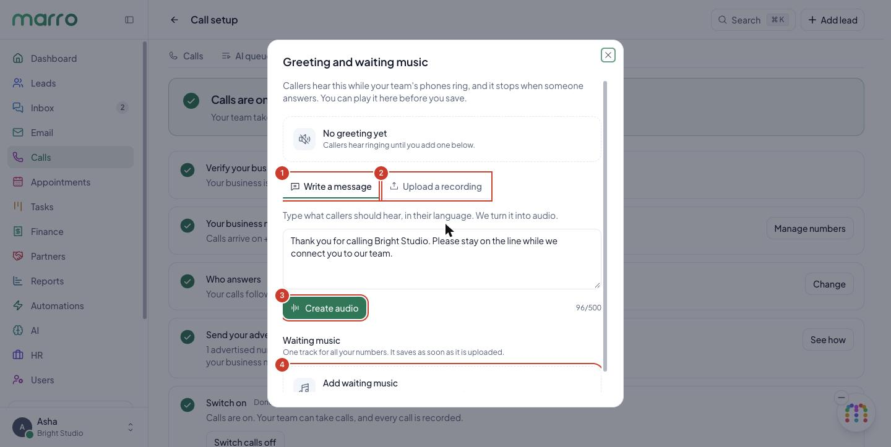

Callers hear your greeting and waiting music while staff ring. Open **Calls → Settings → More options → Greeting and waiting music**.

<Frame>
  
</Frame>

## Set a greeting

<Steps>
  <Step title="Type a message">Write what callers should hear, then choose **Create audio**.</Step>
  <Step title="Or upload your own">Use an MP3 or WAV up to 5 MB.</Step>
  <Step title="Listen">Press play to hear what callers hear.</Step>
</Steps>

## Add waiting music

<Steps>
  <Step title="Choose Add waiting music">It is in **More options → Greeting and waiting music**.</Step>
  <Step title="Upload a file">One MP3 or WAV, at least five seconds, up to 5 MB.</Step>
  <Step title="Press play to check">You hear what callers hear.</Step>
</Steps>

## What you can upload

| | Greeting | Waiting music |
| --- | --- | --- |
| Made from | Typed text, or a file | A file |
| File type | MP3 or WAV | MP3 or WAV |
| Size | Up to 5 MB | Up to 5 MB |
| Length | | At least five seconds |

## Ask Marro

<Card title="Try asking" icon="message-circle">
  *"What do callers hear when they ring us?"*

  Marro tells you the current greeting and whether waiting music is set.
</Card>
